# 16092026 Quản Lý Nhân Viên (C# Console App)
**Học phần:** 2611COMP101904 - Lập trình trên Windows  
**Sinh viên thực hiện:** Lê Trần Anh Khoa | **MSSV:** 51.01.104.044 | **Lớp:** 51.01.CNTT.C

---

## 📌 Tính Năng Chính

* **Vòng lặp Menu điều khiển linh hoạt**: Sau khi hoàn thành nhập liệu ban đầu, chương trình chuyển sang Menu chức năng từ `0` đến `4`, tự động quay lại Menu sau khi xử lý xong một tác vụ cho tới khi người dùng chọn `0` để thoát.
* **Xác thực dữ liệu đầu vào (Validation)**:
  * **Ép buộc nhập số lượng ban đầu**: Bắt buộc người dùng phải nhập thông tin ban đầu cho ít nhất 5 nhân viên ($n \ge 5$) trước khi truy cập vào Menu chính.
  * **Chống rỗng chuỗi (Non-Empty String)**: Bắt buộc các trường như Mã NV, Họ Ten phải có dữ liệu, không được để trống hoặc chỉ nhập khoảng trắng.
  * **Ép kiểu & Kiểm tra khoảng giá trị hợp lệ**: Sử dụng `int.TryParse` và `double.TryParse` để kiểm tra kiểu dữ liệu, bắt buộc nhập đúng phạm vi (ví dụ: Số ngày làm việc từ 0-31, Lương cơ bản $> 0$, Doanh số $\ge 0$).
* **Quản lý đa dạng loại hình nhân viên (OOP & Polymorphism)**:
  1. **Nhân viên Văn phòng**: Lương = Lương CB + (Số ngày làm $\times$ 200,000 VND).
  2. **Nhân viên Kinh doanh**: Lương = Lương CB + (5% $\times$ Doanh số).
  3. **Nhân viên Thời vụ**: Lương = Số giờ làm $\times$ Lương theo giờ.
* **Xử lý tác vụ quản lý**:
  1. **Xuất danh sách nhân viên**: Hiển thị chi tiết thông tin và tổng lương tính toán của từng nhân viên theo lớp tương ứng.
  2. **Tìm nhân viên theo mã**: Tìm kiếm thông tin chính xác theo Mã NV (không phân biệt chữ hoa/thường).
  3. **Tìm nhân viên lương cao nhất**: Duyệt danh sách và xác định nhân viên có tổng lương thực nhận cao nhất.
  4. **Tính tổng quỹ lương**: Cộng dồn và hiển thị tổng chi phí lương công ty cần chi trả.

---

## 🛠 Giải Thích Các Hàm Cốt Lõi

* `ReadStringNonEmpty(string prompt)`: Đọc chuỗi nhập từ Console, loại bỏ khoảng trắng dư thừa (`Trim()`) và lặp lại yêu cầu nếu người dùng để trống.
* `ReadIntValid(string prompt, int min, int max)`: Kiểm tra ép kiểu số nguyên và bắt buộc giá trị nằm trong khoảng $[min, max]$.
* `ReadDoubleValid(string prompt, double min)`: Kiểm tra ép kiểu số thực và bắt buộc giá trị $\ge min$.
* `TinhLuong()` (Virtual/Override): Phương thức tính lương đa hình. Lớp cơ sở `NhanVien` trả về Lương CB, các lớp con (`NhanVienVanPhong`, `NhanVienKinhDoanh`, `NhanVienThoiVu`) ghi đè công thức tính riêng.
* `HienThiThongTin()` (Virtual/Override): Phương thức hiển thị đa hình, cho phép in chi tiết thông tin theo từng loại nhân viên.
* `List<NhanVien>.Find(...)`: Sử dụng biểu thức Lambda kết hợp `StringComparison.OrdinalIgnoreCase` để tìm kiếm nhân viên theo mã không phân biệt hoa thường.

---

## 📸 Hình Ảnh Kết Quả

### 1. Giao diện Nhập liệu ban đầu & Menu chính

* **Khởi tạo danh sách ban đầu ($\ge 5$ nhân viên):**  
  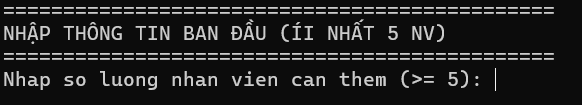  
  *Mô tả: Màn hình yêu cầu nhập số lượng nhân viên ban đầu (tối thiểu 5) và lần lượt nhập thông tin chi tiết từng nhân viên.*

* **Giao diện Menu chính:**  
  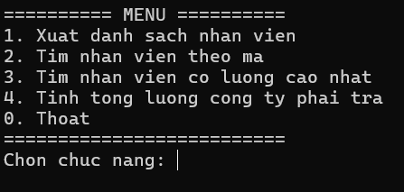  
  *Mô tả: Màn hình hiển thị danh sách các chức năng quản lý từ 0 đến 4 sau khi hoàn tất nhập dữ liệu ban đầu.*

---

### 2. Thông báo lỗi xác thực dữ liệu (Validation)

* **Bắt lỗi nhập số lượng nhân viên ban đầu $< 5$:**  
  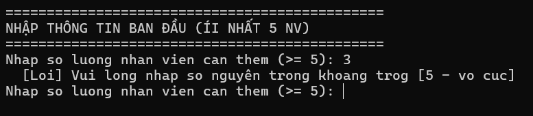  
  *Mô tả: Hiển thị thông báo "Vui long nhap so nguyên trong khoang trog [5 - vo cuc]" khi người dùng nhập số lượng $< 5$.*

* **Bắt lỗi để trống trường thông tin (Mã NV, Họ tên):**  
  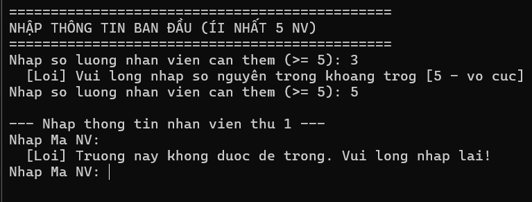  
  *Mô tả: Cảnh báo "[Loi] Truong nay khong duoc de trong. Vui long nhap lai!" khi nhấn Enter mà không nhập dữ liệu.*

* **Bắt lỗi nhập sai loại nhân viên hoặc số ngày làm việc ngoài khoảng:**  
  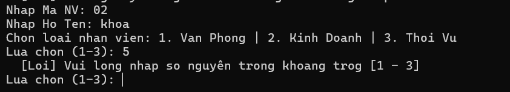  
  *Mô tả: Thông báo lỗi khi chọn loại nhân viên ngoài phạm vi 1-3 hoặc nhập số ngày làm việc ngoài khoảng 0-31.*

* **Bắt lỗi nhập lương/doanh số âm hoặc không phải số:**  
  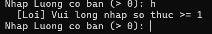  
  *Mô tả: Yêu cầu nhập lại nếu người dùng nhập chữ, ký tự đặc biệt hoặc giá trị nhỏ hơn mức cho phép.*

* **Bắt lỗi chọn chức năng Menu không hợp lệ:**  
  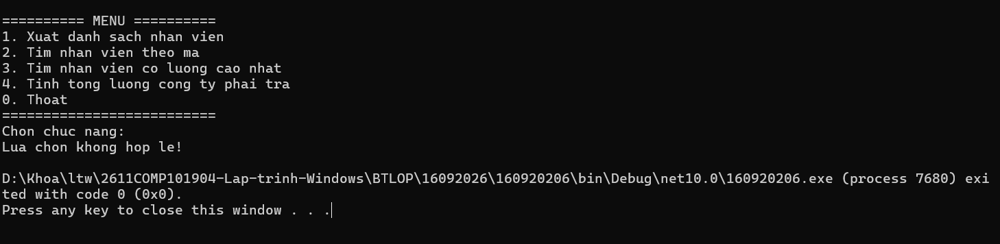  
  *Mô tả: Thông báo "Lua chon khong hop le!" khi nhập ký tự hoặc số nằm ngoài khoảng 0–4 tại Menu.*

* **Bắt lỗi không tìm thấy Mã nhân viên:**  
  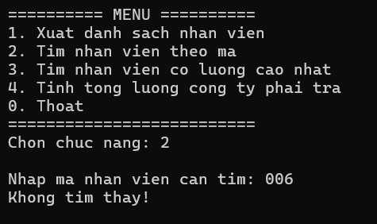  
  *Mô tả: Hiển thị "Khong tim thay!" khi nhập mã nhân viên không tồn tại trong danh sách.*

---

### 3. Thực thi các chức năng

* **Xuất danh sách nhân viên (Chức năng 1):**  
  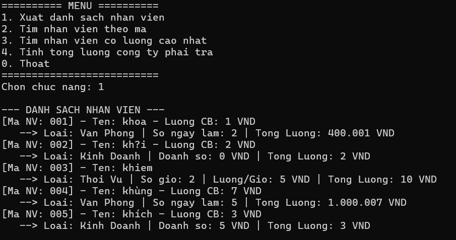  
  *Mô tả: In toàn bộ danh sách nhân viên phân loại chi tiết theo Văn phòng, Kinh doanh, Thời vụ cùng tổng lương tương ứng.*

* **Tìm nhân viên theo mã (Chức năng 2):**  
  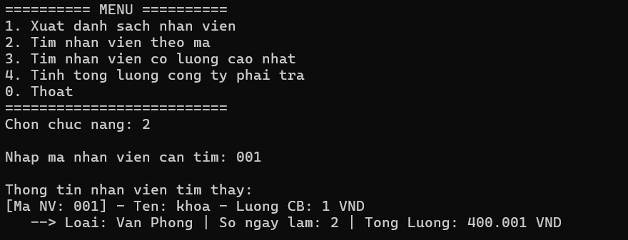  
  *Mô tả: Nhập Mã NV cần tìm (ví dụ: `NV01` hoặc `nv01`) và hiển thị thông tin chi tiết nhân viên tìm thấy.*

* **Tìm nhân viên lương cao nhất (Chức năng 3):**  
  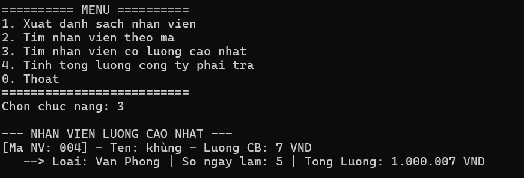  
  *Mô tả: Xác định và xuất thông tin của nhân viên có tổng lương thực nhận cao nhất trong công ty.*

* **Tính tổng lương công ty phải trả (Chức năng 4):**  
  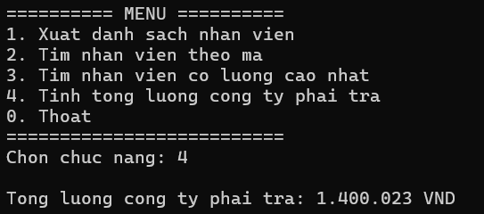  
  *Mô tả: Tính tổng chi phí lương của tất cả nhân viên trong danh sách và in ra màn hình.*

* **Thoát chương trình (Chức năng 0):**  
  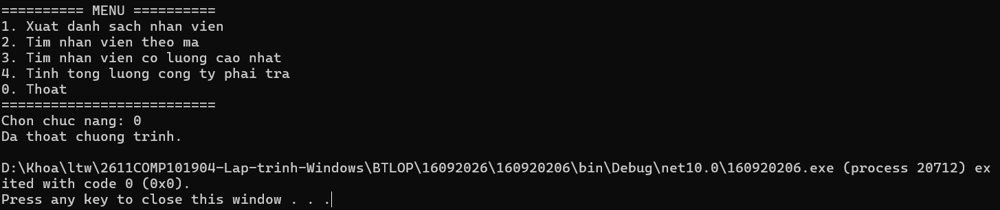  
  *Mô tả: Chọn 0 để hiển thị thông báo "Da thoat chuong trinh." và kết thúc ứng dụng Console.*