# Lab03 - Quản Lý Sinh Viên (C# Console App - OOP)

**Học phần:** 2611COMP101904 - Lập trình trên Windows  
**Sinh viên thực hiện:** Lê Trần Anh Khoa | **MSSV:** 51.01.104.044 | **Lớp:** 51.01.CNTT.C

---

## 📌 Tính Năng Chính

* **Vòng lặp Menu điều khiển linh hoạt**: Hiển thị danh sách chức năng từ `0` đến `8`, tự động quay lại menu sau khi xử lý xong một tính năng cho tới khi người dùng chọn `0` để thoát.
* **Xác thực dữ liệu đầu vào (Validation & OOP Constraints)**:
* **Xác thực định dạng ngày sinh**: Kiểm tra tính hợp lệ của chuỗi ngày tháng theo đúng định dạng `dd/MM/yyyy` (VD: `15/08/2004`) bằng `DateTime.TryParseExact`.
* **Ràng buộc khoảng điểm số**: Đảm bảo điểm trung bình (ĐTB) nhập vào phải là số thực hợp lệ nằm trong khoảng từ `0` đến `10`.
* **Chặn trùng lặp mã sinh viên**: Kiểm tra tính duy nhất của Mã sinh viên trong danh sách khi thực hiện thêm mới.
* **Xử lý tác vụ quản lý sinh viên (Hướng đối tượng - OOP)**:
  1. **Thêm sinh viên**: Nhập đầy đủ thông tin chi tiết (Mã SV, Họ tên, Ngày sinh, Mã lớp, Điểm TB) và thêm vào danh sách.
  2. **Xuất danh sách**: In toàn bộ thông tin sinh viên kèm theo xếp loại học lực ra màn hình.
  3. **Tìm sinh viên theo mã**: Tìm kiếm chính xác sinh viên dựa vào Mã sinh viên (không phân biệt hoa thường).
  4. **Tìm sinh viên theo tên**: Tìm kiếm gần đúng sinh viên theo từ khóa trong Họ tên.
  5. **Sửa điểm trung bình**: Cập nhật lại điểm trung bình mới cho sinh viên dựa vào Mã sinh viên.
  6. **Xóa sinh viên**: Xóa bỏ một sinh viên khỏi danh sách thông qua Mã sinh viên.
  7. **Sắp xếp theo điểm giảm dần**: Sắp xếp danh sách sinh viên theo thứ tự điểm trung bình từ cao xuống thấp.
  8. **Lọc sinh viên đạt**: Lọc và hiển thị danh sách các sinh viên có điểm trung bình từ `5.0` trở lên.

---

## 🛠 Giải Thích Các Thành Phần & Hàm Cốt Lõi

* **Lớp `Nguoi`**: Lưu trữ các thuộc tính cơ bản chung gồm `HoTen` (Họ tên) và `NgaySinh` (Ngày sinh), kèm phương thức ảo `LayThongTin()`.
* **Lớp `SinhVien` (Kế thừa từ `Nguoi`)**:
  * Bổ sung các thuộc tính riêng: `MaSinhVien`, `MaLop`, `DiemTrungBinh`.
  * Sử dụng **Encapsulation (Tính đóng gói)** qua các property có cơ chế `set` kiểm tra điều kiện dữ liệu (không được để trống mã, điểm phải từ 0-10) và ném ngoại lệ (`ArgumentException`, `ArgumentOutOfRangeException`) nếu vi phạm.
  * `XepLoai()`: Phương thức tính toán và trả về chuỗi xếp loại học lực dựa trên điểm trung bình (Giỏi >= 8.0, Khá >= 6.5, Trung bình >= 5.0, Yếu < 5.0).
  * `Ghi đè (override) LayThongTin()`: Kết hợp thông tin cơ bản từ lớp cha và các thông tin chi tiết của sinh viên.
* **Lớp `QuanLySinhVien`**:
  * Quản lý danh sách tập hợp `List<SinhVien>`.
  * `Them(SinhVien sv)`: Kiểm tra mã trùng lặp trước khi thêm vào danh sách.
  * `TimTheoMa(string maSV)` / `TimTheoTen(string keyword)`: Sử dụng LINQ (`FirstOrDefault`, `Where`) để truy vấn dữ liệu linh hoạt.
  * `SapXepTheoDiem()`: Sắp xếp danh sách giảm dần bằng LINQ `OrderByDescending`.
* **Lớp `Program` (Giao diện Console)**:
  * Điều phối vòng lặp `do-while` và cấu trúc `switch-case` tương ứng với các chức năng menu.
  * Sử dụng các vòng lặp `while` kết hợp `try-catch` để bắt lỗi nhập liệu sai định dạng hoặc để trống thông tin, giúp chương trình không bị crash.

---

## 📸 Hình Ảnh Kết Quả

### 1. Giao diện Menu chính
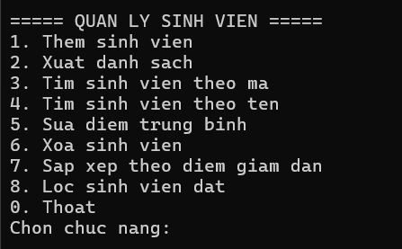  
*Mô tả: Màn hình hiển thị danh sách chức năng từ 0 đến 8 khi bắt đầu chạy chương trình.*

---

### 2. Thông báo lỗi xác thực dữ liệu (Validation)

* **Bắt lỗi sai định dạng ngày sinh:**  
  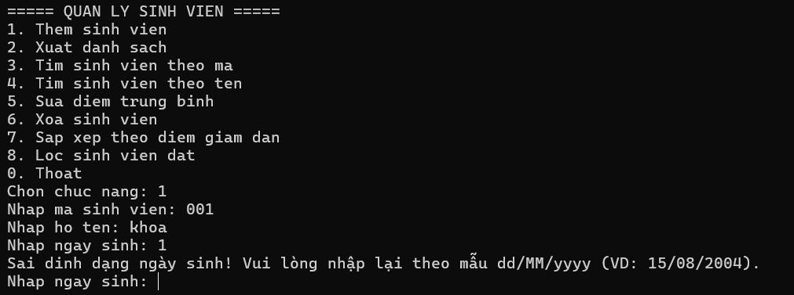  
  *Mô tả: Báo lỗi khi chuỗi nhập vào không khớp với định dạng `dd/MM/yyyy`.*

* **Bắt lỗi nhập điểm ngoài khoảng 0–10 hoặc nhập sai kiểu số:**  
  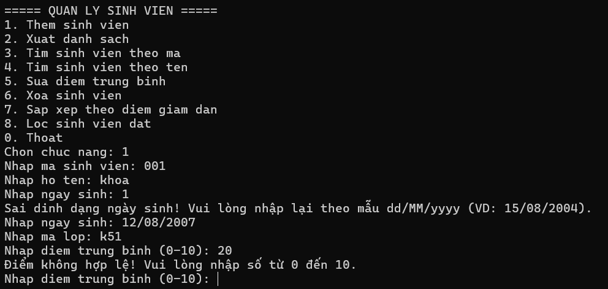  
  *Mô tả: Từ chối giá trị điểm không hợp lệ và yêu cầu nhập lại số thực từ 0 đến 10.*

* **Bắt lỗi trùng mã sinh viên khi thêm mới:**  
  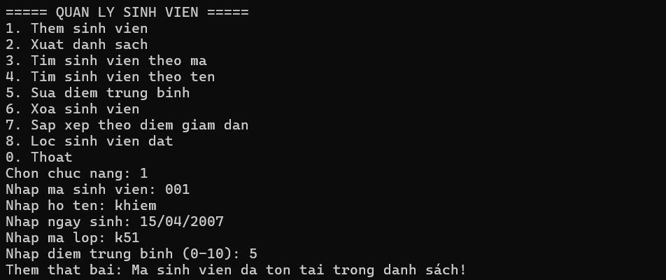  
  *Mô tả: Thông báo thất bại khi Mã sinh viên đã tồn tại trong hệ thống.*
* **Bắt lỗi không tìm thấy mã sinh viên:**  
  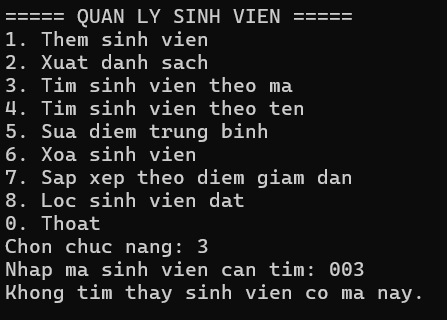  
  *Mô tả: Thông báo thất bại khi không tìm thấy sinh viên với mã đã nhập.*
* **Bắt lỗi không tìm thấy sinh viên khi nhập tên:**  
  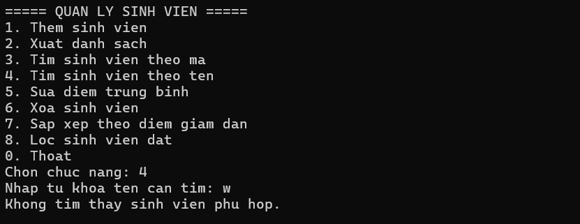  
  *Mô tả: Thông báo thất bại khi không tìm thấy sinh viên với tên đã nhập.*
---

### 3. Thực thi các chức năng

* **Thêm sinh viên (Chức năng 1):**  
  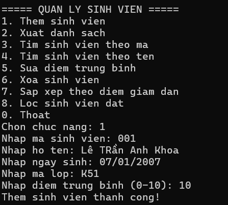  
  *Mô tả: Quy trình nhập đầy đủ các thông tin được kiểm tra chặt chẽ và thông báo thành công.*

* **Xuất danh sách sinh viên (Chức năng 2):**  
  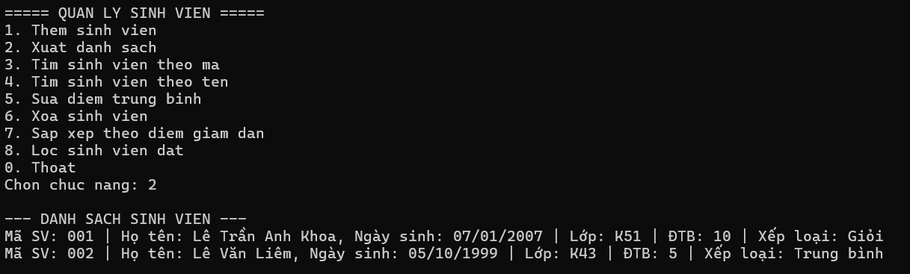  
  *Mô tả: In toàn bộ danh sách sinh viên cùng với xếp loại học lực tương ứng.*

* **Tìm kiếm theo Mã hoặc Tên (Chức năng 3 & 4):**  
  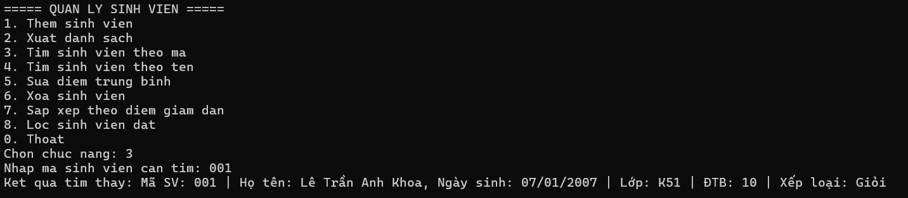
  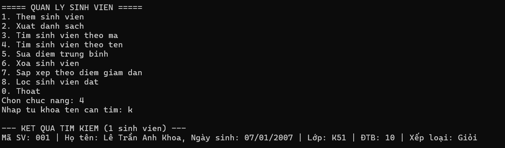
  *Mô tả: Hiển thị kết quả chi tiết của sinh viên tìm được theo mã hoặc từ khóa họ tên.*

* **Sửa điểm trung bình & Xóa sinh viên (Chức năng 5 & 6):**  
  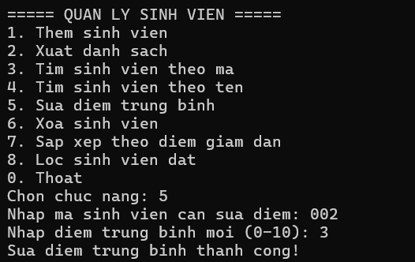
  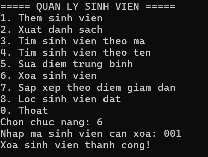
  *Mô tả: Cập nhật điểm mới hoặc xóa sinh viên khỏi danh sách dựa vào Mã sinh viên.*

* **Sắp xếp & Lọc sinh viên đạt (Chức năng 7 & 8):**  
  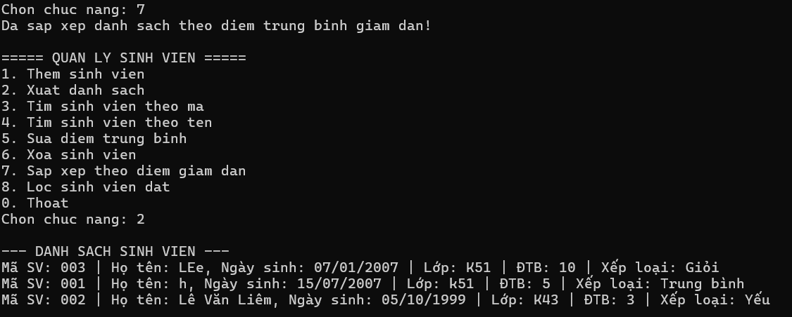
  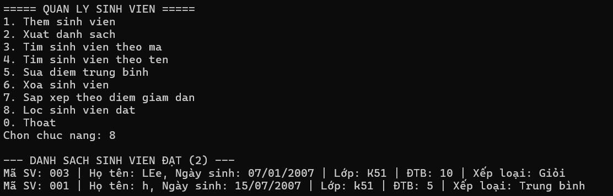
  *Mô tả: Sắp xếp danh sách giảm dần theo điểm hoặc lọc ra các sinh viên có ĐTB >= 5.0.*

* **Thoát chương trình (Chức năng 0):**  
  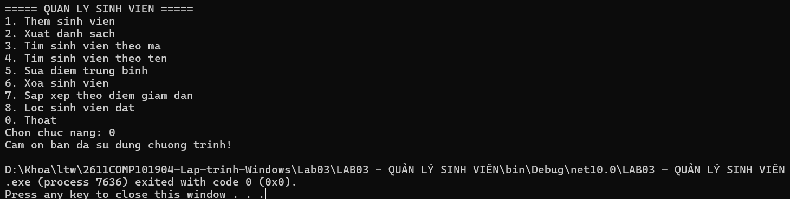  
  *Mô tả: Chọn 0 để kết thúc chương trình và đóng Console.*