# Lab04 - Quản Lý Sản Phẩm (C# Console App - OOP, Exception, Event, Func & Generic Repository)

**Học phần:** 2611COMP101904 - Lập trình trên Windows  
**Sinh viên thực hiện:** Lê Trần Anh Khoa | **MSSV:** 51.01.104.044 | **Lớp:** 51.01.CNTT.C

---

## 📌 Tính Năng Chính

* **Vòng lặp Menu điều khiển linh hoạt**: Hiển thị danh sách chức năng từ `0` đến `7`, tự động quay lại menu sau khi xử lý xong một tính năng cho tới khi người dùng chọn `0` để thoát.
* **Xác thực dữ liệu đầu vào & Ngoại lệ tùy chỉnh (Custom Exceptions & Validation)**:
  * **Chặn trùng lặp mã sản phẩm (`DuplicateProductException`)**: Tự động phát hiện và ngăn chặn việc thêm sản phẩm có mã trùng lặp trong hệ thống.
  * **Xử lý khi không tìm thấy (`ProductNotFoundException`)**: Bắt lỗi và thông báo rõ ràng bằng màu sắc khi thao tác tìm kiếm hoặc xóa một mã sản phẩm không tồn tại.
  * **Ràng buộc dữ liệu hợp lệ (`InvalidProductDataException`)**: Đảm bảo đơn giá, số lượng không được nhỏ hơn $0$, không để trống thông tin và kiểu dữ liệu chuẩn xác.
* **Xử lý tác vụ quản lý sản phẩm nâng cao (OOP & Advanced C# Features)**:
  1. **Thêm sản phẩm**: Nhập đầy đủ thông tin chi tiết gồm Mã sản phẩm, Tên sản phẩm, Đơn giá, Số lượng; kích hoạt **Event** thông báo thành công.
  2. **Xuất danh sách sản phẩm**: In toàn bộ thông tin sản phẩm có trong kho ra màn hình.
  3. **Tìm sản phẩm theo mã**: Tìm kiếm chính xác sản phẩm dựa vào mã ID (không phân biệt chữ hoa/thường).
  4. **Tìm sản phẩm theo tên**: Tìm kiếm gần đúng sản phẩm theo từ khóa trong tên bằng LINQ.
  5. **Lọc sản phẩm theo khoảng giá (Sử dụng `Func<T, bool>`)**: Lọc linh hoạt các sản phẩm nằm trong khoảng giá tối thiểu và tối đa do người dùng nhập.
  6. **Xóa sản phẩm theo mã**: Tìm và xóa bỏ sản phẩm khỏi kho, đồng thời kích hoạt **Event** thông báo xóa thành công.
  7. **Tính tổng giá trị kho hàng**: Tính toán chính xác tổng giá trị toàn bộ kho dựa trên công thức $\sum (\text{Đơn giá} \times \text{Số lượng})$.

---

## 🛠 Giải Thích Các Thành Phần & Hàm Cốt Lõi

* **Giao diện `IEntity`**: Định nghĩa khuôn mẫu chung với thuộc tính `Id` để các thực thể (như `Product`) có thể áp dụng Generic Repository.
* **Lớp `Product` (Thực thi `IEntity`)**:
  * Lưu trữ các thuộc tính: `Id`, `Name`, `Price`, `Quantity`.
  * Áp dụng **Encapsulation (Tính đóng gói)** với các property có cơ chế `set` kiểm tra điều kiện dữ liệu (giá và số lượng phải $\ge 0$) và ném ngoại lệ `InvalidProductDataException` nếu vi phạm.
  * Ghi đè phương thức `ToString()` để định dạng hiển thị thông tin sản phẩm chuẩn đẹp.
* **Lớp `Repository<T>` (Generic Repository)**:
  * Quản lý danh sách tập hợp `List<T>` tổng quát cho phép tái sử dụng.
  * `Add(T item)`: Kiểm tra trùng mã dựa trên giao diện `IEntity` và ném `DuplicateProductException` nếu đã tồn tại.
  * `Find(Func<T, bool> predicate)`: Sử dụng delegate chuẩn `Func<T, bool>` để lọc dữ liệu linh hoạt (dùng cho tìm kiếm theo tên và lọc khoảng giá).
* **Lớp `ProductService` (Điều phối Logic & Sự kiện - Events)**:
  * Khai báo các sự kiện `OnProductAdded` và `OnProductRemoved` sử dụng `EventHandler<ProductEventArgs>` để phát tín hiệu thông báo khi dữ liệu kho hàng thay đổi.
  * Đóng gói các phương thức xử lý nghiệp vụ kết nối giữa Repository và lớp giao diện.
* **Lớp `Program` (Giao diện Console)**:
  * Điều phối vòng lặp `while` kết hợp cấu trúc `switch-case` tương ứng với các chức năng menu.
  * Tích hợp khối `try-catch` đa tầng phân loại từng ngoại lệ (`DuplicateProductException`, `ProductNotFoundException`, `InvalidProductDataException`) và đổi màu chữ console (`ConsoleColor.Red`, `ConsoleColor.Yellow`) để làm nổi bật thông báo lỗi.

---

## 📸 Hình Ảnh Kết Quả

*(Lưu ý: Bạn hãy tạo một thư mục tên là `Ảnh` nằm cùng cấp với file `README.md` và lưu các ảnh chụp màn hình vào đó theo đúng tên file bên dưới để hình ảnh tự động hiển thị trên GitHub/Markdown Viewer).*

### 1. Giao diện Menu chính
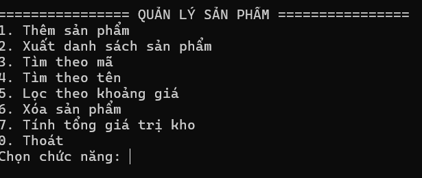  
*Mô tả: Màn hình hiển thị danh sách chức năng từ 0 đến 7 khi bắt đầu chạy chương trình.*

---

### 2. Thông báo lỗi xác thực dữ liệu và Ngoại lệ (Exceptions)

* **Bắt lỗi trùng mã sản phẩm khi thêm mới:**  
  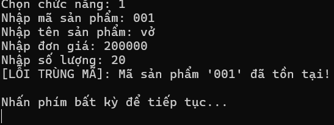  
  *Mô tả: Thông báo thất bại qua ngoại lệ `DuplicateProductException` khi Mã sản phẩm đã tồn tại trong hệ thống.*

* **Bắt lỗi dữ liệu không hợp lệ (Giá/Số lượng âm hoặc định dạng sai):**  
  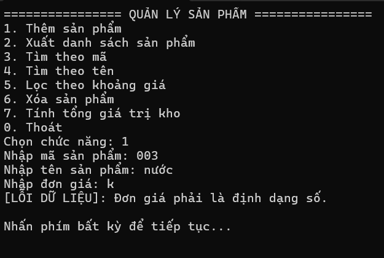  
  *Mô tả: Từ chối giá trị âm hoặc sai kiểu dữ liệu thông qua `InvalidProductDataException`.*

* **Bắt lỗi không tìm thấy mã sản phẩm (Tìm kiếm / Xóa):**  
  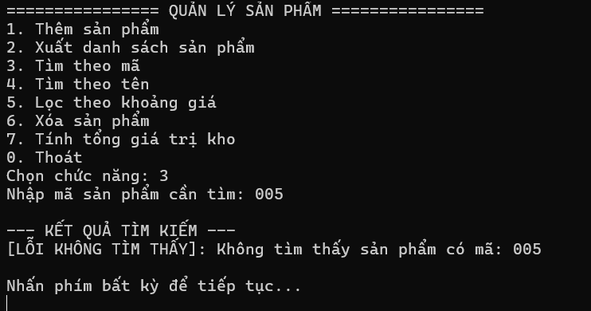  
  *Mô tả: Báo lỗi qua `ProductNotFoundException` khi mã sản phẩm nhập vào không khớp với bất kỳ bản ghi nào.*

---

### 3. Thực thi các tính năng cốt lõi

* **Thêm sản phẩm thành công (Kích hoạt Event):**  
  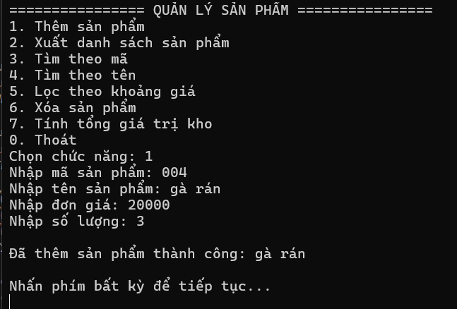  
  *Mô tả: Nhập thông tin sản phẩm thành công, hệ thống bắt sự kiện và hiển thị dòng thông báo `[SỰ KIỆN]...`.*

* **Xuất danh sách sản phẩm (Chức năng 2):**  
  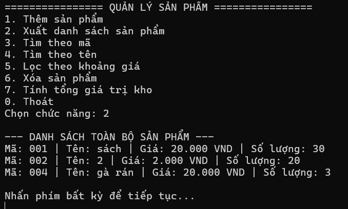  
  *Mô tả: In toàn bộ danh sách sản phẩm gồm mã, tên, giá và số lượng.*

* **Tìm kiếm theo Mã hoặc Tên (Chức năng 3 & 4):**  
  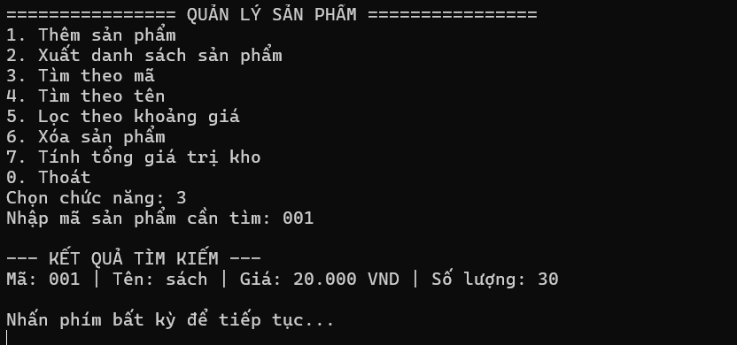
  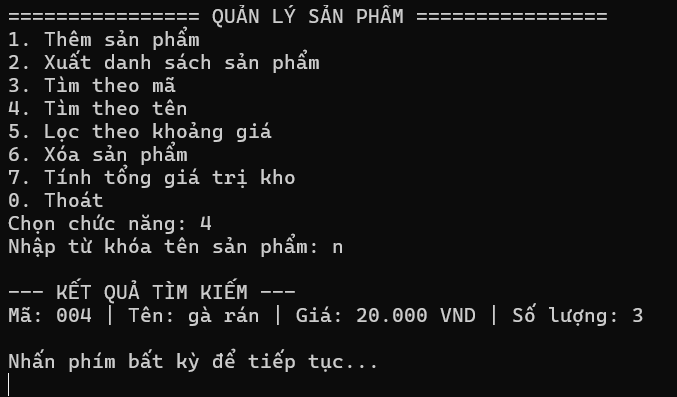
  *Mô tả: Truy xuất thông tin sản phẩm chính xác theo ID hoặc tìm gần đúng theo từ khóa tên.*

* **Lọc theo khoảng giá sử dụng `Func<T, bool>` (Chức năng 5):**  
  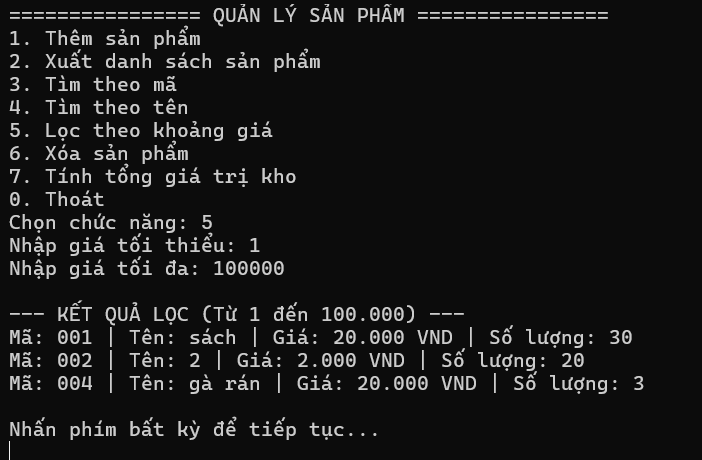  
  *Mô tả: Lọc ra các sản phẩm thỏa mãn điều kiện giá trị nằm trong khoảng tối thiểu và tối đa.*

* **Xóa sản phẩm và tính tổng giá trị kho hàng (Chức năng 6 & 7):**  
  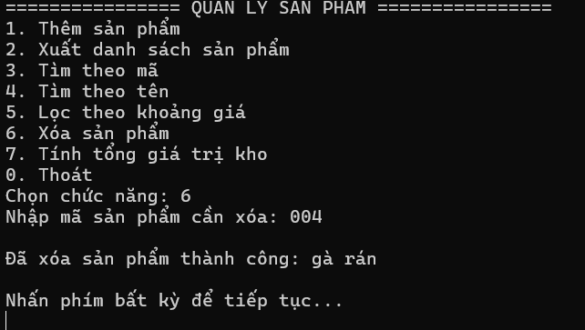
  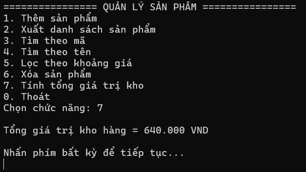
  *Mô tả: Xóa sản phẩm dựa trên Event thông báo và tính tổng tài sản kho hàng bằng công thức `Đơn giá * Số lượng`.*

* **Thoát chương trình (Chức năng 0):**  
  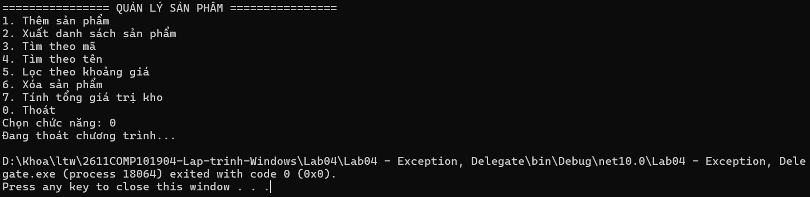  
  *Mô tả: Chọn 0 để kết thúc chương trình và đóng cửa sổ Console an toàn.*