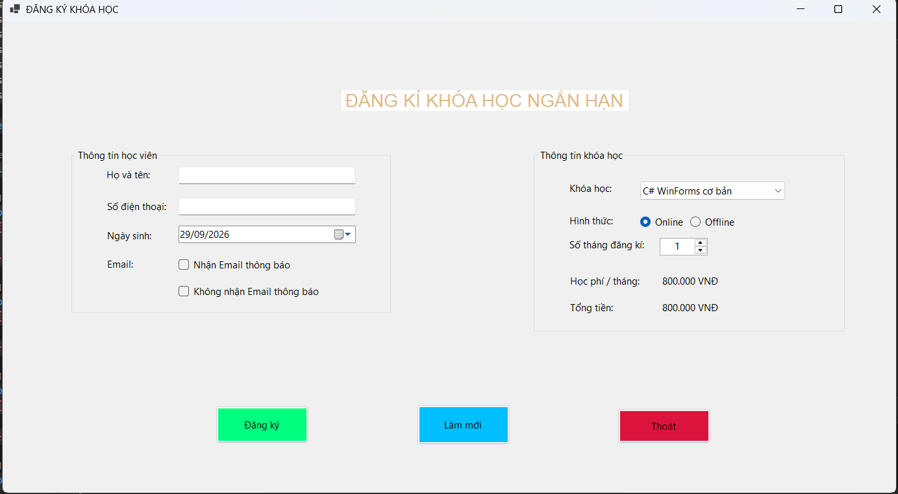
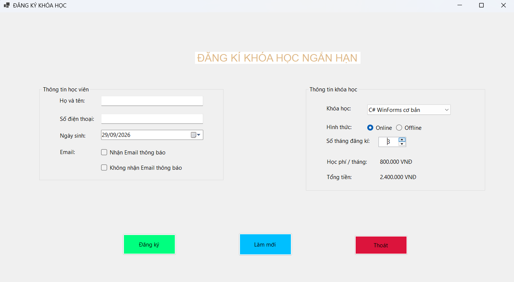
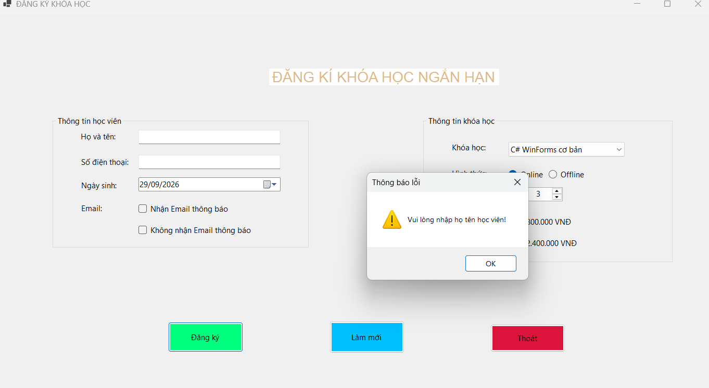
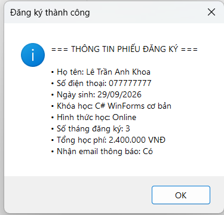
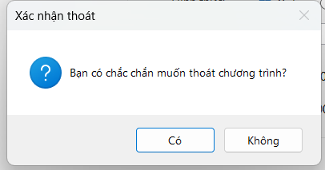

# Lab05

**Học phần:** 2611COMP101904 - Lập trình trên Windows  
**Sinh viên thực hiện:** Lê Trần Anh Khoa | **MSSV:** 51.01.104.044 | **Lớp:** 51.01.CNTT.C

---

## 1. Giao Diện Khi Khởi Chạy Ứng Dụng (`Form1_Load`)

### Mô tả hoạt động:
Khi ứng dụng khởi động (`Form1_Load`), hệ thống sẽ thực hiện các thiết lập ban đầu:
- Khởi tạo danh sách các khóa học (`List<KhoaHoc>`) gồm 4 khóa học mẫu: *C# WinForms cơ bản*, *SQL Server cơ bản*, *Web Frontend cơ bản*, và *Lập trình Python cơ bản* kèm theo mức học phí tương ứng mỗi tháng.
- Nạp danh sách này vào điều khiển `cboKhoaHoc` và gán thuộc tính hiển thị `DisplayMember = "TenKhoaHoc"`.
- Chọn sẵn phần tử đầu tiên (`SelectedIndex = 0`), thiết lập hình thức học mặc định là `radOnline`, cấu hình giá trị cho `numSoThang` (tối thiểu là 1, tối đa là 12, giá trị ban đầu là 1).
- Gọi hàm `CapNhatTongTien()` để tính toán và hiển thị học phí hàng tháng cũng như tổng tiền ngay khi vừa mở form.

### Hình ảnh minh họa:
  

---

## 2. Tính Toán Học Phí Tự Động (`CapNhatTongTien`)

### Mô tả hoạt động:
- Khi người dùng thay đổi lựa chọn khóa học trong ComboBox (`cboKhoaHoc_SelectedIndexChanged`) hoặc thay đổi số tháng đăng ký bằng NumericUpDown (`numSoThang_ValueChanged`), phương thức `CapNhatTongTien()` sẽ được kích hoạt.
- Hàm này lấy thông tin đối tượng `KhoaHoc` đang được chọn, nhân với số tháng đăng ký (`soThang`) để ra tổng học phí ($\text{Tổng tiền} = \text{Học phí 1 tháng} \times \text{Số tháng}$).
- Kết quả được định dạng theo chuẩn tiền tệ (có dấu phân cách hàng nghìn) và hiển thị lên `lblhocphithang` và `lblTongTien`.

### Hình ảnh minh họa:
*(Minh họa thay đổi số tháng đăng ký thành 3 tháng, hệ thống tự động cập nhật tổng tiền)*

  

---

## 3. Xác Thực Dữ Liệu và Đăng Ký Khóa Học (`btnDangKy_Click_1`)

### Mô tả hoạt động:
Khi người dùng nhấn nút **Đăng ký** (`btnDangKy`), sự kiện kiểm tra lỗi (Validation) tuần tự diễn ra:
1. **Kiểm tra họ tên:** Nếu `txtHoTen` để trống, ứng dụng hiển thị hộp thoại cảnh báo (`MessageBox.Show`), đưa con trỏ chuột về ô nhập tên và dừng lại.
2. **Kiểm tra số điện thoại:** Nếu `txtSoDienThoai` để trống, hiển thị cảnh báo tương tự.
3. **Kiểm tra khóa học:** Đảm bảo một khóa học đã được chọn trong ComboBox.
4. Nếu tất cả dữ liệu hợp lệ, hệ thống tổng hợp thông tin học viên, khóa học, hình thức học, ngày sinh, tổng học phí và xuất phiếu đăng ký dạng hộp thoại thông tin thành công.

### Hình ảnh minh họa:
*(Minh họa hộp thoại thông báo lỗi khi chưa nhập họ tên hoặc khi đăng ký thành công)*

---

## 4. Chức Năng Làm Mới Form (`btnLamMoi_Click_1`)

### Mô tả hoạt động:
Khi người dùng bấm nút **Làm mới**, toàn bộ các ô nhập liệu được đưa về trạng thái ban đầu:
- Xóa trắng `txtHoTen` và `txtSoDienThoai`.
- Đặt lại ngày sinh `dtpNgaySinh` về thời gian hiện tại (`DateTime.Now`).
- Bỏ chọn các checkbox, đưa ComboBox về vị trí đầu tiên, chọn lại hình thức Online và số tháng bằng 1.
- Gọi lại hàm tính tiền và đưa focus về ô nhập họ tên (`txtHoTen.Focus()`).

---

## 5. Xác Nhận Thoát Ứng Dụng (`btnThoat_Click_1`)

### Mô tả hoạt động:
Khi người dùng nhấn nút **Thoát**, một hộp thoại xác nhận kiểu `MessageBoxButtons.YesNo` xuất hiện hỏi người dùng có chắc chắn muốn thoát hay không. Nếu chọn `Yes`, form sẽ đóng lại thông qua lệnh `this.Close()`.

### Hình ảnh minh họa:

