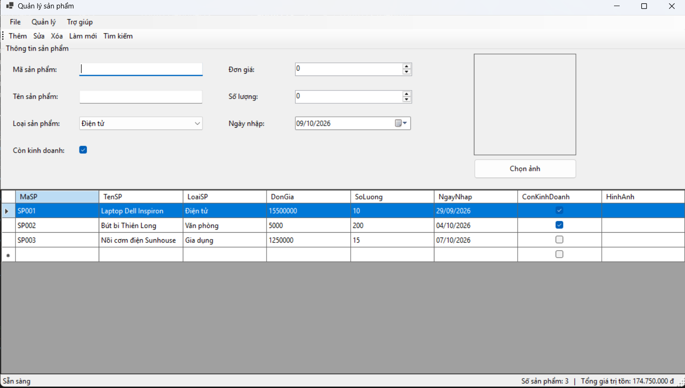
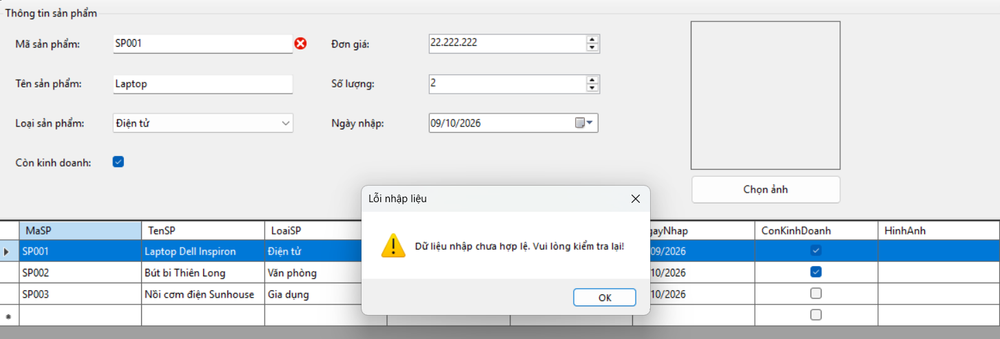
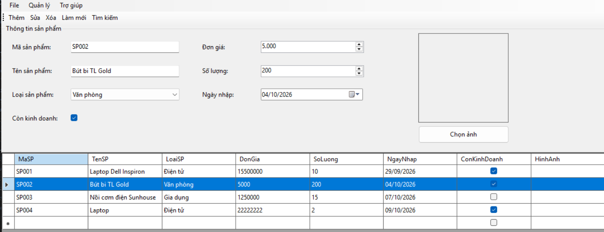
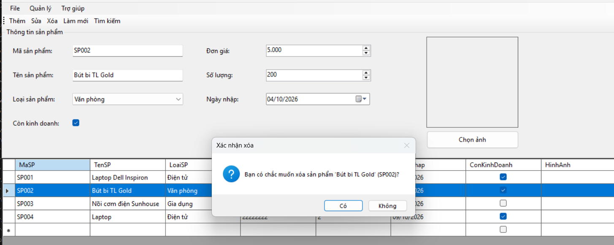
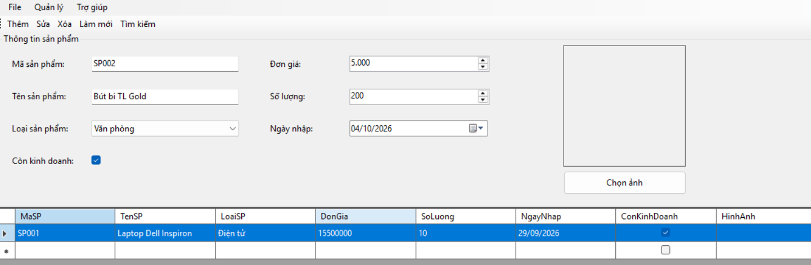
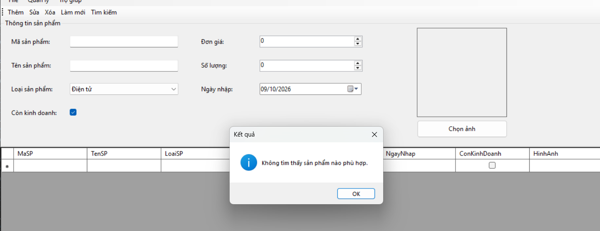
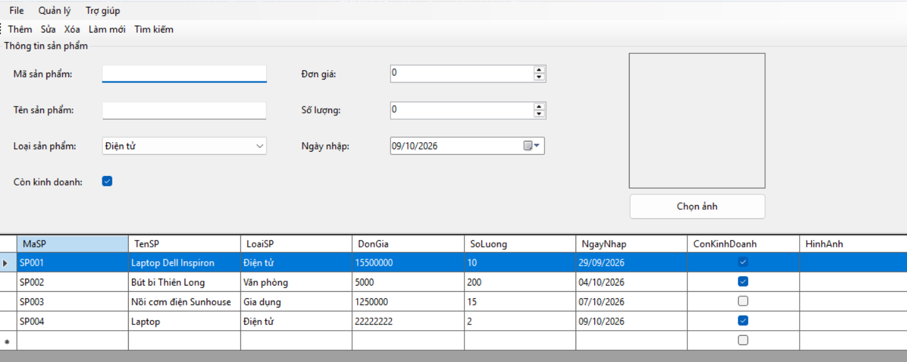
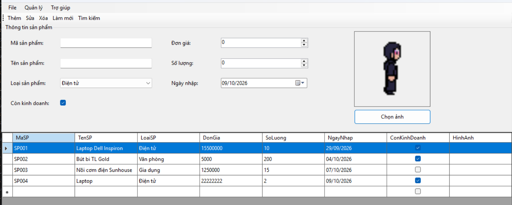
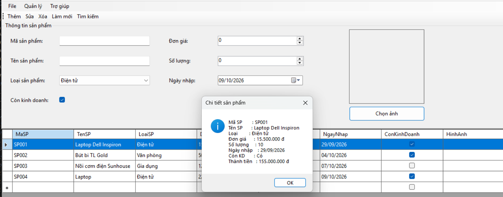

# Lab06 - Windows Forms nâng cao và DataGridView  

**Học phần:** 2611COMP101904 - Lập trình trên Windows  
**Sinh viên thực hiện:** Lê Trần Anh Khoa | **MSSV:** 51.01.104.044 | **Lớp:** 51.01.CNTT.C

---

## 📑 Mục lục

1. [Giới thiệu](#-giới-thiệu)
2. [Cấu trúc project](#-cấu-trúc-project)
3. [Giao diện tổng quan](#-giao-diện-tổng-quan)
4. [Hướng dẫn vận hành từng chức năng](#-hướng-dẫn-vận-hành-từng-chức-năng)
   - [1. Khởi động – Load Form](#1-khởi-động--load-form)
   - [2. Thêm sản phẩm](#2-thêm-sản-phẩm)
   - [3. Sửa sản phẩm](#3-sửa-sản-phẩm)
   - [4. Xóa sản phẩm](#4-xóa-sản-phẩm)
   - [5. Tìm kiếm sản phẩm](#5-tìm-kiếm-sản-phẩm)
   - [6. Làm mới dữ liệu](#6-làm-mới-dữ-liệu)
   - [7. Chọn ảnh sản phẩm](#7-chọn-ảnh-sản-phẩm)
   - [8. Xem chi tiết (chuột phải)](#8-xem-chi-tiết-chuột-phải)
   - [9. Cập nhật trạng thái (StatusStrip)](#9-cập-nhật-trạng-thái-statusstrip)
5. [Phím tắt](#-phím-tắt)
6. [Quy tắc kiểm tra dữ liệu](#-quy-tắc-kiểm-tra-dữ-liệu)
7. [Xử lý sự cố thường gặp](#-xử-lý-sự-cố-thường-gặp)

---

## 🎯 Giới thiệu

**ProductManager** là ứng dụng Windows Forms cho phép quản lý danh sách sản phẩm của một cửa hàng với các chức năng:

- ✅ Hiển thị danh sách sản phẩm bằng `DataGridView`
- ✅ Thêm / Sửa / Xóa / Tìm kiếm / Làm mới sản phẩm
- ✅ Kiểm tra dữ liệu nhập bằng `ErrorProvider`
- ✅ Chọn và hiển thị ảnh sản phẩm
- ✅ MenuStrip, ToolStrip, StatusStrip, ContextMenuStrip

Dữ liệu được lưu trong bộ nhớ (`BindingList<Product>`), khi tắt ứng dụng dữ liệu sẽ mất.

---


## 📂 Cấu trúc project

```
ProductManager/
├── Program.cs               # Điểm khởi chạy ứng dụng
├── Product.cs               # Lớp model Product
├── Form1.cs                 # Xử lý logic (FrmProduct)
├── Form1.Designer.cs        # Thiết kế giao diện (FrmProduct)
├── Form1.resx               # Tài nguyên của form
└── README.md                # Tài liệu này
```

---

## 🖼️ Giao diện tổng quan

```
┌───────────────────────────────────────────────────────────────────────────┐
│  File    Quản lý    Trợ giúp                                              │  ← MenuStrip
├───────────────────────────────────────────────────────────────────────────┤
│  [Thêm]  [Sửa]  [Xóa]  [Làm mới]  [Tìm kiếm]                              │  ← ToolStrip
├───────────────────────────────────────────────────────────────────────────┤
│ ┌── Thông tin sản phẩm ──────────────────────────────────────┐            │
│ │  Mã sản phẩm: [____________]     Đơn giá:    [___________] │            │
│ │  Tên SP:      [____________]     Số lượng:   [___________] │  ┌───────┐ │
│ │  Loại SP:     [▼ Điện tử  ]      Ngày nhập:  [__/__/____]  │  │ ẢNH   │ │
│ │  Còn KD:      [✓]                Chọn ảnh ▸ [Chọn ảnh]     │  └───────┘ │
│ └────────────────────────────────────────────────────────────┘            │
├───────────────────────────────────────────────────────────────────────────┤
│  Mã SP │ Tên SP          │ Loại        │ Đơn giá   │ SL │ Ngày nhập │ KD  │  ← DataGridView
│ ───────┼─────────────────┼─────────────┼───────────┼────┼───────────┼─────│
│  SP001 │ Laptop Dell     │ Điện tử     │ 15.500.000│ 10 │ 01/01/25  │  ☑  │
│  SP002 │ Bút bi TL       │ Văn phòng   │      5.000│200 │ 05/01/25  │  ☑  │
│  SP003 │ Nồi cơm SH      │ Gia dụng    │  1.250.000│ 15 │ 08/01/25  │  ☐  │
├───────────────────────────────────────────────────────────────────────────┤
│  Sẵn sàng             Số sản phẩm: 3  |  Tổng giá trị tồn: 174.750.000 đ │  ← StatusStrip
└───────────────────────────────────────────────────────────────────────────┘
```

---

## 🎮 Hướng dẫn vận hành từng chức năng

### 1. Khởi động – Load Form

**Cách thực hiện:** Chạy ứng dụng → Form tự động load.

**Hoạt động:**
- Khởi tạo ComboBox loại sản phẩm: `Điện tử, Văn phòng, Gia dụng, Thời trang`.
- Thêm 3 sản phẩm mẫu vào danh sách.
- Hiển thị danh sách lên `DataGridView`.
- Xóa trắng form nhập liệu.
- Cập nhật StatusStrip.

**Minh họa:**
```
[KHỞI ĐỘNG] ──► Load dữ liệu mẫu ──► DataGridView hiển thị 3 dòng
                                  └─► StatusStrip: "Sẵn sàng | 3 sản phẩm"
```

---

### 2. Thêm sản phẩm

**Cách thực hiện:**
1. Nhập đầy đủ thông tin: Mã, Tên, Loại, Đơn giá, Số lượng, Ngày nhập.
2. (Tùy chọn) Bấm **Chọn ảnh** để thêm hình.
3. Bấm nút **Thêm** (ToolStrip) hoặc **Ctrl + N** hoặc menu **Quản lý → Thêm**.

**Hoạt động:**
- Kiểm tra dữ liệu qua `ValidateInput()`.
- Nếu mã đã tồn tại → báo lỗi bằng `ErrorProvider` + `MessageBox`.
- Nếu hợp lệ → thêm vào `BindingList` → DataGridView tự cập nhật.
- Xóa trắng form → cập nhật StatusStrip.

**Minh họa lỗi khi mã trùng:**
```
┌────────────────────────────────────────────────┐
│  ⚠  Dữ liệu nhập chưa hợp lệ!                  │
│     Vui lòng kiểm tra lại.                     │
│                                        [ OK ]  │
└────────────────────────────────────────────────┘
      ▼ (ErrorProvider icon đỏ cạnh txtMaSP)
   Mã sản phẩm: [SP001❗]
                       └─ Mã sản phẩm đã tồn tại!
```


---

### 3. Sửa sản phẩm

**Cách thực hiện:**
1. Nhấp vào một dòng bất kỳ trong `DataGridView` → dữ liệu tự động nạp lên form.
2. Chỉnh sửa thông tin cần thay đổi.
3. Bấm nút **Sửa** (ToolStrip) hoặc **Ctrl + E** hoặc menu **Quản lý → Sửa**.

**Hoạt động:**
- Lấy sản phẩm đang chọn (`_editing` hoặc `GetSelectedProduct()`).
- Kiểm tra dữ liệu (bỏ qua trùng mã với chính nó).
- Cập nhật lại các thuộc tính và refresh grid.

**Minh họa:**
```
[BƯỚC 1] Click dòng SP002
   ┌──────────────────────────────────┐
   │ SP002 │ Bút bi TL │ Văn phòng    │  ◄── click
   └──────────────────────────────────┘
                │
                ▼
   Form tự điền: Mã=SP002, Tên=Bút bi TL, ...

[BƯỚC 2] Sửa "Bút bi Thiên Long" → "Bút bi TL Gold"

[BƯỚC 3] Bấm [Sửa]
                │
                ▼
   DataGridView dòng SP002 được cập nhật ✅
```

---

### 4. Xóa sản phẩm

**Cách thực hiện:**
1. Chọn một dòng trong `DataGridView`.
2. Bấm nút **Xóa** hoặc phím **Delete** hoặc chuột phải → **Xóa**.
3. Xác nhận trong hộp thoại.

**Minh họa hộp thoại xác nhận:**
```
┌────────────────────────────────────────────────────────────┐
│  ❓  Bạn có chắc muốn xóa sản phẩm                         │
│      'Bút bi Thiên Long' (SP002)?                          │
│                                                            │
│                                     [ Yes ]   [ No ]       │
└────────────────────────────────────────────────────────────┘
```

**Hoạt động:**
- Nếu chọn **Yes** → xóa khỏi `_products` → DataGridView cập nhật.
- Nếu chọn **No** → không làm gì.

---

### 5. Tìm kiếm sản phẩm

**Cách thực hiện:**
- Bấm nút **Tìm kiếm** (ToolStrip) hoặc **Ctrl + F** hoặc menu **Quản lý → Tìm kiếm**.

**Minh họa:**
```
┌───────────────────────────────────────────────┐
│  Tìm kiếm                                  ✕  │
│ ┌───────────────────────────────────────────┐ │
│ │ Nhập mã hoặc tên sản phẩm cần tìm:        │ │
│ │ ┌───────────────────────────────────────┐ │ │
│ │ │ laptop                                │ │ │
│ │ └───────────────────────────────────────┘ │ │
│ │               [ OK ]    [ Hủy ]           │ │
│ └───────────────────────────────────────────┘ │
└───────────────────────────────────────────────┘
```

**Hoạt động:**
- Tìm theo **mã** hoặc **tên**, **không phân biệt hoa/thường**.
- Nếu để trống → tương đương **Làm mới**.
- Kết quả được lọc và gán vào `BindingSource` mới.

**Kết quả hiển thị:**
```
Tìm thấy 1 sản phẩm cho từ khóa 'laptop'.
┌───────┬────────────────────┬──────────┬───────────┬────┬───────────┐
│ SP001 │ Laptop Dell Inspi  │ Điện tử  │ 15.500.000│ 10 │ 01/01/25  │
└───────┴────────────────────┴──────────┴───────────┴────┴───────────┘
```


Nếu không có kết quả:
```
┌──────────────────────────────────────────────┐
│  ℹ  Không tìm thấy sản phẩm nào phù hợp.     │
│                                      [ OK ]  │
└──────────────────────────────────────────────┘
```

---

### 6. Làm mới dữ liệu

**Cách thực hiện:**
- Bấm nút **Làm mới** hoặc **F5** hoặc menu **Quản lý → Làm mới**.

**Hoạt động:**
1. Xóa toàn bộ nội dung form nhập.
2. Xóa tất cả lỗi `ErrorProvider`.
3. Reset ComboBox về mục đầu tiên.
4. Bỏ ảnh trong `PictureBox`.
5. Hiển thị lại **toàn bộ danh sách** sản phẩm (bỏ kết quả tìm kiếm trước đó).

**Minh họa:**
```
[FORM TRƯỚC]                     [SAU KHI F5]
─────────────────                ─────────────────
Mã:  SP001                       Mã:  (trống)
Tên: Laptop Dell                 Tên: (trống)
Loại: Điện tử                    Loại: Điện tử (mặc định)
Ảnh: [🖼️]                        Ảnh: (trống)
```


---

### 7. Chọn ảnh sản phẩm

**Cách thực hiện:**
- Bấm nút **Chọn ảnh** trong GroupBox.

**Minh họa hộp thoại OpenFileDialog:**
```
┌───────────────────────────────────────────────────────────┐
│  Chọn ảnh sản phẩm                                     ✕  │
│ ┌─────────────────────────────────────────────────────┐   │
│ │ 📁 This PC ▸ Pictures                               │   │
│ │ ─────────────────────────────────────────────────── │   │
│ │  📄 laptop.jpg                                      │   │
│ │  📄 phone.png                                       │   │
│ │  📄 chair.bmp                                       │   │
│ └─────────────────────────────────────────────────────┘   │
│  File name: [laptop.jpg                ] [Open] [Cancel]  │
│  File type: [Image files (*.jpg;...)]                     │
└───────────────────────────────────────────────────────────┘
```

**Hoạt động:**
- Lọc file ảnh: `*.jpg;*.jpeg;*.png;*.bmp;*.gif`.
- Lưu đường dẫn vào `_currentImagePath`.
- Nạp ảnh vào `PictureBox` bằng `FileStream` (tránh khóa file).

**Kết quả:**
```
┌───────────┐
│           │
│   🖼️      │   ◄── Ảnh hiển thị với SizeMode = Zoom
│  (Ảnh)    │
│           │
└───────────┘
```

---

### 8. Xem chi tiết (chuột phải)

**Cách thực hiện:**
1. Nhấp **chuột phải** vào một dòng trong `DataGridView`.
2. Chọn **Xem chi tiết** từ ContextMenuStrip.

**Minh họa menu chuột phải:**
```
┌──────────────┐
│  Sửa         │
│  Xóa         │
│  Xem chi tiết│ ◄── chọn
└──────────────┘
```

**Hộp thoại chi tiết:**
```
┌──────────────────────────────────────────────────┐
│  Chi tiết sản phẩm                          ✕   │
│                                                  │
│  Mã SP        : SP001                            │
│  Tên SP       : Laptop Dell Inspiron             │
│  Loại         : Điện tử                          │
│  Đơn giá      : 15.500.000 đ                     │
│  Số lượng     : 10                               │
│  Ngày nhập    : 01/01/2025                       │
│  Còn KD       : Có                               │
│  Thành tiền   : 155.000.000 đ                    │
│                                        [ OK ]    │
└──────────────────────────────────────────────────┘
```

---

### 9. Cập nhật trạng thái (StatusStrip)

**Vị trí:** Cuối cửa sổ (dưới cùng).

**Minh họa:**
```
┌──────────────────────────────────────────────────────────────────┐
│ Đã thêm sản phẩm SP004.   │  Số sản phẩm: 4 | Tổng giá trị: ... │
└──────────────────────────────────────────────────────────────────┘
       ▲                                       ▲
   lblStatus (bên trái)                  lblCount (bên phải)
```

**Cập nhật sau mỗi thao tác:**

| Thao tác | Thông báo |
|---|---|
| Khởi động | `Sẵn sàng` |
| Chọn dòng | `Đã chọn SPxxx — Chỉnh sửa rồi bấm Sửa để cập nhật.` |
| Thêm | `Đã thêm sản phẩm SPxxx.` |
| Sửa | `Đã cập nhật sản phẩm SPxxx.` |
| Xóa | `Đã xóa sản phẩm SPxxx.` |
| Tìm kiếm | `Tìm thấy N sản phẩm cho từ khóa 'kw'.` |
| Làm mới | `Đã làm mới dữ liệu.` |
| Chọn ảnh | `Đã chọn ảnh: xxx.jpg` |

---

## ⌨️ Phím tắt

| Chức năng | Phím tắt |
|---|---|
| Thêm | `Ctrl + N` |
| Sửa | `Ctrl + E` |
| Xóa | `Delete` |
| Làm mới | `F5` |
| Tìm kiếm | `Ctrl + F` |
| Thoát | `Alt + F4` |

---

## ✅ Quy tắc kiểm tra dữ liệu

| Trường | Quy tắc | Thông báo lỗi |
|---|---|---|
| **Mã SP** | Không rỗng, không trùng | "Mã sản phẩm không được rỗng!" / "Mã sản phẩm đã tồn tại!" |
| **Tên SP** | Không rỗng | "Tên sản phẩm không được rỗng!" |
| **Loại SP** | Phải chọn | "Vui lòng chọn loại sản phẩm!" |
| **Đơn giá** | > 0 | "Đơn giá phải lớn hơn 0!" |
| **Số lượng** | ≥ 0 | "Số lượng phải lớn hơn hoặc bằng 0!" |
| **Ngày nhập** | ≤ ngày hiện tại | "Ngày nhập không được lớn hơn ngày hiện tại!" |

Khi có lỗi: 
- 🔴 Biểu tượng cảnh báo `ErrorProvider` xuất hiện bên cạnh control sai.
- ⚠️ Hộp thoại `MessageBox` thông báo tổng quát.

---

## 🛠️ Xử lý sự cố thường gặp

| Vấn đề | Nguyên nhân | Cách khắc phục |
|---|---|---|
| Nút Sửa/Xóa báo "chưa chọn dòng" | Chưa click vào dòng nào | Nhấp chuột vào một dòng trong DataGridView |
| Ảnh không hiển thị | File ảnh bị lỗi hoặc di chuyển | Chọn lại ảnh khác bằng nút **Chọn ảnh** |
| Dữ liệu mất khi tắt app | Do lưu trong bộ nhớ | Cần mở rộng kết nối SQL Server (ngoài phạm vi Lab) |
| Tìm kiếm không ra kết quả | Nhập sai mã/tên | Kiểm tra lại hoặc bấm **Làm mới (F5)** |
| Không thấy menu chuột phải | Click không đúng vùng grid | Nhấp chuột phải trực tiếp **lên một dòng dữ liệu** |

---

## 📌 Ghi chú

- Dữ liệu chỉ lưu trong **bộ nhớ RAM**, không được lưu ra file. Khi đóng ứng dụng, toàn bộ dữ liệu sẽ mất.
- Có thể mở rộng thêm: **sắp xếp theo đơn giá/số lượng**, **xuất file .txt**, **kết nối SQL Server**.
- Source code tuân thủ nguyên tắc **tách hàm rõ ràng** (`ValidateInput`, `ClearInput`, `LoadProductToForm`, `UpdateStatus`).

---