# Lab07 - SDI, MDI và ứng dụng nhiều Form trong C# WinForms 

**Học phần:** 2611COMP101904 - Lập trình trên Windows  
**Sinh viên thực hiện:** Lê Trần Anh Khoa | **MSSV:** 51.01.104.044 | **Lớp:** 51.01.CNTT.C

---

## 📑 Mục lục

1. [Giới thiệu](#1-giới-thiệu)
2. [Cấu trúc project](#2-cấu-trúc-project)
3. [Tài khoản đăng nhập](#4-tài-khoản-đăng-nhập)
4. [Luồng hoạt động tổng quát](#5-luồng-hoạt-động-tổng-quát)
5. [Chi tiết từng chức năng](#6-chi-tiết-từng-chức-năng)
6. [Kiến trúc & kỹ thuật chính](#7-kiến-trúc--kỹ-thuật-chính)
7. [Xử lý lỗi & Validation](#8-xử-lý-lỗi--validation)
8. [Ghi chú & mở rộng](#9-ghi-chú--mở-rộng)

---

## 1. Giới thiệu

**ShopManagerMini** là ứng dụng demo WinForms nhiều Form, minh họa các kỹ thuật:

- Đăng nhập & truyền dữ liệu `User` giữa các Form.
- Form chính dạng **MDI Parent** có `MenuStrip` + `StatusStrip`.
- Mở Form con MDI **không trùng** (dùng `MdiChildren`).
- CRUD dữ liệu trong bộ nhớ với `DataGridView`.
- Validation & MessageBox xác nhận.

| Thông tin | Nội dung |
|---|---|
| Tên ứng dụng | ShopManagerMini |
| Phiên bản | 1.0 |
| Nền tảng | .NET Framework 4.7.2+ / .NET 6+ (Windows Forms) |
| Lưu trữ | Bộ nhớ (mất khi đóng app) |
| Ngôn ngữ | C# |

---

## 2. Cấu trúc project

```
ShopManagerMini
│
├── Models
│   ├── User.cs           # Tài khoản đăng nhập
│   ├── Product.cs        # Sản phẩm
│   └── Customer.cs       # Khách hàng
│
├── Forms
│   ├── FrmLogin.cs / FrmLogin.Designer.cs
│   ├── FrmMain.cs  / FrmMain.Designer.cs
│   ├── FrmProduct.cs / FrmProduct.Designer.cs
│   ├── FrmCustomer.cs / FrmCustomer.Designer.cs
│   └── FrmAbout.cs / FrmAbout.Designer.cs
│
└── Program.cs            # Entry point
```

---


## 3. Tài khoản đăng nhập

| Username | Password | Họ tên | Vai trò |
|---|---|---|---|
| `admin` | `123` | Quản trị viên | Admin |
| `user`  | `123` | Nhân viên bán hàng | User |

---

## 4. Luồng hoạt động tổng quát

```
┌─────────────┐   OK    ┌─────────────┐   Menu    ┌──────────────┐
│  FrmLogin   │ ──────► │   FrmMain   │ ────────► │  FrmProduct  │
│ (ShowDialog)│  user   │ (MDI Parent)│           │  FrmCustomer │
└─────────────┘         └─────────────┘           │  FrmAbout    │
      │ Cancel                │                    └──────────────┘
      ▼                       │ Đăng xuất
   Thoát app ◄────────────────┘
```

1. `Program.cs` mở `FrmLogin` bằng `ShowDialog()`.
2. Nếu `DialogResult == OK` → mở `FrmMain`, truyền `User` qua **constructor**.
3. Trong `FrmMain`, chọn menu để mở các Form con dạng **MDI child**.
4. Đăng xuất → đóng tất cả Form con, ẩn `FrmMain`, mở lại `FrmLogin`.

---

## 5. Chi tiết từng chức năng

### 5.1. Đăng nhập (FrmLogin)

**Mục đích:** Xác thực người dùng trước khi vào hệ thống.

**Giao diện:**

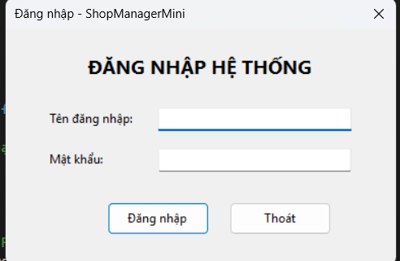
**Thao tác:**

| Bước | Hành động | Kết quả |
|---|---|---|
| 1 | Nhập `admin` / `123` → nhấn **Đăng nhập** | Đóng FrmLogin, mở FrmMain |
| 2 | Bỏ trống một trong hai ô → nhấn **Đăng nhập** | MessageBox cảnh báo, focus vào ô trống |
| 3 | Nhập sai → nhấn **Đăng nhập** | MessageBox "Sai tên đăng nhập hoặc mật khẩu!" |
| 4 | Nhấn **Thoát** | Hỏi xác nhận → đóng app |

**Cơ chế kỹ thuật:**
- Danh sách tài khoản `_accounts` là `List<User>` khởi tạo sẵn.
- Khi đăng nhập thành công: gán `CurrentUser = found` và đặt `DialogResult = OK`.
- `Program.cs` đọc `login.CurrentUser` để truyền sang `FrmMain`.

---

### 5.2. Màn hình chính (FrmMain)

**Mục đích:** Form cha MDI chứa menu và thanh trạng thái.

**Giao diện:**

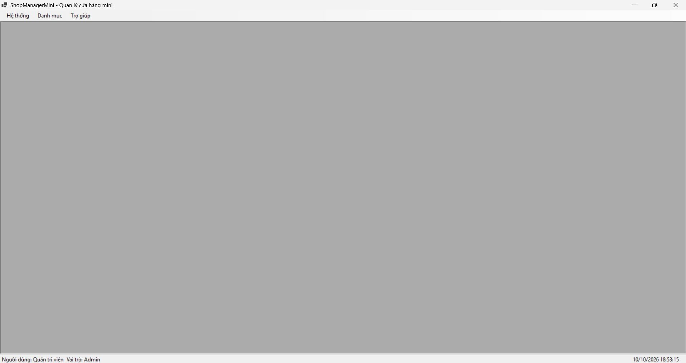

**Thành phần:**

| Khu vực | Nội dung |
|---|---|
| Menu **Hệ thống** | Đăng xuất, Thoát |
| Menu **Danh mục** | Quản lý sản phẩm, Quản lý khách hàng |
| Menu **Trợ giúp** | Giới thiệu |
| StatusStrip (trái) | `Người dùng: <Họ tên>` |
| StatusStrip (giữa) | `Vai trò: Admin/User` |
| StatusStrip (phải) | Đồng hồ `dd/MM/yyyy HH:mm:ss` (cập nhật mỗi giây qua `Timer`) |

**Mở Form con không trùng — ví dụ chọn "Quản lý sản phẩm":**

```csharp
private void OpenChildForm(Form child)
{
    foreach (Form f in this.MdiChildren)
    {
        if (f.GetType() == child.GetType())
        {
            if (f.WindowState == FormWindowState.Minimized)
                f.WindowState = FormWindowState.Normal;
            f.Activate();
            child.Dispose();   // huỷ form mới
            return;
        }
    }
    child.MdiParent = this;
    child.Show();
}
```

**Kết quả:**

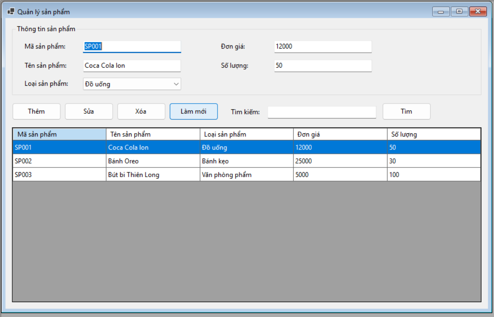

- Nếu FrmProduct **chưa mở** → mở mới.
- Nếu FrmProduct **đã mở** → chỉ `Activate()` form cũ, không tạo mới.

---

### 5.3. Quản lý sản phẩm (FrmProduct)

**Mục đích:** CRUD sản phẩm trong bộ nhớ.

**Giao diện:**


**Trường dữ liệu:** Mã SP, Tên SP, Loại SP, Đơn giá, Số lượng.

#### a) Thêm sản phẩm
1. Nhập thông tin vào các ô.
2. Nhấn **Thêm**.
3. Thành công → thêm vào `BindingList<Product>` + MessageBox "Thêm sản phẩm thành công!".

**Ràng buộc:**
- Mã và Tên không được trống.
- Đơn giá ≥ 0, số lượng ≥ 0 (số nguyên).
- **Không trùng mã** (so sánh `StringComparison.OrdinalIgnoreCase`).

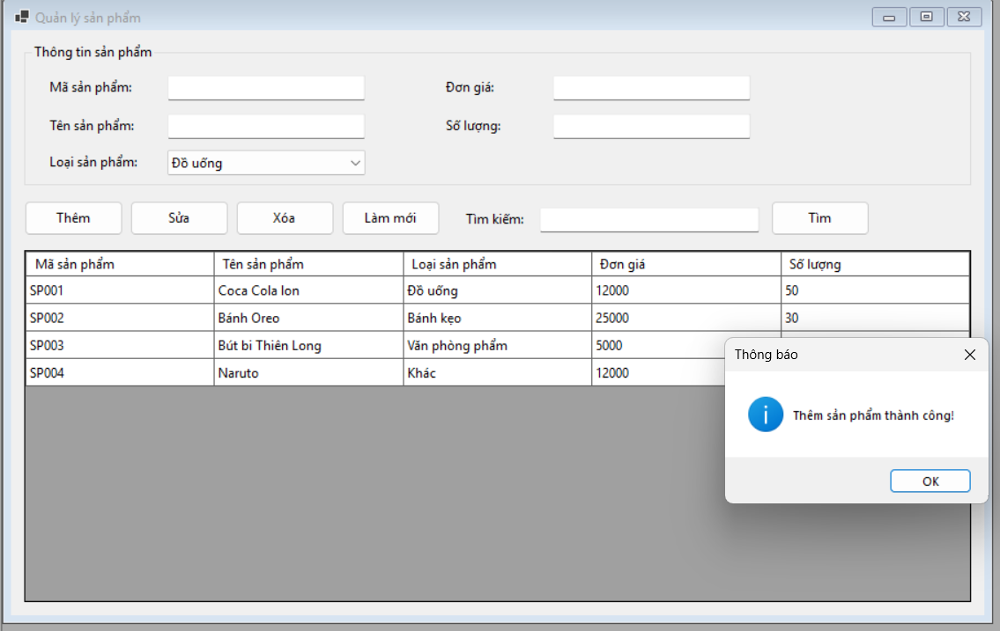

#### b) Sửa sản phẩm
1. Click 1 dòng trên DataGridView → dữ liệu tự đổ lên form.
2. Sửa thông tin → nhấn **Sửa**.

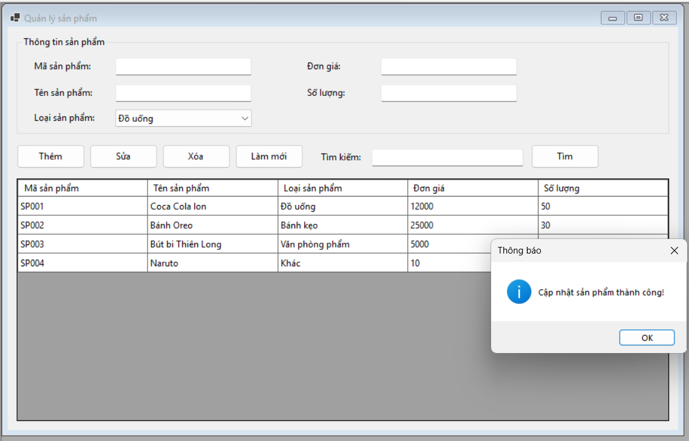

#### c) Xóa sản phẩm
1. Chọn dòng cần xóa → nhấn **Xóa**.
2. MessageBox hỏi xác nhận **Yes/No**.
3. Yes → xóa khỏi danh sách.

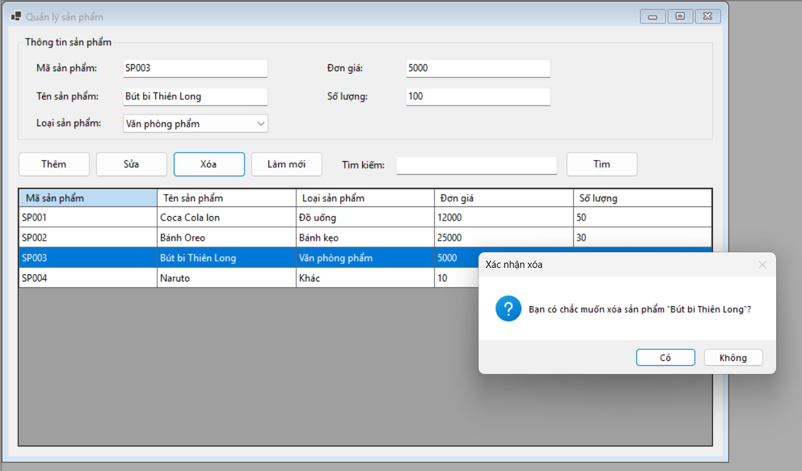

#### d) Tìm kiếm
1. Nhập từ khóa (mã / tên / loại) vào ô **Tìm kiếm**.
2. Nhấn **Tìm**.
3. Kết quả lọc theo `Contains(keyword)` — nếu rỗng thì báo "Không tìm thấy...".

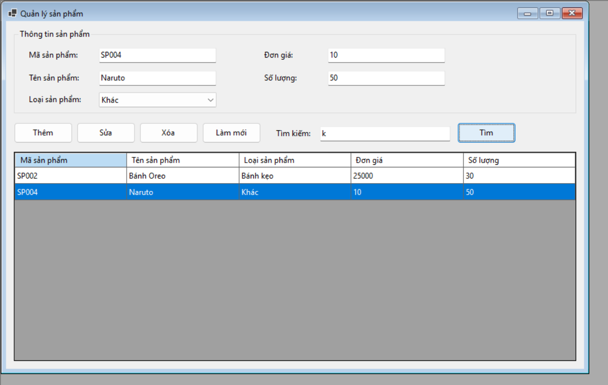

#### e) Làm mới
- Xóa từ khóa tìm kiếm, nạp lại toàn bộ danh sách, xóa trắng các ô nhập.

---

### 5.4. Quản lý khách hàng (FrmCustomer)

**Mục đích:** CRUD khách hàng (tối thiểu Thêm + Hiển thị).

**Giao diện:**

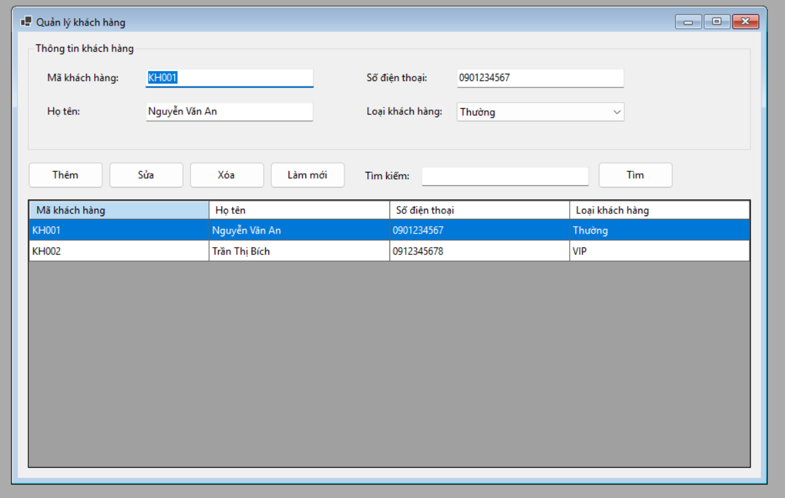

**Trường dữ liệu:** Mã KH, Họ tên, Số điện thoại, Loại KH (Thường / VIP / Thân thiết).

**Chức năng:** giống FrmProduct — **Thêm / Sửa / Xóa / Làm mới / Tìm kiếm**.

**Ràng buộc riêng:**
- Số điện thoại (nếu nhập) phải là 9–11 chữ số.
- Không trùng mã khách hàng.
---

### 5.5. Giới thiệu (FrmAbout)

**Mục đích:** Hiển thị thông tin app + sinh viên + lớp.

**Giao diện:**

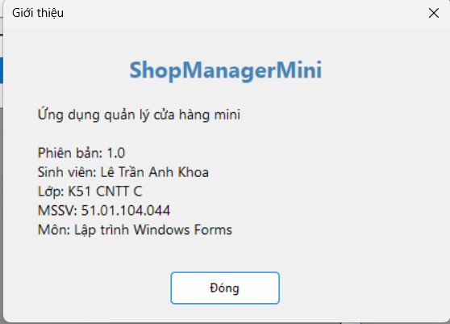

- Mở dạng **hộp thoại modal** (`ShowDialog`) — không phải MDI child.
- Nhấn **Đóng** để tắt.

---

### 5.6. Đăng xuất / Thoát

#### Đăng xuất (Menu Hệ thống → Đăng xuất)
1. MessageBox xác nhận.
2. Đóng tất cả Form con MDI.
3. Ẩn `FrmMain`, mở lại `FrmLogin`.
4. Nếu đăng nhập lại thành công → cập nhật lại StatusStrip.

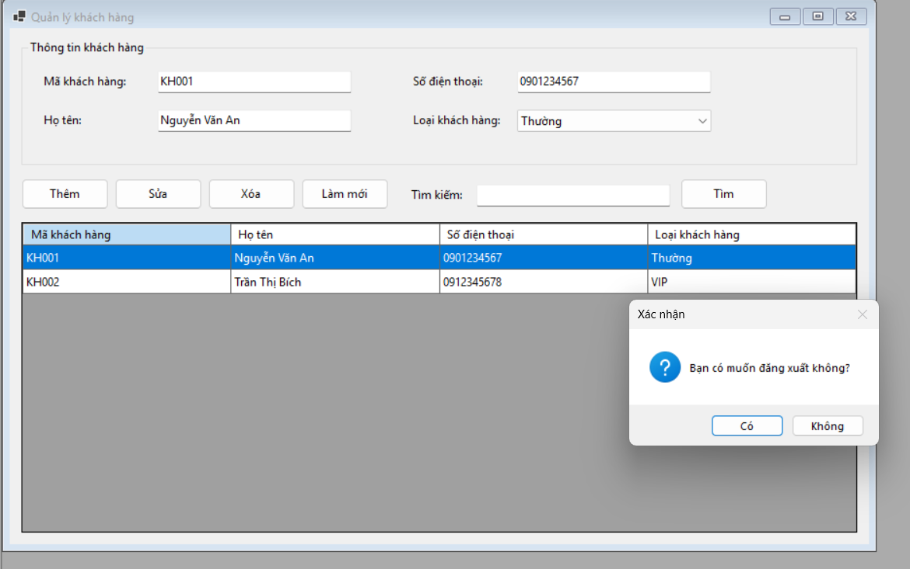

#### Thoát (Menu Hệ thống → Thoát, hoặc nút X)
1. MessageBox xác nhận **Yes/No**.
2. Yes → đóng ứng dụng. No → hủy đóng (`e.Cancel = true`).

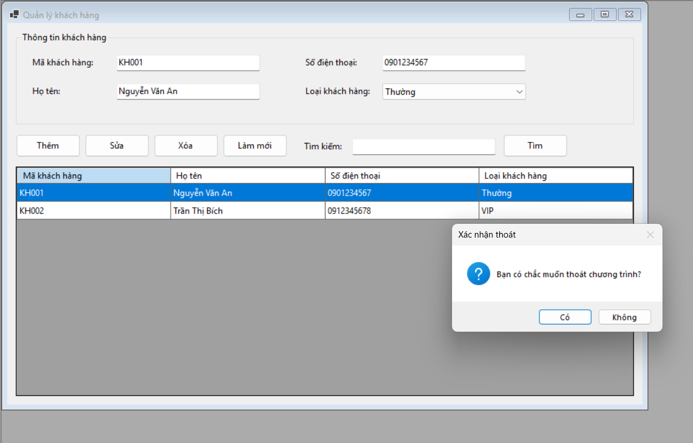

---

## 6. Kiến trúc & kỹ thuật chính

| Kỹ thuật | Nơi áp dụng | Mô tả |
|---|---|---|
| **MDI Parent** | `FrmMain` | `IsMdiContainer = true` |
| **ShowDialog** | `FrmLogin`, `FrmAbout` | Hộp thoại modal |
| **Constructor injection** | `FrmMain(User user)` | Truyền User từ Login |
| **Property (get-only)** | `FrmLogin.CurrentUser` | Đọc user sau khi ShowDialog |
| **BindingList + BindingSource** | `FrmProduct`, `FrmCustomer` | Tự cập nhật DataGridView |
| **Timer** | `FrmMain` | Cập nhật đồng hồ StatusStrip mỗi 1s |
| **Duyệt `MdiChildren`** | `OpenChildForm()` | Chống mở trùng Form |
| **Kiểm tra trùng mã** | Thêm/Sửa SP & KH | Tránh khóa chính trùng |

---

## 7. Xử lý lỗi & Validation

| Trường hợp | Thông báo | Icon |
|---|---|---|
| Bỏ trống username/password | "Vui lòng nhập đầy đủ tên đăng nhập và mật khẩu!" | Warning |
| Sai tài khoản | "Sai tên đăng nhập hoặc mật khẩu!" | Error |
| Trùng mã SP/KH | "Mã ... đã tồn tại!" | Error |
| Đơn giá không phải số | "Đơn giá phải là số!" | Warning |
| Đơn giá/số lượng âm | "…không được âm!" | Warning |
| Xóa SP/KH | "Bạn có chắc muốn xóa…?" | Question |
| Thoát app | "Bạn có chắc muốn thoát chương trình?" | Question |
| Đăng xuất | "Bạn có muốn đăng xuất không?" | Question |
| Tìm kiếm rỗng | "Không tìm thấy ... phù hợp!" | Information |

---

## 8. Ghi chú & mở rộng

- **Không lưu DB:** đóng app là mất dữ liệu — đúng yêu cầu Lab 07. Có thể mở rộng sang SQL Server / SQLite / JSON sau.
- **Phân quyền:** hiện chỉ hiển thị vai trò lên StatusStrip. Có thể chặn các chức năng nhạy cảm (Xóa, Sửa) với role `User`.
- **Thêm MDI child mới:** chỉ cần tạo Form, thêm mục menu và gọi `OpenChildForm(new FrmXxx())`.

---