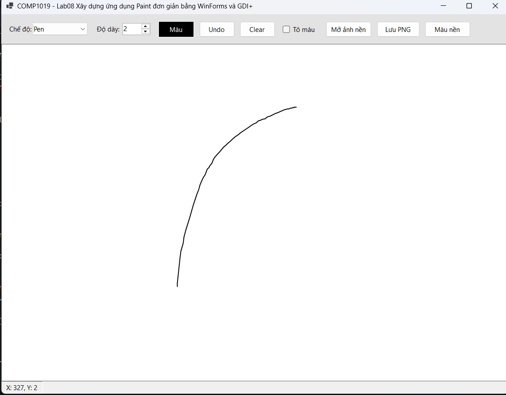
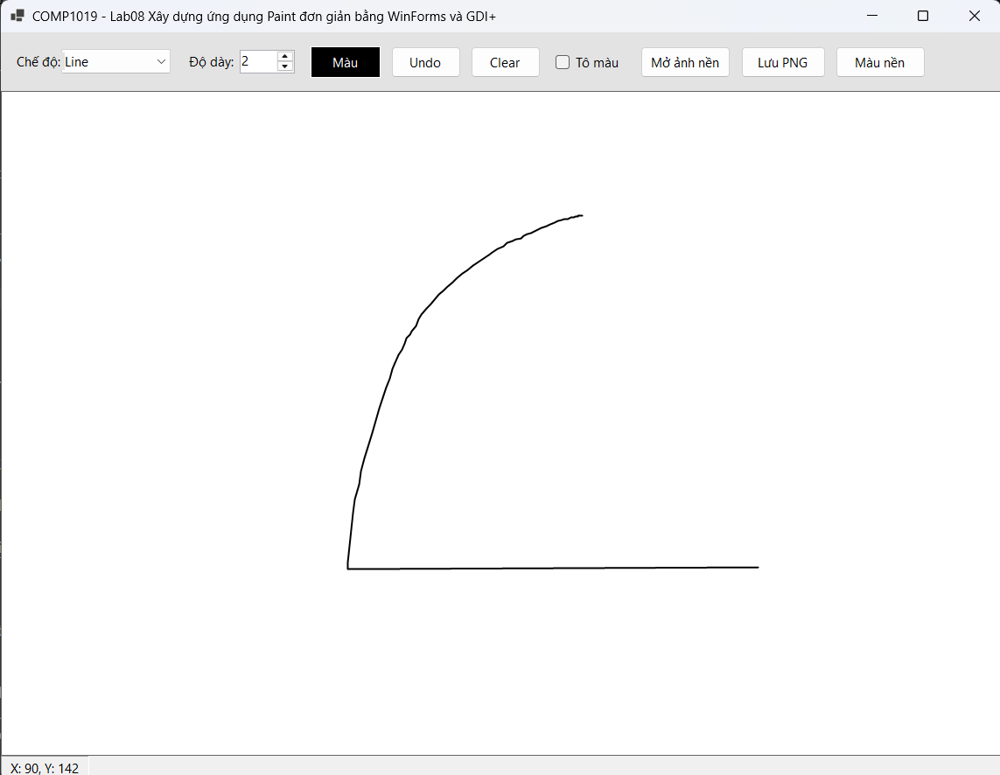
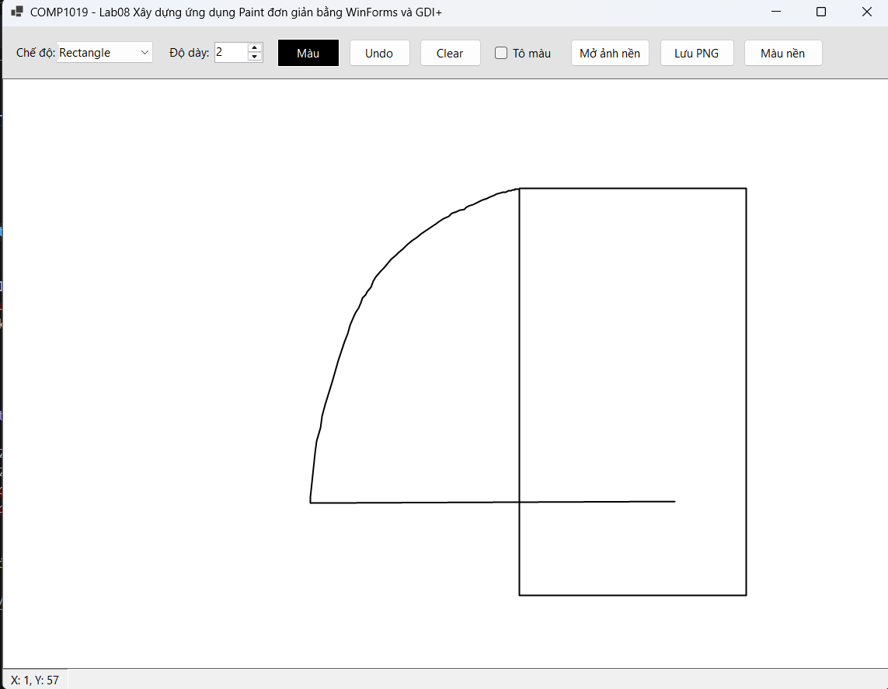
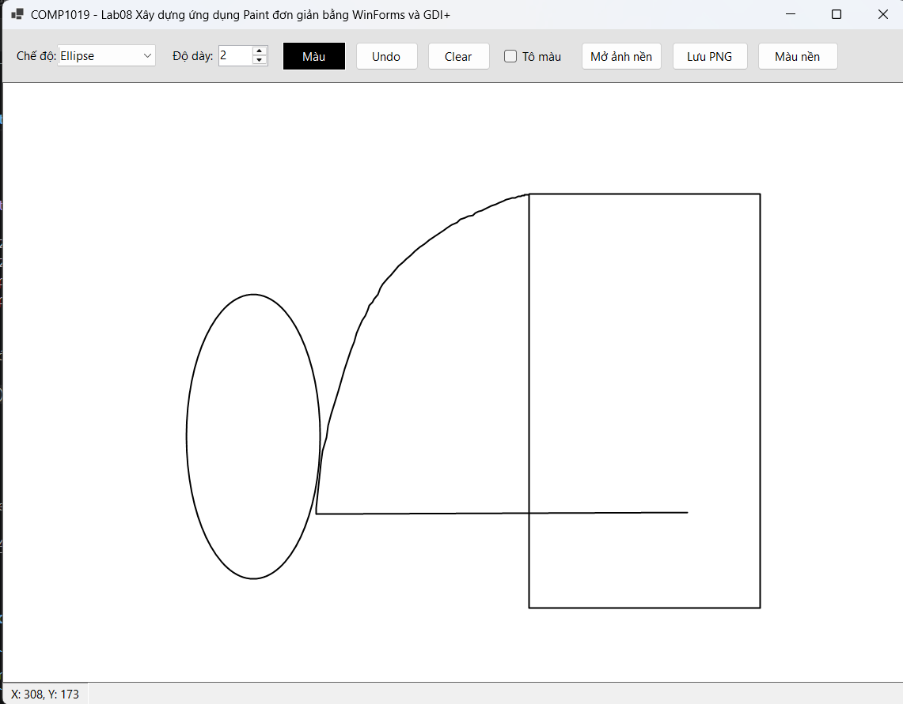
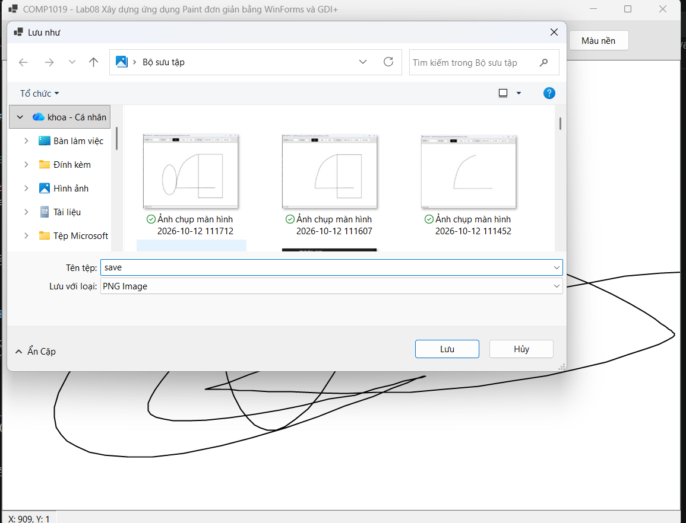
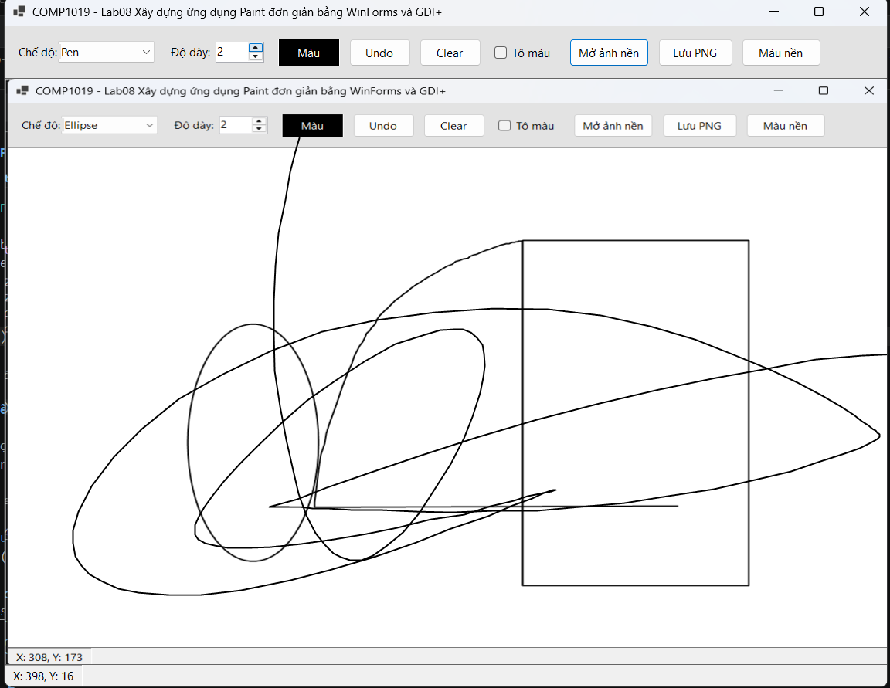
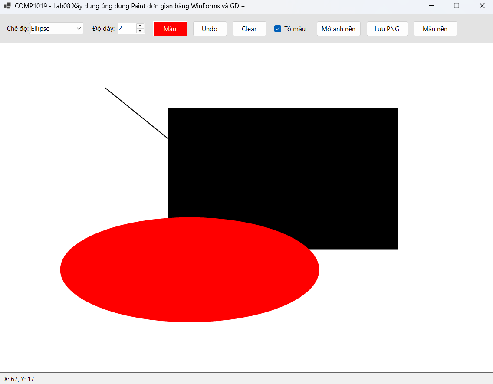

# Lab08 - Ứng dụng Paint đơn giản bằng WinForms & GDI+

**Học phần:** 2611COMP101904 - Lập trình trên Windows  
**Sinh viên thực hiện:** Lê Trần Anh Khoa | **MSSV:** 51.01.104.044 | **Lớp:** 51.01.CNTT.C

---

## 📑 Mục lục

1. [Giới thiệu](#1-giới-thiệu)
2. [Cấu trúc project](#2-cấu-trúc-project)
3. [Giao diện & Control](#4-giao-diện--control)
4. [Luồng hoạt động tổng quát](#5-luồng-hoạt-động-tổng-quát)
5. [Chi tiết từng chức năng](#6-chi-tiết-từng-chức-năng)
6. [Chức năng nâng cao](#7-chức-năng-nâng-cao)
7. [Kiến trúc & kỹ thuật chính](#8-kiến-trúc--kỹ-thuật-chính)
8. [Xử lý lỗi & Validation](#9-xử-lý-lỗi--validation)
9. [Ghi chú & mở rộng](#10-ghi-chú--mở-rộng)

---

## 1. Giới thiệu

**SimplePaint** là ứng dụng demo WinForms minh họa các kỹ thuật:

- Sử dụng **Graphics, Pen, Brush** và sự kiện **Paint** trong WinForms.
- Xử lý **MouseDown / MouseMove / MouseUp** để vẽ tương tác bằng chuột.
- Lưu danh sách đối tượng cần vẽ (`List<DrawItem>`) và **vẽ lại khi Form hoặc Panel refresh**.
- Tối ưu chống giật bằng kỹ thuật **double buffering**.

| Thông tin | Nội dung |
|---|---|
| Tên ứng dụng | COMP1019_Lab08_SimplePaint |
| Phiên bản | 1.0 |
| Nền tảng | .NET 8 (Windows Forms) / .NET Framework 4.7.2+ |
| Lưu trữ | Bộ nhớ (mất khi đóng app) |
| Ngôn ngữ | C# |

---

## 2. Cấu trúc project

```
COMP1019_Lab08_SimplePaint
│
├── Form1.cs                # Logic chính: vẽ, mouse, toolbar, undo, save…
├── Form1.Designer.cs       # Khai báo control giao diện
├── Program.cs              # Entry point
├── COMP1019_Lab08.csproj
├── README.md               # File mô tả này
```

---


## 3. Giao diện & Control

### Thanh công cụ trên cùng

| Control | Tên | Mô tả |
|---|---|---|
| ComboBox | `cboMode` | Chọn chế độ: **Pen, Line, Rectangle, Ellipse** |
| NumericUpDown | `nudWidth` | Độ dày nét vẽ (1 – 20), mặc định 2 |
| Button | `btnColor` | Mở `ColorDialog` để chọn màu vẽ |
| Button | `btnUndo` | Xóa nét vẽ gần nhất |
| Button | `btnClear` | Xóa toàn bộ vùng vẽ (có xác nhận) |
| CheckBox | `chkFill` | Bật/tắt tô màu cho Rectangle & Ellipse |
| Button | `btnOpenBg` | Mở ảnh nền để vẽ đè |
| Button | `btnSave` | Lưu vùng vẽ ra file PNG |
| Button | `btnBgColor` | Đổi màu nền canvas |

### Vùng vẽ & trạng thái

| Control | Tên | Mô tả |
|---|---|---|
| Custom Panel | `canvas` | Vùng vẽ chính (double buffered, nền trắng) |
| Label | `lblStatus` | Hiển thị tọa độ chuột hiện tại `X: ..., Y: ...` |

---

## 4. Luồng hoạt động tổng quát

```
┌──────────────┐    MouseDown     ┌──────────────────┐
│   Người dùng │ ───────────────► │  canvas          │
│              │                  │  (DoubleBuffered │
│              │ ◄─────────────── │   Panel)         │
└──────────────┘    MouseMove     └────────┬─────────┘
        ▲              MouseUp             │
        │                                  │ 1. Tạo / cập nhật currentItem
        │                                  │ 2. canvas.Invalidate()
        │                                  ▼
        │                        ┌──────────────────┐
        │                        │  Canvas_Paint    │
        │                        │  - Vẽ ảnh nền    │
        │                        │  - Duyệt list    │
        │                        │  - Vẽ current    │
        │                        └────────┬─────────┘
        │                                 │ MouseUp → add vào drawItems
        │                                 ▼
        │                        ┌──────────────────┐
        └────────────────────────│  List<DrawItem>  │
                                 │  (lưu trong RAM) │
                                 └──────────────────┘
```

1. **MouseDown** → tạo `DrawItem` mới (`currentItem`), lưu điểm bắt đầu.
2. **MouseMove** → cập nhật `currentItem` (thêm điểm cho Pen, cập nhật End cho Line/Rect/Ellipse), gọi `canvas.Invalidate()`.
3. **Canvas_Paint** → vẽ lại toàn bộ `drawItems` + `currentItem` (nếu đang vẽ).
4. **MouseUp** → nếu nét vẽ có nội dung, thêm vào `drawItems`.
5. Mọi thay đổi dữ liệu (Undo, Clear, đổi màu nền, mở ảnh nền…) đều gọi `canvas.Invalidate()` để vẽ lại.

---

## 5. Chi tiết từng chức năng

### 5.1. Vẽ tự do — Pen

**Mục đích:** Vẽ nét tự do theo chuyển động chuột.

**Thao tác:**
1. Chọn chế độ **Pen** trong `cboMode`.
2. Chọn màu + độ dày.
3. Giữ chuột trái và di chuyển để vẽ.

**Cơ chế kỹ thuật:**
- Mỗi lần `MouseMove`, thêm `Point` vào `currentItem.Points` (chỉ thêm nếu khác điểm cuối → giảm số lần vẽ lại).
- Trong `Paint`, dùng `g.DrawLines(pen, points.ToArray())`.



---

### 5.2. Vẽ đường thẳng — Line

**Thao tác:**
1. Chọn chế độ **Line**.
2. Giữ chuột trái, kéo từ điểm đầu đến điểm cuối, thả chuột.

**Cơ chế:** `MouseDown` lưu `Start`, `MouseMove` cập nhật `End`, `Paint` gọi `g.DrawLine(pen, Start, End)`.



---

### 5.3. Vẽ hình chữ nhật — Rectangle

**Thao tác:**
1. Chọn chế độ **Rectangle**.
2. Tick **Tô màu** nếu muốn tô đặc.
3. Kéo chuột theo **bất kỳ hướng nào**.

**Xử lý mọi hướng kéo:**

```csharp
private Rectangle GetRect(Point p1, Point p2) =>
    new Rectangle(
        Math.Min(p1.X, p2.X),
        Math.Min(p1.Y, p2.Y),
        Math.Abs(p1.X - p2.X),
        Math.Abs(p1.Y - p2.Y));
```

→ Luôn tạo `Rectangle` có tọa độ dương, không bị lỗi khi kéo từ phải sang trái hoặc từ dưới lên trên.



---

### 5.4. Vẽ hình ellipse — Ellipse

**Thao tác:** Tương tự Rectangle nhưng vẽ hình ellipse (dùng `DrawEllipse` / `FillEllipse` với cùng `Rectangle` bao).



---

### 5.5. Chọn màu — `btnColor`

- Mở `ColorDialog`, gán `selectedColor = cd.Color`.
- Đổi `btnColor.BackColor` để phản hồi trực quan.
- Màu được lưu vào từng `DrawItem` khi bắt đầu vẽ (nên nét cũ không đổi màu khi chọn màu mới).

---

### 5.6. Chọn độ dày — `nudWidth`

- NumericUpDown giá trị 1–20.
- Lấy giá trị tại thời điểm `MouseDown` → gán vào `DrawItem.PenWidth`.

---

### 5.7. Undo — `btnUndo` / Ctrl + Z

```csharp
if (drawItems.Count == 0) return;
drawItems.RemoveAt(drawItems.Count - 1);
canvas.Invalidate();
```

Phím tắt `Ctrl + Z` được xử lý trong `Form1_KeyDown` (Form có `KeyPreview = true`).

---

### 5.8. Clear — `btnClear`

1. Nếu danh sách rỗng → không làm gì.
2. Nếu có dữ liệu → MessageBox xác nhận Yes/No.
3. Yes → `drawItems.Clear()` + `canvas.Invalidate()`.

---

### 5.9. Hiển thị tọa độ chuột

Trong `MouseMove`:

```csharp
lblStatus.Text = $"X: {e.X}, Y: {e.Y}";
```

---

### 5.10. Không mất nét vẽ khi resize

Vì toàn bộ dữ liệu nằm trong `List<DrawItem>` và **Paint event luôn vẽ lại từ danh sách**, nên khi resize Form, minimize → restore, hoặc bị Form khác che, nét vẽ vẫn nguyên vẹn.

---

## 6. Chức năng nâng cao

### 6.1. Lưu vùng vẽ ra PNG — `btnSave`

```csharp
using (Bitmap bmp = new Bitmap(canvas.Width, canvas.Height))
{
    canvas.DrawToBitmap(bmp, new Rectangle(0, 0, canvas.Width, canvas.Height));
    bmp.Save(sfd.FileName, ImageFormat.Png);
}
```



---

### 6.2. Mở ảnh nền để vẽ đè — `btnOpenBg`

1. Mở `OpenFileDialog` lọc `*.png;*.jpg;*.jpeg;*.bmp;*.gif`.
2. Clone ảnh để giải phóng file handle (tránh lỗi khóa file).
3. Trong `Canvas_Paint`, vẽ ảnh **trước** khi vẽ các nét:

```csharp
if (backgroundImage != null)
    e.Graphics.DrawImage(backgroundImage, 0, 0, canvas.Width, canvas.Height);
```



---

### 6.3. Phím tắt Ctrl + Z

```csharp
private void Form1_KeyDown(object sender, KeyEventArgs e)
{
    if (e.Control && e.KeyCode == Keys.Z)
    {
        btnUndo.PerformClick();
        e.Handled = true;
    }
}
```

---

### 6.4. Tô màu Rectangle / Ellipse — `chkFill`

- Nếu `chkFill.Checked == true` → khi bắt đầu vẽ, `DrawItem.IsFilled = true`.
- Trong `RenderItem`:
  ```csharp
  if (item.IsFilled)
      using (Brush b = new SolidBrush(item.PenColor))
          g.FillRectangle(b, r);   // hoặc g.FillEllipse
  g.DrawRectangle(pen, r);         // luôn vẽ viền
  ```



---

### 7.5. Đổi màu nền canvas — `btnBgColor`

```csharp
using (ColorDialog cd = new ColorDialog { Color = canvas.BackColor })
    if (cd.ShowDialog() == DialogResult.OK)
        canvas.BackColor = cd.Color;
```

---

## 8. Kiến trúc & kỹ thuật chính

| Kỹ thuật | Nơi áp dụng | Mô tả |
|---|---|---|
| **Graphics / Pen / Brush** | `RenderItem` | Vẽ tất cả hình bằng GDI+ |
| **Paint event** | `Canvas_Paint` | Vẽ lại từ danh sách mỗi khi cần |
| **Double Buffering** | `DoubleBufferedPanel` | Chống giật / nhấp nháy |
| **List\<DrawItem\>** | `drawItems` | Lưu toàn bộ nét vẽ |
| **MouseDown / Move / Up** | `canvas` | Tương tác vẽ bằng chuột |
| **Invalidate()** | Mọi thay đổi dữ liệu | Yêu cầu vẽ lại |
| **using / Dispose** | Pen, Brush, Dialog… | Quản lý tài nguyên GDI+ |
| **KeyPreview + KeyDown** | `Form1` | Phím tắt Ctrl+Z |
| **DrawToBitmap** | `btnSave_Click` | Xuất canvas ra PNG |
| **Clone Image** | `btnOpenBg_Click` | Giải phóng file handle |

### 8.1. Lớp `DrawItem`

```csharp
public class DrawItem
{
    public ShapeType Type { get; set; }
    public Color PenColor { get; set; }
    public float PenWidth { get; set; }
    public List<Point> Points { get; set; }   // Cho Pen
    public Point Start { get; set; }          // Cho Line / Rect / Ellipse
    public Point End { get; set; }
    public bool IsFilled { get; set; }
}
```

### 8.2. Panel chống giật `DoubleBufferedPanel`

```csharp
public class DoubleBufferedPanel : Panel
{
    public DoubleBufferedPanel()
    {
        SetStyle(ControlStyles.AllPaintingInWmPaint |
                 ControlStyles.UserPaint |
                 ControlStyles.OptimizedDoubleBuffer |
                 ControlStyles.ResizeRedraw, true);
        UpdateStyles();
    }
}
```

Các cờ này giúp:
- `AllPaintingInWmPaint` + `OptimizedDoubleBuffer` → vẽ vào buffer ảo trước, sau đó mới blit ra màn hình → **không nhấp nháy**.
- `ResizeRedraw` → tự vẽ lại khi resize.

### 8.3. Tránh thêm điểm trùng khi vẽ Pen

```csharp
if (currentItem.Points.Count == 0 ||
    currentItem.Points[currentItem.Points.Count - 1] != e.Location)
{
    currentItem.Points.Add(e.Location);
}
```

→ Giảm số điểm dư thừa, giảm thời gian vẽ lại → mượt hơn.

---

## 9. Xử lý lỗi & Validation

| Trường hợp | Thông báo | Icon |
|---|---|---|
| Clear khi danh sách rỗng | (không báo gì, bỏ qua) | — |
| Clear có dữ liệu | "Xóa toàn bộ hình vẽ?" | Question |
| Mở ảnh nền lỗi (file hỏng / không đọc được) | "Không thể mở ảnh: ..." | Error |
| Lưu PNG thành công | "Đã lưu ảnh!" | Information |
| Vẽ Line/Rect/Ellipse mà không kéo (Start == End) | (không thêm vào list) | — |
| Pen chỉ có 1 điểm | (không thêm vào list) | — |

---

## 10. Ghi chú & mở rộng

- **Không lưu DB:** đóng app là mất dữ liệu. Có thể mở rộng ghi/đọc JSON để bền vững hơn.
- **Có thể mở rộng thêm:**
  - Vẽ hình tam giác, hình tròn, mũi tên, text…
  - Chọn nét liền / nét đứt / nét chấm (`DashStyle`).
  - Thêm chức năng **Redo** (stack thứ hai).
  - Chọn vùng (Select) và di chuyển hình.
  - Lưu / mở file project dạng XML/JSON (lưu cả `List<DrawItem>`).
  - Zoom canvas (`Matrix`).
- **Tối ưu khi vẽ rất nhiều nét Pen:** cache các nét cũ vào một `Bitmap` nền, trong `Paint` chỉ cần `DrawImage(bitmap)` + vẽ nét đang vẽ.

---
