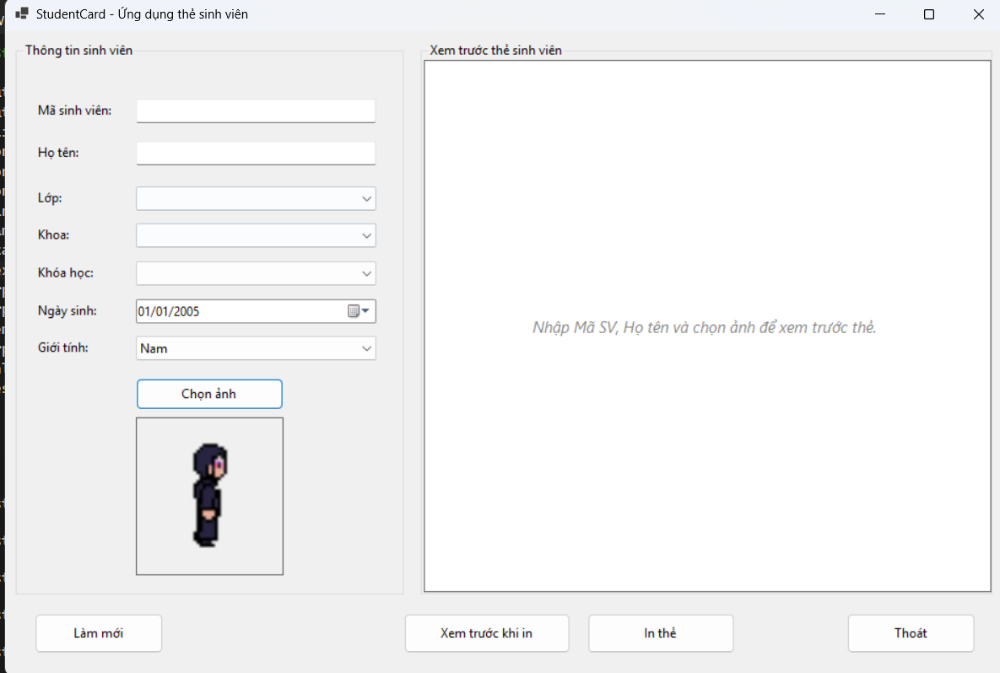
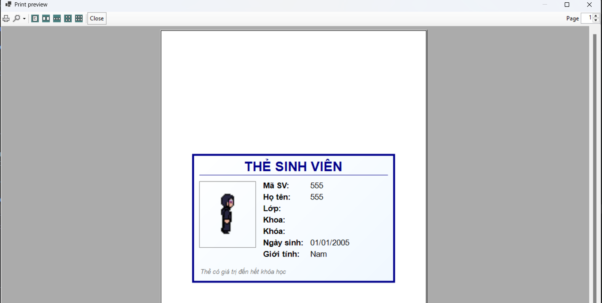
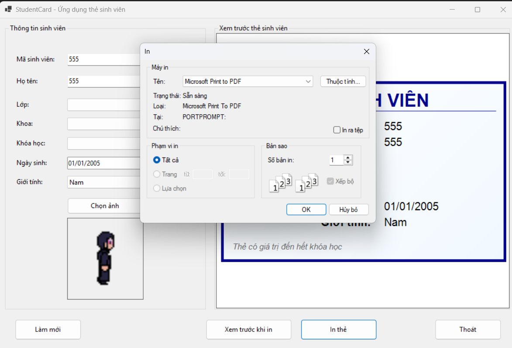

# Lab09 - Thiết kế và in thẻ sinh viên bằng WinForms

**Học phần:** 2611COMP101904 - Lập trình trên Windows  
**Sinh viên thực hiện:** Lê Trần Anh Khoa | **MSSV:** 51.01.104.044 | **Lớp:** 51.01.CNTT.C

---

## 📑 Mục lục

1. [Giới thiệu](#1-giới-thiệu)
2. [Cấu trúc project](#2-cấu-trúc-project)
3. [Giao diện & Control](#3-giao-diện--control)
4. [Luồng hoạt động tổng quát](#4-luồng-hoạt-động-tổng-quát)
5. [Chi tiết từng chức năng](#5-chi-tiết-từng-chức-năng)
6. [Xử lý ảnh](#6-xử-lý-ảnh)
7. [Xử lý in ấn](#7-xử-lý-in-ấn)
8. [Kiến trúc & kỹ thuật chính](#8-kiến-trúc--kỹ-thuật-chính)
9. [Xử lý lỗi & Validation](#9-xử-lý-lỗi--validation)
10. [Ghi chú & mở rộng](#11-ghi-chú--mở-rộng)

---

## 1. Giới thiệu

**StudentCardApp** là ứng dụng WinForms cho phép nhập thông tin sinh viên, chọn ảnh đại diện, xem trước thẻ sinh viên bằng GDI+ và in thẻ ra máy in. Ứng dụng không yêu cầu kết nối cơ sở dữ liệu — dữ liệu được nhập trực tiếp trên Form.

Các kỹ thuật chính được minh họa:

- Sử dụng **PictureBox + OpenFileDialog** để chọn và hiển thị ảnh đại diện.
- Vẽ **preview thẻ sinh viên bằng GDI+** trên `Panel` (không dùng control có sẵn).
- Sử dụng **PrintDocument + PrintPreviewDialog + PrintDialog** để xem trước và in thẻ.
- Kiểm tra dữ liệu đầu vào (validation) trước khi preview / in.
- Tổ chức code WinForms rõ ràng, dễ đọc.

| Thông tin | Nội dung |
|---|---|
| Tên ứng dụng | COMP1019_Lab09_StudentCard |
| Phiên bản | 1.0 |
| Nền tảng | .NET 8 (Windows Forms) / .NET Framework 4.7.2+ |
| Lưu trữ | Bộ nhớ (mất khi đóng app) |
| Ngôn ngữ | C# |

---

## 2. Cấu trúc project

```
COMP1019_Lab09_StudentCard
│
├── From1.cs           # Logic chính: chọn ảnh, paint preview, in ấn, validation
├── From1.Designer.cs  # Khai báo control giao diện
├── Program.cs                  # Entry point
├── COMP1019_Lab09_StudentCard.csproj
├── README.md                   # File mô tả này
```

---

## 3. Giao diện & Control

### Vùng nhập liệu (bên trái)

| Control | Tên | Mô tả |
|---|---|---|
| TextBox | `txtMaSV` | Mã sinh viên — **bắt buộc** |
| TextBox | `txtHoTen` | Họ tên sinh viên — **bắt buộc** |
| ComboBox | `cboLop` | Lớp (CNTT1, CNTT2, KTPM1, HTTT1) |
| ComboBox | `cboKhoa` | Khoa (CNTT, Kinh tế, Cơ khí, Điện – Điện tử) |
| ComboBox | `cboKhoaHoc` | Khóa học (K49, K50, K51, K52) |
| DateTimePicker | `dtpNgaySinh` | Ngày sinh |
| ComboBox | `cboGioiTinh` | Giới tính (Nam / Nữ / Khác) |
| PictureBox | `picAnh` | Hiển thị ảnh đại diện — `SizeMode = Zoom` |
| Button | `btnChonAnh` | Mở OpenFileDialog chọn ảnh |

### Vùng xem trước (bên phải)

| Control | Tên | Mô tả |
|---|---|---|
| GroupBox | `grpPreview` | Khung bao quanh khu vực preview |

### Thanh nút chức năng

| Control | Tên | Mô tả |
|---|---|---|
| Button | `btnLamMoi` | Xóa dữ liệu, xóa ảnh, về trạng thái ban đầu |
| Button | `btnXemTruocIn` | Mở `PrintPreviewDialog` |
| Button | `btnIn` | Mở `PrintDialog` → in qua `PrintDocument` |
| Button | `btnThoat` | Đóng ứng dụng |
| PrintDocument | `printDocument1` | Định nghĩa nội dung in |

---

## 4. Luồng hoạt động tổng quát

```
┌──────────────┐   Nhập liệu / chọn ảnh   ┌────────────────────┐
│  Người dùng  │ ───────────────────────► │  txtMaSV, txtHoTen │
│              │                          │  cbo*, dtp*, picAnh│
│              │                          └─────────┬──────────┘
│              │                                    │
│              │  TextChanged / SelectedIndexChanged│
│              │  ValueChanged                      │
│              │                                    ▼
│              │                          ┌────────────────────┐
│              │                          │  pnlPreview.       │
│              │                          │  Invalidate()      │
│              │                          └─────────┬──────────┘
│              │                                    │
│              │                          ┌─────────▼──────────┐
│              │                          │  pnlPreview_Paint  │
│              │                          │  - Kiểm tra dữ liệu│
│              │                          │  - DrawStudentCard │
│              │                          └─────────┬──────────┘
│              │                                    │
│              │  Click Xem trước / In              │
│              │ ──────────────────────────────────►│
│              │                                    ▼
│              │                          ┌────────────────────┐
│              │                          │  ValidateInput()   │
│              │                          │  - Mã SV rỗng?     │
│              │                          │  - Họ tên rỗng?    │
│              │                          │  - Chưa chọn ảnh?  │
│              │                          └─────────┬──────────┘
│              │                                    │ OK
│              │                          ┌─────────▼──────────┐
│              │                          │  PrintPreviewDialog│
│              │                          │  hoặc PrintDialog  │
│              │                          └─────────┬──────────┘
│              │                                    │
│              │                          ┌─────────▼──────────┐
│              │                          │  printDocument1_   │
│              │                          │  PrintPage         │
│              │                          │  (DrawStudentCard) │
│              │                          └────────────────────┘
└──────────────┘
```

1. **Nhập liệu / chọn ảnh** → mọi thay đổi đều gọi `pnlPreview.Invalidate()`.
2. **`pnlPreview_Paint`** → kiểm tra dữ liệu bắt buộc; nếu thiếu → hiện dòng gợi ý; nếu đủ → gọi `DrawStudentCard`.
3. **Click Xem trước / In** → `ValidateInput()` → nếu OK mở `PrintPreviewDialog` / `PrintDialog`.
4. **`printDocument1_PrintPage`** → tái sử dụng `DrawStudentCard` để vẽ thẻ lên trang in.

---

## 5. Chi tiết từng chức năng

### 5.1. Chọn ảnh đại diện

**Mục đích:** Cho phép người dùng chọn ảnh JPG / JPEG / PNG / BMP từ máy.

**Thao tác:**

1. Nhấn nút **Chọn ảnh**.
2. Chọn file ảnh trong `OpenFileDialog` (filter sẵn).
3. Ảnh hiển thị trong `picAnh` theo chế độ Zoom.

**Cơ chế kỹ thuật:**

```csharp
using (FileStream fs = new FileStream(ofd.FileName, FileMode.Open, FileAccess.Read))
using (Image img = Image.FromStream(fs))
{
    _avatar?.Dispose();
    _avatar = new Bitmap(img);   // clone để không giữ file handle
}
picAnh.Image = _avatar;
picAnh.SizeMode = PictureBoxSizeMode.Zoom;
```

→ Dùng `FileStream` + `new Bitmap(img)` để **không khóa file ảnh gốc**, cho phép đổi ảnh khác không lỗi.



---


### 5.2. Validation

**Mục đích:** Không cho preview / in khi thiếu dữ liệu bắt buộc.

**Quy tắc:**

| Trường | Bắt buộc |
|---|---|
| Mã sinh viên | ✅ |
| Họ tên | ✅ |
| Ảnh đại diện | ✅ |
| Lớp, Khoa, Khóa, Ngày sinh, Giới tính | Không (đã có giá trị mặc định) |

**Cơ chế kỹ thuật:**

```csharp
private bool ValidateInput(bool showMessage)
{
    if (string.IsNullOrWhiteSpace(txtMaSV.Text)) { ... return false; }
    if (string.IsNullOrWhiteSpace(txtHoTen.Text)) { ... return false; }
    if (_avatar == null) { ... return false; }
    return true;
}
```

- Preview: nếu **thiếu** → hiện chữ gợi ý, **không vẽ thẻ**.
- In / Xem trước in: nếu **thiếu** → `MessageBox` cảnh báo + focus vào control thiếu.

---

### 5.3. Xem trước khi in 

```csharp
using (PrintPreviewDialog dlg = new PrintPreviewDialog())
{
    dlg.Document = printDocument1;
    dlg.Width = 1000;
    dlg.Height = 800;
    dlg.ShowDialog(this);
}
```



---

### 5.4. In 

```csharp
using (PrintDialog pd = new PrintDialog())
{
    pd.Document = printDocument1;
    if (pd.ShowDialog(this) == DialogResult.OK)
        printDocument1.Print();
}
```



---

### 5.5. Làm mới 

- Xóa `txtMaSV`, `txtHoTen`.
- Reset `cbo*` về `SelectedIndex = -1` (riêng `cboGioiTinh = 0`).
- `dtpNgaySinh` về `01/01/2005`.
- `Dispose` `_avatar`, `picAnh.Image = null`.
- `pnlPreview.Invalidate()` để vẽ lại trạng thái rỗng.

---

## 6. Xử lý ảnh

| Yêu cầu | Cách xử lý |
|---|---|
| Filter JPG / JPEG / PNG / BMP | `OpenFileDialog.Filter = "Ảnh (*.jpg;*.jpeg;*.png;*.bmp)|..."` |
| Ảnh không méo trong PictureBox | `SizeMode = PictureBoxSizeMode.Zoom` |
| Ảnh không méo trong preview | Hàm `DrawImageFit()` tính tỉ lệ `Math.Min(...)` |
| Không khóa file ảnh | Mở qua `FileStream` + clone `new Bitmap(img)` |
| Giải phóng ảnh cũ | `_avatar?.Dispose()` trước khi gán ảnh mới |
| Giải phóng khi đóng Form | Override `OnFormClosed` → `_avatar?.Dispose()` |

**Hàm `DrawImageFit`:**

```csharp
float ratio = Math.Min(dest.Width / img.Width, dest.Height / img.Height);
float w = img.Width * ratio;
float h = img.Height * ratio;
float x = dest.X + (dest.Width - w) / 2;
float y = dest.Y + (dest.Height - h) / 2;
g.DrawImage(img, x, y, w, h);
```

→ Ảnh luôn nằm gọn trong khung, giữ đúng tỉ lệ, canh giữa.

---

## 7. Xử lý in ấn

| Thành phần | Vai trò |
|---|---|
| `PrintDocument` | Định nghĩa nội dung in qua event `PrintPage` |
| `PrintPreviewDialog` | Xem trước bản in trên màn hình |
| `PrintDialog` | Chọn máy in, số bản, khổ giấy |

**Event `printDocument1_PrintPage`:**

```csharp
private void printDocument1_PrintPage(object sender, PrintPageEventArgs e)
{
    e.Graphics.SmoothingMode = SmoothingMode.AntiAlias;
    RectangleF margin = e.MarginBounds;
    RectangleF card = FitAspect(margin, 85.6f / 54f);
    DrawStudentCard(e.Graphics, card);
    e.HasMorePages = false;
}
```

**Điểm quan trọng:** Preview và in **dùng chung hàm `DrawStudentCard`** → bản in khớp với preview, ảnh không bị méo.

**Bố cục thẻ in:**

- Khung ngoài màu xanh đậm.
- Tiêu đề **"THẺ SINH VIÊN"** in đậm, canh giữa.
- Ảnh sinh viên bên trái (canh tỉ lệ).
- Thông tin sinh viên bên phải (Mã SV, Họ tên, Lớp, Khoa, Khóa, Ngày sinh, Giới tính).
- Dòng chú thích cuối: *"Thẻ có giá trị đến hết khóa học"*.

---

## 8. Kiến trúc & kỹ thuật chính

| Kỹ thuật | Nơi áp dụng | Mô tả |
|---|---|---|
| **Graphics / Pen / Brush** | `DrawStudentCard` | Vẽ toàn bộ thẻ bằng GDI+ |
| **Paint event** | `pnlPreview_Paint` | Vẽ lại preview khi có thay đổi |
| **MeasureString** | `DrawStudentCard` | Canh cột label – value không bị dè |
| **FitAspect** | Preview + Print | Giữ đúng tỉ lệ thẻ ngang 85.6 × 54 |
| **DrawImageFit** | Preview + Print | Vẽ ảnh không méo |
| **OpenFileDialog** | `btnChonAnh_Click` | Chọn ảnh với filter |
| **FileStream + Clone** | `btnChonAnh_Click` | Không khóa file ảnh |
| **PrintDocument** | `printDocument1_PrintPage` | Vẽ thẻ lên trang in |
| **PrintPreviewDialog** | `btnXemTruocIn_Click` | Xem trước khi in |
| **PrintDialog** | `btnIn_Click` | Chọn máy in |
| **Validation** | `ValidateInput` | Kiểm tra dữ liệu bắt buộc |
| **Dispose / using** | `_avatar`, `Image`, `Font`, `Brush` | Quản lý tài nguyên GDI+ |

### 8.1. Hàm `FitAspect` — giữ tỉ lệ thẻ

```csharp
private RectangleF FitAspect(RectangleF container, float aspect)
{
    float w = container.Width;
    float h = w / aspect;

    if (h > container.Height)
    {
        h = container.Height;
        w = h * aspect;
    }

    float x = container.X + (container.Width - w) / 2;
    float y = container.Y + (container.Height - h) / 2;

    return new RectangleF(x, y, w, h);
}
```

→ Thẻ luôn nằm giữa khung, đúng tỉ lệ **85.6 : 54** (thẻ sinh viên ngang chuẩn).

### 8.2. Canh cột label – value bằng `MeasureString`

```csharp
float labelColWidth = 0f;
foreach (string[] item in lines)
{
    float w = g.MeasureString(item[0], labelFont).Width;
    if (w > labelColWidth) labelColWidth = w;
}
float valueX = infoX + labelColWidth + r.Height * 0.02f;
```

→ Cột giá trị nằm sau label dài nhất → không bao giờ bị dính chữ (lỗi thường gặp khi dùng tỉ lệ cố định).

---

## 9. Xử lý lỗi & Validation

| Trường hợp | Hành vi | Icon |
|---|---|---|
| Mã SV rỗng khi Xem trước / In | "Vui lòng nhập mã sinh viên." | Warning |
| Họ tên rỗng khi Xem trước / In | "Vui lòng nhập họ tên." | Warning |
| Chưa chọn ảnh khi Xem trước / In | "Vui lòng chọn ảnh đại diện." | Warning |
| Thiếu dữ liệu khi đang preview | Hiện chữ gợi ý giữa panel, không vẽ thẻ | — |
| Mở ảnh lỗi (file hỏng) | "Không thể mở ảnh: ..." | Error |
| Đổi ảnh liên tục | Dispose ảnh cũ trước khi gán ảnh mới | — |
| Đóng Form | Dispose `_avatar` trong `OnFormClosed` | — |

---

## 10. Ghi chú & mở rộng

- **Không lưu DB:** đóng app là mất dữ liệu (đúng yêu cầu Lab09). Có thể mở rộng lưu `List<SinhVien>` tạm thời.

- **Có thể mở rộng thêm:**
  - Cho phép **chọn màu nền thẻ** (ColorDialog).
  - **Lưu preview thẻ thành PNG** (`DrawToBitmap` trên panel).
  - Thêm **mã QR giả lập** bằng cách vẽ ma trận ô vuông đơn giản.
  - **In nhiều thẻ / trang** (chia trang bằng `HasMorePages`).
  - **Lưu danh sách sinh viên** tạm thời bằng `List<T>` (thêm/xóa/sửa).
  - **Phóng to / thu nhỏ preview** bằng `Matrix`.

- **Tối ưu:** tách hàm `DrawStudentCard` thành `static` + `public` để tái sử dụng cho nhiều form khác (ví dụ form danh sách sinh viên).

---

