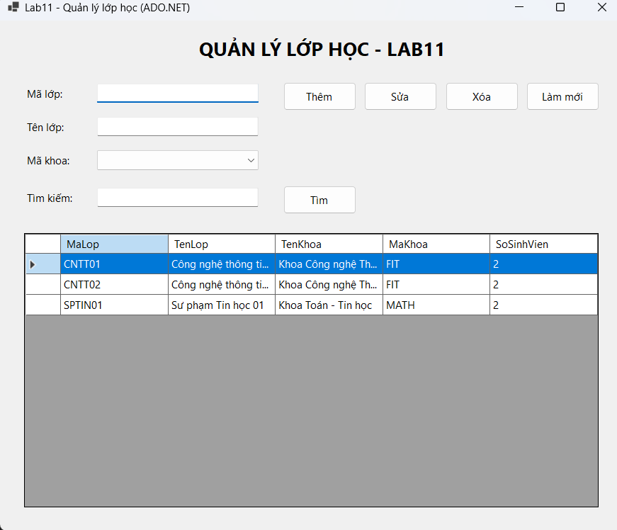
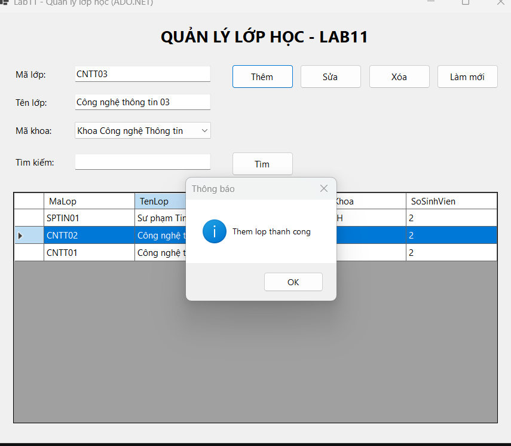
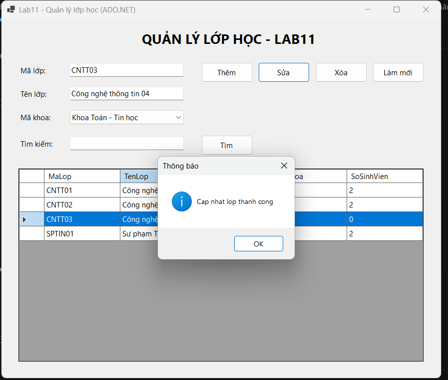
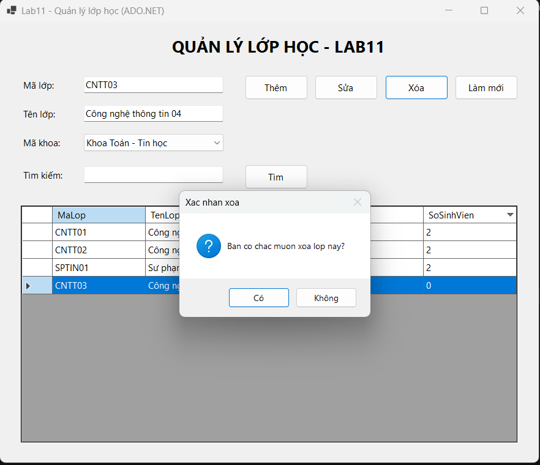
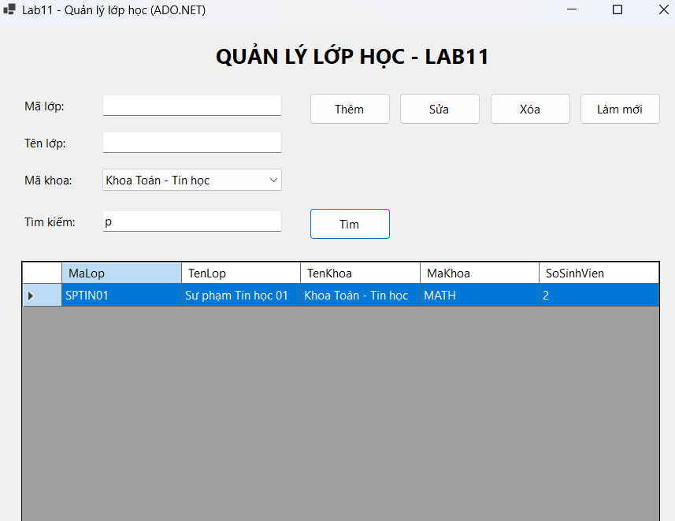

# Lab11 - ADO.NET và CRUD với SQL Server (Quản lý lớp học)

**Học phần:** 2611COMP101904 - Lập trình trên Windows  
**Sinh viên thực hiện:** Lê Trần Anh Khoa | **MSSV:** 51.01.104.044 | **Lớp:** 51.01.CNTT.C

---

## 📑 Mục lục

1. [Giới thiệu](#1-giới-thiệu)
2. [Cấu trúc project](#2-cấu-trúc-project)
3. [Giao diện & Control](#3-giao-diện--control)
4. [Luồng hoạt động tổng quát](#4-luồng-hoạt-động-tổng-quát)
5. [Chi tiết từng chức năng](#5-chi-tiết-từng-chức-năng)
6. [Script SQL](#6-script-sql)
7. [Kết nối Database](#7-kết-nối-database)
8. [Kiến trúc & kỹ thuật chính](#8-kiến-trúc--kỹ-thuật-chính)
9. [Xử lý lỗi & Validation](#9-xử-lý-lỗi--validation)
10. [Các lỗi thường gặp](#10-các-lỗi-thường-gặp)
11. [Ghi chú & mở rộng](#12-ghi-chú--mở-rộng)

---

## 1. Giới thiệu

**COMP1019_Buoi11_Lab11** là ứng dụng WinForms minh họa **ADO.NET** và thao tác **CRUD** (Create - Read - Update - Delete) với SQL Server. Ứng dụng cho phép quản lý danh sách lớp học: thêm, sửa, xóa, tìm kiếm và hiển thị số sinh viên trong từng lớp.

Các kỹ thuật chính được minh họa:

- Kết nối SQL Server bằng **Microsoft.Data.SqlClient**.
- Sử dụng **SqlConnection, SqlCommand, SqlDataAdapter, DataTable**.
- Dùng **Parameterized Query** (`@ma`, `@ten`) để chống SQL Injection.
- Dùng **ExecuteNonQuery** cho INSERT/UPDATE/DELETE và **ExecuteScalar** cho COUNT.
- Ràng buộc **khóa ngoại** giữa `LOP` và `SINHVIEN` — không cho xóa lớp đang có sinh viên.
- Validation dữ liệu đầu vào trước khi gửi xuống database.
- Load dữ liệu vào **DataGridView** và bắt sự kiện **CellClick**.

| Thông tin | Nội dung |
|---|---|
| Tên ứng dụng | COMP1019_Buoi11_Lab11 |
| Phiên bản | 1.0 |
| Nền tảng | .NET 8 (Windows Forms) / .NET Framework 4.7.2+ |
| Database | SQL Server (EduManagerDB) |
| Package | Microsoft.Data.SqlClient |
| Ngôn ngữ | C# |

---

## 2. Cấu trúc project

```
COMP1019_Buoi11_Lab11
│
├── Program.cs                  # Entry point
├── From1.cs                   # Logic chính: CRUD, validation, kết nối SQL
├── From1.Designer.cs          # Khai báo control giao diện
├── EduManagerDB.sql            # Script tạo database + bảng + dữ liệu mẫu
├── COMP1019_Buoi11_Lab11.csproj
├── README.md                   # File mô tả này
```
---

## 3. Giao diện & Control

### Vùng nhập liệu

| Control | Tên | Mô tả |
|---|---|---|
| TextBox | `txtMaLop` | Mã lớp — **bắt buộc**, là khóa chính |
| TextBox | `txtTenLop` | Tên lớp — **bắt buộc** |
| TextBox | `txtTimKiem` | Từ khóa tìm kiếm (theo mã hoặc tên lớp) |

### Thanh nút chức năng

| Control | Tên | Mô tả |
|---|---|---|
| Button | `btnThem` | Thêm lớp mới (INSERT) |
| Button | `btnSua` | Cập nhật tên lớp theo mã (UPDATE) |
| Button | `btnXoa` | Xóa lớp (DELETE) — kiểm tra còn sinh viên không |
| Button | `btnTimKiem` | Tìm kiếm theo Mã lớp / Tên lớp (LIKE) |
| Button | `btnLamMoi` | Xóa input, load lại danh sách |

### Vùng hiển thị

| Control | Tên | Mô tả |
|---|---|---|
| DataGridView | `dgvLop` | Hiển thị danh sách lớp + số sinh viên |

---

## 4. Luồng hoạt động tổng quát

```
┌────────────────┐    Nhập liệu     ┌────────────────────┐
│   Người dùng   │ ───────────────► │  txtMaLop          │
│                │                  │  txtTenLop         │
│                │                  │  txtTimKiem        │
│                │                  └─────────┬──────────┘
│                │                            │
│                │  Click Thêm / Sửa / Xóa     │
│                │ ───────────────────────────►│
│                │                            ▼
│                │                  ┌────────────────────┐
│                │                  │  ValidateInput()   │
│                │                  │  - Mã rỗng?        │
│                │                  │  - Tên rỗng?       │
│                │                  └─────────┬──────────┘
│                │                            │ OK
│                │                            ▼
│                │                  ┌────────────────────┐
│                │                  │  SqlConnection     │
│                │                  │  SqlCommand        │
│                │                  │  + Parameters      │
│                │                  │  ExecuteNonQuery   │
│                │                  └─────────┬──────────┘
│                │                            │
│                │                            ▼
│                │                  ┌────────────────────┐
│                │                  │  LoadData()        │
│                │                  │  SqlDataAdapter    │
│                │                  │  Fill(DataTable)   │
│                │                  │  dgvLop.DataSource │
│                │                  └────────────────────┘
└────────────────┘
```

1. **Form Load** → `FrmLop_Load` gọi `LoadData()` để hiển thị danh sách lớp.
2. **Click Thêm/Sửa/Xóa** → `ValidateInput()` → thực thi SQL → `LoadData()` cập nhật lại DataGridView.
3. **Click Tìm kiếm** → build câu SQL với `LIKE @kw` → fill DataTable → gán lại DataSource.
4. **Click vào dòng trong DataGridView** → `dgvLop_CellClick` đưa dữ liệu lên TextBox để sửa/xóa.

---

## 5. Chi tiết từng chức năng

### 5.1. Load dữ liệu

**Mục đích:** Hiển thị danh sách lớp kèm số sinh viên mỗi lớp.

**Câu SQL:**

```sql
SELECT l.MaLop, l.TenLop, 
       COUNT(sv.MaSV) AS SoSinhVien
FROM LOP l
LEFT JOIN SINHVIEN sv ON l.MaLop = sv.MaLop
GROUP BY l.MaLop, l.TenLop
ORDER BY l.MaLop
```

**Cơ chế kỹ thuật:**

```csharp
using SqlConnection conn = new SqlConnection(connectionString);
using SqlCommand cmd = new SqlCommand(sql, conn);
using SqlDataAdapter da = new SqlDataAdapter(cmd);

DataTable dt = new DataTable();
da.Fill(dt);
dgvLop.DataSource = dt;
```

→ `LEFT JOIN` đảm bảo lớp chưa có sinh viên vẫn hiện với `SoSinhVien = 0`.



---

### 5.2. Thêm lớp 

**Mục đích:** Thêm một lớp mới vào database.

**Quy trình:**

1. `ValidateInput()` — kiểm tra Mã lớp và Tên lớp không rỗng.
2. `IsMaLopExists(ma)` — kiểm tra mã lớp đã tồn tại chưa (dùng `ExecuteScalar`).
3. Nếu chưa tồn tại → chạy `INSERT INTO LOP(MaLop, TenLop) VALUES(@ma, @ten)`.
4. Nếu thành công → `LoadData()` + `ClearInput()`.

**Cơ chế kỹ thuật:**

```csharp
string sql = "INSERT INTO LOP(MaLop, TenLop) VALUES(@ma, @ten)";
using SqlConnection conn = new SqlConnection(connectionString);
using SqlCommand cmd = new SqlCommand(sql, conn);
cmd.Parameters.AddWithValue("@ma", ma);
cmd.Parameters.AddWithValue("@ten", ten);

conn.Open();
int rows = cmd.ExecuteNonQuery();
if (rows > 0) { MessageBox.Show("Them lop thanh cong"); LoadData(); ClearInput(); }
```



---

### 5.3. Sửa lớp 

**Mục đích:** Cập nhật tên lớp theo mã lớp (không sửa `MaLop` vì đây là khóa chính).

**Câu SQL:**

```sql
UPDATE LOP SET TenLop = @ten WHERE MaLop = @ma
```

**Xử lý:**

- Nếu `rows > 0` → cập nhật thành công → `LoadData()`.
- Nếu `rows == 0` → thông báo "Không tìm thấy lớp cần sửa".



---

### 5.4. Xóa lớp (F4)

**Mục đích:** Xóa lớp — **chỉ xóa được khi lớp không còn sinh viên**.

**Quy trình:**

1. Kiểm tra Mã lớp rỗng.
2. `CountSinhVienByLop(ma)` — đếm số sinh viên thuộc lớp đó.
3. Nếu `soSinhVien > 0` → thông báo "Không thể xóa lớp đang có sinh viên".
4. Nếu `= 0` → hỏi xác nhận (`MessageBoxButtons.YesNo`) → chạy `DELETE FROM LOP WHERE MaLop = @ma`.

**Cơ chế kỹ thuật:**

```csharp
int soSinhVien = CountSinhVienByLop(ma);
if (soSinhVien > 0) { MessageBox.Show("Khong the xoa lop dang co sinh vien"); return; }

DialogResult result = MessageBox.Show("Ban co chac muon xoa lop nay?", "Xac nhan xoa",
    MessageBoxButtons.YesNo, MessageBoxIcon.Question);
if (result == DialogResult.No) return;

string sql = "DELETE FROM LOP WHERE MaLop = @ma";
// ... ExecuteNonQuery
```



---

### 5.5. Tìm kiếm (F5)

**Mục đích:** Tìm lớp theo Mã lớp hoặc Tên lớp (dùng `LIKE`).

**Câu SQL:**

```sql
SELECT l.MaLop, l.TenLop, COUNT(sv.MaSV) AS SoSinhVien
FROM LOP l
LEFT JOIN SINHVIEN sv ON l.MaLop = sv.MaLop
WHERE l.MaLop LIKE @kw OR l.TenLop LIKE @kw
GROUP BY l.MaLop, l.TenLop
ORDER BY l.MaLop
```

**Cơ chế:**

```csharp
cmd.Parameters.AddWithValue("@kw", "%" + keyword + "%");
```

→ Từ khóa được bao bằng `%...%` để tìm gần đúng.



---

### 5.6. Làm mới

- Xóa `txtMaLop`, `txtTenLop`, `txtTimKiem`.
- Focus về `txtMaLop`.
- Gọi `LoadData()` để hiển thị lại toàn bộ danh sách.

---

### 5.7. Click dòng trong DataGridView (F7)

```csharp
private void dgvLop_CellClick(object sender, DataGridViewCellEventArgs e)
{
    if (e.RowIndex < 0) return;

    DataGridViewRow row = dgvLop.Rows[e.RowIndex];
    txtMaLop.Text = row.Cells["MaLop"].Value.ToString();
    txtTenLop.Text = row.Cells["TenLop"].Value.ToString();
}
```

→ Đưa dữ liệu dòng được chọn lên TextBox để sửa hoặc xóa.

---

## 6. Script SQL

**File `EduManagerDB.sql`:**

```sql
IF DB_ID('EduManagerDB') IS NULL 
    CREATE DATABASE EduManagerDB;
GO

USE EduManagerDB;
GO

IF OBJECT_ID('SINHVIEN', 'U') IS NOT NULL DROP TABLE SINHVIEN;
IF OBJECT_ID('LOP', 'U') IS NOT NULL DROP TABLE LOP;
GO

CREATE TABLE LOP (
    MaLop VARCHAR(20) PRIMARY KEY,
    TenLop NVARCHAR(100) NOT NULL
);

CREATE TABLE SINHVIEN (
    MaSV VARCHAR(20) PRIMARY KEY,
    HoTen NVARCHAR(100) NOT NULL,
    MaLop VARCHAR(20) NOT NULL,
    CONSTRAINT FK_SINHVIEN_LOP FOREIGN KEY (MaLop) REFERENCES LOP(MaLop)
);

INSERT INTO LOP(MaLop, TenLop) VALUES 
('CNTT01', N'Công nghệ thông tin 01'), 
('CNTT02', N'Công nghệ thông tin 02'), 
('SPTIN01', N'Sư phạm Tin học 01');

INSERT INTO SINHVIEN(MaSV, HoTen, MaLop) VALUES 
('SV001', N'Nguyễn Văn An', 'CNTT01'), 
('SV002', N'Trần Thị Bình', 'CNTT01');
```

**Giải thích:**

- Bảng `SINHVIEN` tham chiếu `LOP` qua `MaLop`.
- Nếu một lớp đang có sinh viên → SQL Server **không cho xóa lớp đó** (ràng buộc FK).
- Dùng `NVARCHAR` cho các cột chứa tiếng Việt để tránh lỗi font.

---

## 7. Kết nối Database

### 7.1. Cài package

```bash
dotnet add package Microsoft.Data.SqlClient
```

Hoặc dùng **NuGet Package Manager** trong Visual Studio: chuột phải project → **Manage NuGet Packages** → tìm `Microsoft.Data.SqlClient` → Install.

### 7.2. Chuỗi kết nối

```csharp
private readonly string connectionString = 
    @"Data Source=.;Initial Catalog=EduManagerDB;Integrated Security=True;TrustServerCertificate=True";
```

| Thành phần | Ý nghĩa |
|---|---|
| `Data Source=.` | SQL Server mặc định trên máy local |
| `Data Source=.\SQLEXPRESS` | SQL Server Express |
| `Initial Catalog=EduManagerDB` | Tên database |
| `Integrated Security=True` | Đăng nhập bằng Windows Authentication |
| `TrustServerCertificate=True` | Bỏ qua kiểm tra chứng chỉ SSL |

> **Lưu ý:** Nếu máy bạn dùng SQLEXPRESS thì phải đổi thành `Data Source=.\SQLEXPRESS`.

---

## 8. Kiến trúc & kỹ thuật chính

| Kỹ thuật | Nơi áp dụng | Mô tả |
|---|---|---|
| **SqlConnection** | Tất cả các method | Mở kết nối tới SQL Server |
| **SqlCommand** | Thêm/Sửa/Xóa/Tìm | Thực thi câu lệnh SQL |
| **SqlDataAdapter** | `LoadData`, `btnTimKiem` | Đổ dữ liệu vào DataTable |
| **DataTable** | `LoadData`, `btnTimKiem` | Chứa dữ liệu tạm trong bộ nhớ |
| **ExecuteNonQuery** | INSERT/UPDATE/DELETE | Trả về số dòng bị ảnh hưởng |
| **ExecuteScalar** | `IsMaLopExists`, `CountSinhVienByLop` | Trả về 1 giá trị duy nhất |
| **Parameters.AddWithValue** | Tất cả các câu SQL | Truyền tham số an toàn |
| **using statement** | Tất cả các method | Tự động Dispose connection/command |
| **LEFT JOIN** | `LoadData` | Hiển thị cả lớp chưa có sinh viên |
| **CellClick event** | `dgvLop_CellClick` | Bắt sự kiện click dòng |

### 8.1. Vì sao dùng Parameterized Query?

```csharp
// ❌ Cách sai — dễ bị SQL Injection
string sql = "SELECT * FROM LOP WHERE MaLop = '" + ma + "'";

// ✅ Cách đúng — dùng parameter
string sql = "SELECT * FROM LOP WHERE MaLop = @ma";
cmd.Parameters.AddWithValue("@ma", ma);
```

→ Parameter giúp **chống SQL Injection** và tránh lỗi khi dữ liệu có ký tự đặc biệt.

### 8.2. Vì sao dùng `using` statement?

```csharp
using SqlConnection conn = new SqlConnection(connectionString);
using SqlCommand cmd = new SqlCommand(sql, conn);
```

→ `using` đảm bảo **connection và command được Dispose** ngay cả khi có exception, tránh rò rỉ tài nguyên.

### 8.3. Vì sao dùng `LEFT JOIN` khi load danh sách lớp?

```sql
FROM LOP l
LEFT JOIN SINHVIEN sv ON l.MaLop = sv.MaLop
```

→ `LEFT JOIN` giữ lại **tất cả các lớp**, kể cả lớp chưa có sinh viên (`SoSinhVien = 0`). Nếu dùng `INNER JOIN`, lớp rỗng sẽ bị mất khỏi kết quả.

---

## 9. Xử lý lỗi & Validation

### 9.1. Validation trước khi gửi xuống database

```csharp
private bool ValidateInput()
{
    if (string.IsNullOrWhiteSpace(txtMaLop.Text))
    {
        MessageBox.Show("Vui long nhap ma lop");
        txtMaLop.Focus();
        return false;
    }

    if (string.IsNullOrWhiteSpace(txtTenLop.Text))
    {
        MessageBox.Show("Vui long nhap ten lop");
        txtTenLop.Focus();
        return false;
    }

    return true;
}
```

### 9.2. Kiểm tra mã lớp đã tồn tại

```csharp
private bool IsMaLopExists(string maLop)
{
    string sql = "SELECT COUNT(*) FROM LOP WHERE MaLop = @ma";
    using SqlConnection conn = new SqlConnection(connectionString);
    using SqlCommand cmd = new SqlCommand(sql, conn);
    cmd.Parameters.AddWithValue("@ma", maLop);

    conn.Open();
    int count = Convert.ToInt32(cmd.ExecuteScalar());
    return count > 0;
}
```

### 9.3. Bảng xử lý lỗi

| Trường hợp | Hành vi | Icon |
|---|---|---|
| Mã lớp rỗng | "Vui lòng nhập mã lớp" | Warning |
| Tên lớp rỗng | "Vui lòng nhập tên lớp" | Warning |
| Mã lớp đã tồn tại khi Thêm | "Mã lớp đã tồn tại" | Warning |
| Sửa lớp không tồn tại | "Không tìm thấy lớp cần sửa" | Warning |
| Xóa lớp đang có sinh viên | "Không thể xóa lớp đang có sinh viên" | Warning |
| Chưa chọn lớp để xóa | "Vui lòng chọn lớp cần xóa" | Warning |
| Lỗi kết nối database | "Lỗi load dữ liệu: ..." | Error |
| Lỗi khi thêm/sửa/xóa | "Lỗi thêm/sửa/xóa lớp: ..." | Error |

---

## 10. Các lỗi thường gặp

| Lỗi | Cách xử lý |
|---|---|
| Không kết nối được database | Kiểm tra `Data Source`, tên database, SQL Server service và quyền đăng nhập |
| Không nhận `SqlConnection` | Cài `Microsoft.Data.SqlClient` và thêm `using Microsoft.Data.SqlClient;` |
| DataGridView không hiện dữ liệu | Kiểm tra câu SELECT, bảng có dữ liệu và đã gán `dgvLop.DataSource` |
| Không lấy được dữ liệu khi click dòng | Kiểm tra tên cột `MaLop`, `TenLop` có đúng với DataTable không |
| Xóa lớp bị lỗi | Lớp đang có sinh viên → cần xóa sinh viên trước hoặc chặn xóa như trong lời giải |
| Thêm dữ liệu tiếng Việt bị lỗi font | Bảng phải dùng `NVARCHAR` cho dữ liệu tiếng Việt |


---

## 11. Ghi chú & mở rộng

- **Chỉnh connection string:** Nếu máy dùng SQLEXPRESS, đổi `Data Source=.` thành `Data Source=.\SQLEXPRESS`.
- **Không ghép chuỗi SQL:** Luôn dùng `Parameters.AddWithValue` để tránh SQL Injection và lỗi ký tự đặc biệt.
- **Dùng `using`:** Luôn dùng `using` cho `SqlConnection`, `SqlCommand`, `SqlDataAdapter` để tự động Dispose.

- **Có thể mở rộng thêm:**
  - **Tách DAL/BLL:** Chuyển logic database sang lớp `LopDAL` và `LopBLL`.
  - **Đọc connection string từ `App.config`:** Dùng `ConfigurationManager.ConnectionStrings["EduManagerDB"]`.
  - **Thêm bảng `SINHVIEN` vào Form:** Tạo Form quản lý sinh viên tương tự.
  - **Sử dụng `SqlTransaction`:** Đảm bảo tính toàn vẹn khi thực hiện nhiều câu lệnh liên tiếp.
  - **Phân trang DataGridView:** Chỉ load 20 dòng mỗi trang bằng `OFFSET/FETCH`.
  - **Tìm kiếm nâng cao:** Cho phép tìm theo nhiều tiêu chí (mã + tên).
  - **Xuất Excel:** Dùng thư viện `ClosedXML` để xuất danh sách lớp ra file Excel.
  - **Stored Procedure:** Chuyển các câu INSERT/UPDATE/DELETE thành `PROC` để bảo mật hơn.

- **Tối ưu:** Đối với bảng `SINHVIEN` có cột `MaLop` là khóa ngoại, SQL Server đã tự tạo index để tăng tốc JOIN. Không cần thêm index thủ công.

---
