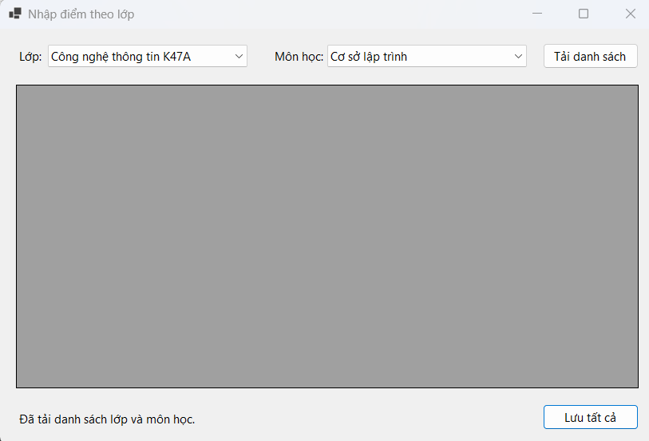
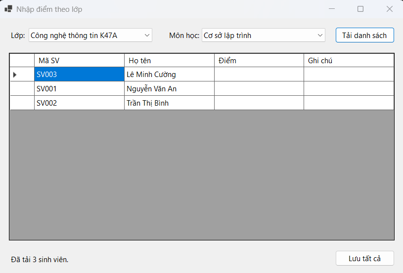
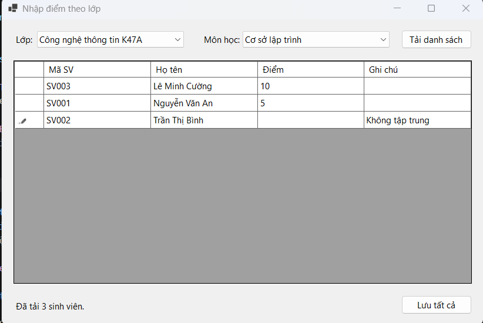
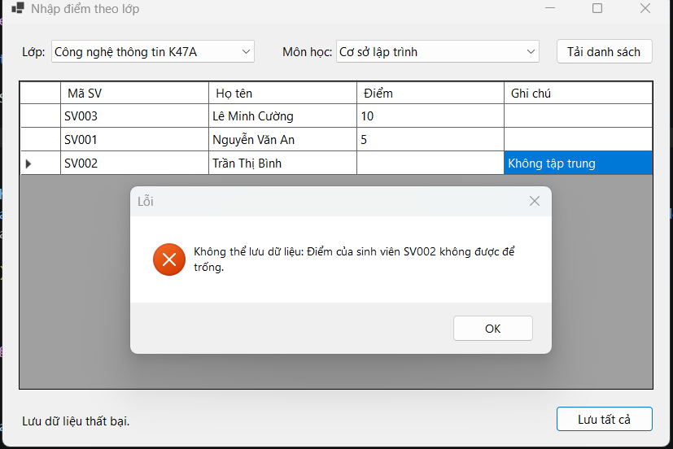
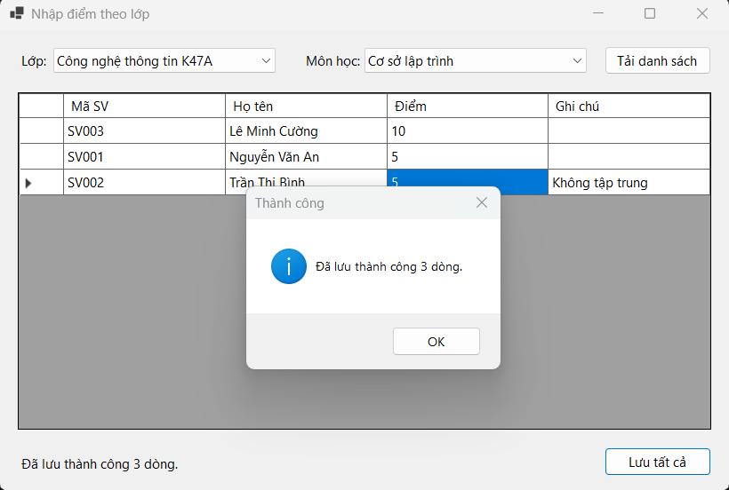

# Lab12 - Data Binding, Stored Procedure và Transaction (Quản lý kết quả học tập)

**Học phần:** 2611COMP101904 - Lập trình trên Windows  
**Sinh viên thực hiện:** Lê Trần Anh Khoa | **MSSV:** 51.01.104.044 | **Lớp:** 51.01.CNTT.C

---

## 📑 Mục lục

1. [Giới thiệu](#1-giới-thiệu)
2. [Cấu trúc project](#2-cấu-trúc-project)
3. [Giao diện & Control](#3-giao-diện--control)
4. [Luồng hoạt động tổng quát](#4-luồng-hoạt-động-tổng-quát)
5. [Chi tiết cách thức hoạt động](#5-chi-tiết-cách-thức-hoạt-động)
6. [Xử lý Cơ sở dữ liệu & Stored Procedure](#6-xử-lý-cơ-sở-dữ-liệu--stored-procedure)
7. [Kiến trúc & Kỹ thuật chính](#7-kiến-trúc--kỹ-thuật-chính)
8. [Xử lý lỗi & Validation](#8-xử-lý-lỗi--validation)
9. [Các lỗi thường gặp](#9-các-lỗi-thường-gặp)
10. [Ghi chú & mở rộng](#10-ghi-chú--mở-rộng)

---

## 1. Giới thiệu

**QLSinhVienLab12** là ứng dụng WinForms hiện thực hóa bài toán Quản lý kết quả học tập. Hệ thống cho phép người dùng chọn Lớp và Môn học, tự động tải danh sách sinh viên tương ứng, cho phép nhập/sửa điểm trực tiếp trên lưới và lưu tất cả xuống cơ sở dữ liệu một cách an toàn.

Bài làm đáp ứng đầy đủ các mục tiêu của đề bài:
- Sử dụng **DataTable, SqlDataAdapter, BindingSource** để hiển thị dữ liệu.
- Binding dữ liệu vào ComboBox và DataGridView.
- Viết **Stored Procedure** để lấy danh sách và lưu kết quả.
- Sử dụng **Transaction** để lưu nhiều dòng an toàn (Rollback nếu có lỗi).
- Kiểm tra dữ liệu điểm (Validation) trước khi lưu.

---

## 2. Cấu trúc project

Dự án được tổ chức theo mô hình phân tầng (Tách biệt giao diện và truy cập dữ liệu):

```
QLSinhVienLab12
│
├── Forms/
│   ├── FrmNhapDiemTheoLop.cs           # Xử lý giao diện, Binding, Validation
│   └── FrmNhapDiemTheoLop.Designer.cs  # Khai báo control
├── DAL/
│   ├── Database.cs                     # Chứa chuỗi kết nối (Connection String)
│   └── KetQuaDAL.cs                    # Truy cập DB, gọi Stored Procedure, Transaction
├── Database/
│   └── QLSinhVienLab12.sql             # Script tạo CSDL, bảng và Stored Procedures
├── Program.cs                          
├── QLSinhVienLab12.csproj
└── README.md                           
```

---

## 3. Giao diện & Control

| Control | Tên | Chức năng theo yêu cầu đề |
|---|---|---|
| ComboBox | `cboLop` | Chọn lớp (Binding từ `sp_Lop_GetAll`) |
| ComboBox | `cboMonHoc` | Chọn môn học (Binding từ `sp_MonHoc_GetAll`) |
| Button | `btnTaiDanhSach` | Tải danh sách sinh viên theo Lớp & Môn |
| DataGridView | `dgvKetQua` | Hiển thị MaSV, HoTen, Diem, GhiChu. Cho phép nhập/sửa cột Điểm & Ghi chú. |
| Button | `btnLuuTatCa` | Lưu toàn bộ điểm (sử dụng Transaction) |
| Label | `lblTrangThai` | Hiển thị trạng thái thao tác (Đang tải, Lưu thành công, Lỗi...) |

---

## 4. Luồng hoạt động tổng quát

1. **Form Load:** Gọi hàm load dữ liệu Lớp/Môn lên ComboBox thông qua Stored Procedure.
2. **Chọn và Tải:** Người dùng chọn Lớp + Môn, bấm "Tải danh sách". Hệ thống lấy dữ liệu đổ vào `BindingSource` để hiển thị lên DataGridView.
3. **Nhập liệu:** Người dùng nhập/sửa cột Điểm hoặc Ghi chú trên DataGridView.
4. **Lưu dữ liệu:** Bấm "Lưu tất cả". Hệ thống kiểm tra tính hợp lệ (0-10). Nếu hợp lệ, mở Transaction, lưu từng dòng. Thành công thì Commit, có lỗi thì Rollback toàn bộ.

---

## 5. Chi tiết cách thức hoạt động

### 5.1. Khi mở Form, load danh sách lớp và môn học vào ComboBox
**Cách hoạt động:** Tại sự kiện `Form_Load`, chương trình gọi DAL để lấy dữ liệu. DAL dùng `SqlDataAdapter` thực thi `sp_Lop_GetAll` và `sp_MonHoc_GetAll`, đổ vào `DataTable`. Form gán `DataTable` vào `DataSource` của ComboBox, thiết lập `DisplayMember` và `ValueMember`.
~~~csharp
private void FrmNhapDiemTheoLop_Load(object sender, EventArgs e)
{
    cboLop.DisplayMember = "TenLop";
    cboLop.ValueMember = "MaLop";
    cboLop.DataSource = ketQuaDAL.GetLop(); // Gọi SP sp_Lop_GetAll

    cboMonHoc.DisplayMember = "TenMon";
    cboMonHoc.ValueMember = "MaMon";
    cboMonHoc.DataSource = ketQuaDAL.GetMonHoc(); // Gọi SP sp_MonHoc_GetAll
}
~~~


### 5.2. Khi chọn lớp và môn học, bấm Tải danh sách thì hiển thị danh sách sinh viên lên DataGridView
**Cách hoạt động:** Tại sự kiện `btnTaiDanhSach_Click`, lấy `MaLop` và `MaMon`. Gọi DAL thực thi `sp_KetQua_GetByLopMon` (dùng `LEFT JOIN` để lấy cả sinh viên chưa có điểm). Kết quả gán vào `BindingSource` để tự động hiển thị lên `DataGridView`.
~~~csharp
private void btnTaiDanhSach_Click(object sender, EventArgs e)
{
    string maLop = cboLop.SelectedValue?.ToString() ?? "";
    string maMon = cboMonHoc.SelectedValue?.ToString() ?? "";
    
    DataTable table = ketQuaDAL.GetKetQuaByLopMon(maLop, maMon);
    ketQuaSource.DataSource = table; // BindingSource tự đẩy lên DGV
}
~~~


### 5.3. Người dùng được nhập hoặc sửa cột Diem và GhiChu
**Cách hoạt động:** Tại sự kiện `DataBindingComplete`, thiết lập `ReadOnly = true` cho các cột `MaSV`, `HoTen` để ngăn sửa. Cột `Diem` và `GhiChu` giữ nguyên cho phép chỉnh sửa. Sự kiện `DataError` chặn lỗi hệ thống nếu nhập chữ vào cột Điểm.
~~~csharp
private void dgvKetQua_DataBindingComplete(object sender, DataGridViewBindingCompleteEventArgs e)
{
    dgvKetQua.Columns["MaSV"].ReadOnly = true;
    dgvKetQua.Columns["HoTen"].ReadOnly = true;
    dgvKetQua.Columns["Diem"].DefaultCellStyle.Format = "0.##";
}
~~~


### 5.4. Kiểm tra điểm không được rỗng, phải là số và nằm trong khoảng 0 đến 10
**Cách hoạt động:** Trước khi lưu, hàm `ValidateData` duyệt qua từng dòng. Kiểm tra ô Điểm có bị `null`/`DBNull` không, dùng `double.TryParse` để đảm bảo là số, và kiểm tra `0 <= diem <= 10`. Nếu vi phạm, ném ra `Exception` và dừng quá trình lưu.
~~~csharp
private void ValidateData(DataTable table)
{
    foreach (DataRow row in table.Rows)
    {
        string maSV = row["MaSV"].ToString();
        object diemObj = row["Diem"];

        if (diemObj == null || diemObj == DBNull.Value || string.IsNullOrWhiteSpace(diemObj.ToString()))
            throw new Exception($"Điểm của sinh viên {maSV} không được để trống.");

        if (!double.TryParse(diemObj.ToString(), out double diem))
            throw new Exception($"Điểm của sinh viên {maSV} không hợp lệ.");

        if (diem < 0 || diem > 10)
            throw new Exception($"Điểm của sinh viên {maSV} phải từ 0 đến 10.");
    }
}
~~~


### 5.5. Khi bấm Lưu tất cả, chương trình lưu nhiều dòng bằng transaction
**Cách hoạt động:** Gọi `ketQuaSource.EndEdit()` để chốt dữ liệu đang gõ dở. Gọi hàm `SaveAll()` ở DAL. Tại đây, mở kết nối và gọi `conn.BeginTransaction()`. Vòng lặp duyệt từng dòng, tạo `SqlCommand` có gắn `trans`, truyền tham số và thực thi `sp_KetQua_Save`.
~~~csharp
public int SaveAll(string maMon, DataTable table)
{
    using var conn = new SqlConnection(Database.ConnectionString);
    conn.Open();
    using var trans = conn.BeginTransaction(); // Bắt đầu Transaction
    int count = 0;
    foreach (DataRow row in table.Rows)
    {
        using var cmd = new SqlCommand("sp_KetQua_Save", conn, trans);
        cmd.CommandType = CommandType.StoredProcedure;
        cmd.Parameters.AddWithValue("@MaSV", row["MaSV"]);
        cmd.Parameters.AddWithValue("@MaMon", maMon);
        cmd.Parameters.AddWithValue("@Diem", Convert.ToDouble(row["Diem"]));
        cmd.Parameters.AddWithValue("@GhiChu", row["GhiChu"].ToString());
        cmd.ExecuteNonQuery();
        count++;
    }
    // (Xem mục 5.6 và 5.7 cho phần Commit/Rollback)
}
~~~

### 5.6. Nếu một dòng lỗi, chương trình rollback toàn bộ và thông báo lỗi
**Cách hoạt động:** Đặt vòng lặp lưu trong khối `try-catch`. Nếu có bất kỳ lỗi nào (vi phạm khóa ngoại, mất kết nối...), khối `catch` gọi `trans.Rollback()` để hủy toàn bộ, đảm bảo không lưu nửa vời. Sau đó ném lỗi (`throw`) để Form hiển thị `MessageBox`.
~~~csharp
try
{
    // ... (Vòng lặp lưu dữ liệu như mục 5.5) ...
    trans.Commit(); 
    return count;
}
catch (Exception ex)
{
    trans.Rollback(); // Hủy toàn bộ nếu có lỗi
    throw new Exception("Lỗi khi lưu dữ liệu: " + ex.Message);
}
~~~

### 5.7. Nếu lưu thành công, chương trình commit và thông báo số dòng đã lưu
**Cách hoạt động:** Nếu vòng lặp hoàn tất không có lỗi, DAL gọi `trans.Commit()` và trả về `count`. Tại Form, nhận kết quả, cập nhật `lblTrangThai` và hiển thị `MessageBox` báo số dòng đã lưu.
~~~csharp
try
{
    int count = ketQuaDAL.SaveAll(maMon, table);
    lblTrangThai.Text = $"Đã lưu thành công {count} dòng.";
    MessageBox.Show($"Đã lưu thành công {count} dòng.", "Thành công");
}
catch (Exception ex)
{
    lblTrangThai.Text = "Lưu dữ liệu thất bại.";
    MessageBox.Show(ex.Message, "Lỗi", MessageBoxButtons.OK, MessageBoxIcon.Error);
}
~~~

---

## 6. Xử lý Cơ sở dữ liệu & Stored Procedure

Cơ sở dữ liệu `QLSinhVienLab12` gồm 4 bảng: `LOP`, `SINHVIEN`, `MONHOC`, `KETQUA`. Bảng `KETQUA` có khóa chính phức hợp `(MaSV, MaMon)` và ràng buộc điểm từ 0-10.

Hệ thống sử dụng 4 Stored Procedure bắt buộc theo đề bài:
- `sp_Lop_GetAll`: Lấy danh sách lớp.
- `sp_MonHoc_GetAll`: Lấy danh sách môn học.
- `sp_KetQua_GetByLopMon`: Lấy danh sách sinh viên theo Lớp/Môn.
- `sp_KetQua_Save`: Xử lý Upsert. Kiểm tra nếu sinh viên đã có điểm môn đó thì `UPDATE`, chưa có thì `INSERT`.

---

## 7. Kiến trúc & Kỹ thuật chính

| Kỹ thuật | Nơi áp dụng | Mô tả |
|---|---|---|
| **DataTable** | DAL, Form | Lưu trữ dữ liệu tạm thời trong RAM. |
| **BindingSource** | Form | Cầu nối quản lý trạng thái dòng và hỗ trợ `EndEdit()`. |
| **SqlTransaction** | `KetQuaDAL.SaveAll` | Đảm bảo tính ACID. Lưu hàng loạt an toàn. |
| **Parameterized Query** | `KetQuaDAL` | Dùng `SqlParameter` để chống SQL Injection. |
| **Phân tầng (DAL)** | `DAL/` | Form không viết SQL, chỉ gọi hàm từ DAL. |

---

## 8. Xử lý lỗi & Validation

| Trường hợp | Hành vi | Icon |
|---|---|---|
| Chưa chọn lớp/môn khi Tải | "Vui lòng chọn lớp và môn học" | Warning |
| Nhập chữ vào cột Điểm | "Giá trị nhập không hợp lệ..." | Warning |
| Để trống điểm | "Điểm của sinh viên X không được để trống" | Warning |
| Nhập điểm âm hoặc > 10 | "Điểm của sinh viên X phải từ 0 đến 10" | Warning |
| Lỗi Database / Transaction | "Không thể lưu dữ liệu: [Chi tiết]" | Error |

---

## 9. Các lỗi thường gặp

| Lỗi | Cách xử lý |
|---|---|
| **Error 40: Could not open a connection** | Bật TCP/IP trong SQL Configuration Manager, kiểm tra chuỗi kết nối (nhớ `.\SQLEXPRESS` nếu dùng bản Express). |
| **Incorrect syntax near 'THROW'** | Lỗi trong script SQL, thêm dấu `;` trước lệnh `THROW`. |
| **ComboBox hiện DataRowView** | Gán `DisplayMember` và `ValueMember` trước khi gán `DataSource`. |
| **Dữ liệu trên Grid không lưu** | Quên gọi `ketQuaSource.EndEdit()` trước khi Validate. |
| **Rollback không hoạt động** | Chưa truyền transaction vào `SqlCommand` (phải là `new SqlCommand(sql, conn, trans)`). |

---

## 10. Ghi chú & mở rộng

- **Lưu ý:** Dữ liệu trên DataGridView chỉ là bản sao trong bộ nhớ. Chỉ khi bấm "Lưu tất cả" thì dữ liệu mới thực sự ghi xuống Database.
- **Mở rộng:** Có thể bổ sung chức năng thống kê điểm trung bình, xuất file Excel, hoặc chuyển chuỗi kết nối vào `App.config` để tăng tính linh hoạt.
```