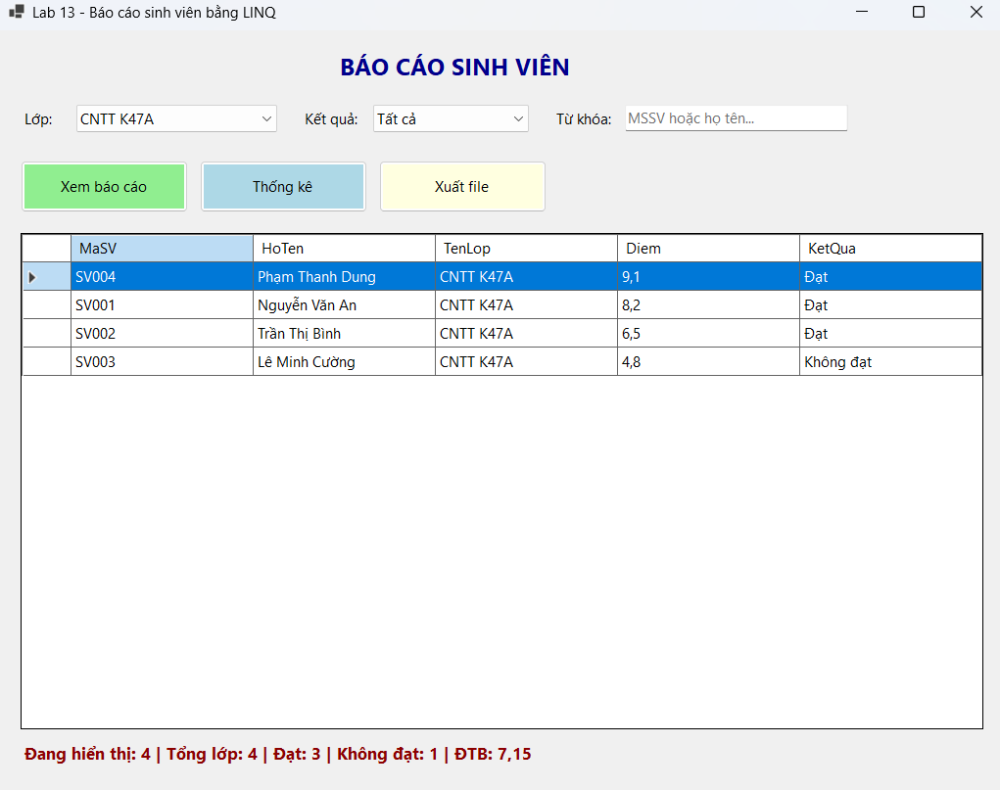
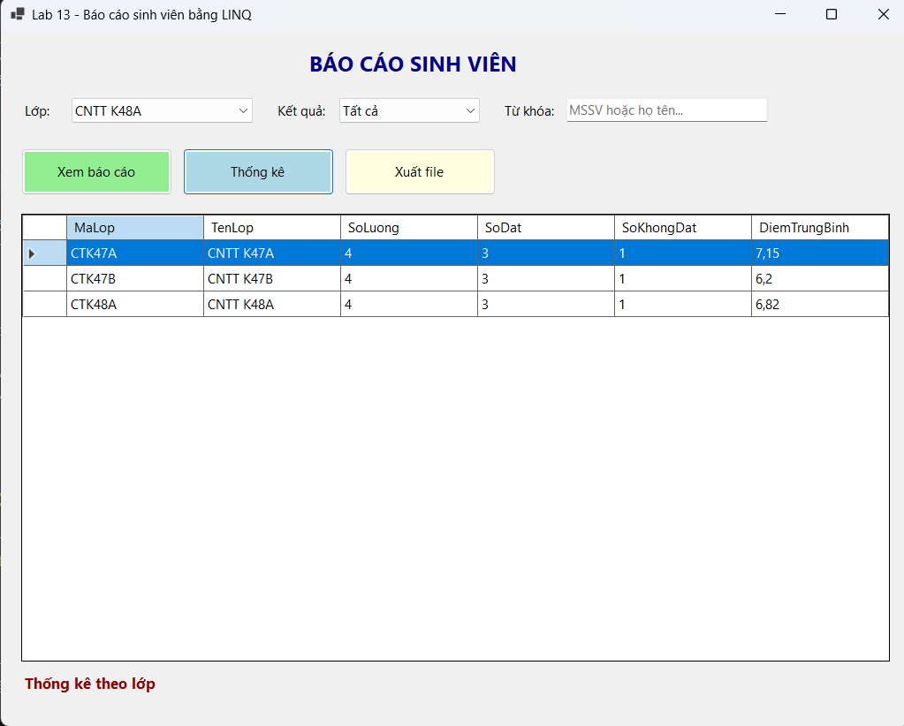
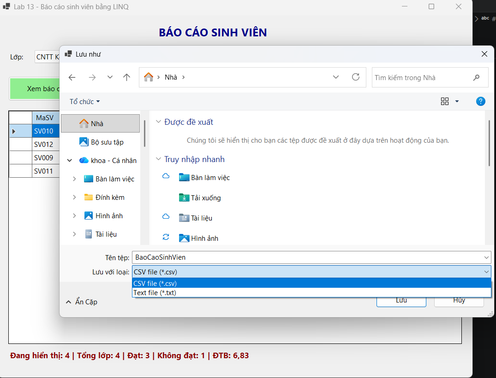

# Lab13 - Báo cáo sinh viên bằng LINQ (Student Report Demo)

**Học phần:** 2611COMP101904 - Lập trình trên Windows  
**Sinh viên thực hiện:** Lê Trần Anh Khoa | **MSSV:** 51.01.104.044 | **Lớp:** 51.01.CNTT.C

---

## 📑 Mục lục

1. [Giới thiệu](#1-giới-thiệu)
2. [Cấu trúc project](#2-cấu-trúc-project)
3. [Giao diện & Control](#3-giao-diện--control)
4. [Luồng hoạt động tổng quát](#4-luồng-hoạt-động-tổng-quát)
5. [Chi tiết cách thức hoạt động](#5-chi-tiết-cách-thức-hoạt-động)
6. [Kiến trúc & Kỹ thuật chính](#6-kiến-trúc--kỹ-thuật-chính)
7. [Xử lý lỗi & Validation](#7-xử-lý-lỗi--validation)
8. [Các lỗi thường gặp](#8-các-lỗi-thường-gặp)
9. [Ghi chú & mở rộng](#9-ghi-chú--mở-rộng)

---

## 1. Giới thiệu

**StudentReportDemo** là ứng dụng WinForms hiện thực hóa bài toán Báo cáo sinh viên bằng ngôn ngữ truy vấn tích hợp **LINQ**. Hệ thống cho phép người dùng lọc danh sách sinh viên theo Lớp, Kết quả học tập và Từ khóa tìm kiếm. Kết quả được sắp xếp khoa học, thống kê trực quan và có thể xuất ra file CSV/TXT.

Bài làm đáp ứng đầy đủ các mục tiêu của đề bài:
- Củng cố kỹ năng xử lý dữ liệu với **LINQ to Objects**.
- Binding dữ liệu vào ComboBox và DataGridView.
- Thực hiện các thao tác Lọc (`Where`), Sắp xếp (`OrderBy`), Nhóm (`GroupBy`), Thống kê (`Count`, `Average`).
- Xuất dữ liệu ra file an toàn với `SaveFileDialog` và `StringBuilder`.

---

## 2. Cấu trúc project

Dự án được tổ chức theo mô hình phân tầng cơ bản (Tách biệt Model và Giao diện):

```text
StudentReportDemo
│
├── Models/
│   └── SinhVien.cs                     # Lớp thực thể chứa thuộc tính và Computed Property
├── Forms/
│   ├── FrmBaoCaoSinhVien.cs            # Xử lý giao diện, logic LINQ, xuất file
│   └── FrmBaoCaoSinhVien.Designer.cs   # Khai báo control
├── Program.cs                          
└── StudentReportDemo.csproj
```

---

## 3. Giao diện & Control

| Control | Tên | Chức năng theo yêu cầu đề |
|---|---|---|
| ComboBox | `cboLop` | Chọn lớp (Dữ liệu load từ LINQ `Select` + `Distinct`) |
| ComboBox | `cboKetQua` | Chọn điều kiện: Tất cả, Đạt, Không đạt |
| TextBox | `txtTuKhoa` | Tìm kiếm theo Mã SV hoặc Họ tên |
| Button | `btnXemBaoCao` | Kích hoạt lọc dữ liệu (LINQ `Where`, `OrderBy`) |
| Button | `btnThongKe` | Thống kê số lượng & ĐTB theo từng lớp (LINQ `GroupBy`) |
| Button | `btnXuatFile` | Lưu dữ liệu đang hiển thị ra file CSV/TXT |
| DataGridView | `dgvBaoCao` | Hiển thị kết quả báo cáo hoặc bảng thống kê |
| Label | `lblThongKe` | Hiển thị tổng số SV, số đạt, số không đạt, ĐTB |

---

## 4. Luồng hoạt động tổng quát

1. **Form Load:** Tạo dữ liệu mẫu (12 sinh viên, 3 lớp). Dùng LINQ trích xuất danh sách Lớp duy nhất đưa vào `cboLop`. Khởi tạo các lựa chọn cho `cboKetQua`.
2. **Lọc dữ liệu:** Người dùng thay đổi Lớp, Kết quả hoặc nhập Từ khóa. Bấm "Xem báo cáo". Hệ thống dùng LINQ để truy vấn, sắp xếp giảm dần theo điểm và đổ vào `DataGridView`.
3. **Thống kê:** Bấm "Thống kê". Dùng LINQ `GroupBy` để gom nhóm theo Lớp, tính toán số lượng và điểm trung bình.
4. **Xuất File:** Bấm "Xuất file". Hệ thống mở hộp thoại lưu file, dùng `StringBuilder` duyệt qua các dòng trên lưới để ghi ra file `.csv` hoặc `.txt`.

---

## 5. Chi tiết cách thức hoạt động

### 5.1. Model Sinh Viên (`Models/SinhVien.cs`)
**Cách hoạt động:** Định nghĩa lớp thực thể. Sử dụng Computed Property (`=>`) cho thuộc tính `KetQua` để tự động tính toán dựa trên điểm số, giúp tránh việc phải lưu trữ và đồng bộ dữ liệu thừa.

```csharp
namespace StudentReportDemo.Models
{
    public class SinhVien
    {
        public string MaSV { get; set; }
        public string HoTen { get; set; }
        public string MaLop { get; set; }
        public string TenLop { get; set; }
        public double Diem { get; set; }

        // Thuộc tính chỉ đọc, tự tính từ Diem -> tránh sai lệch dữ liệu
        public string KetQua => Diem >= 5 ? "Đạt" : "Không đạt";
    }
}
```

### 5.2. Load danh sách Lớp và Kết quả
**Cách hoạt động:** Tại sự kiện `Form_Load`, gọi hàm `LoadComboBox()`. Hàm này dùng LINQ `Select` kết hợp `Distinct` để lấy danh sách lớp không trùng lặp, sau đó `OrderBy` để sắp xếp. Cần gán `DisplayMember` và `ValueMember` trước khi gán `DataSource`. Đồng thời, thêm các lựa chọn "Tất cả", "Đạt", "Không đạt" vào `cboKetQua`.

```csharp
private void LoadComboBox()
{
    // Dùng LINQ: Select + Distinct + OrderBy
    var dsLop = danhSachSinhVien
        .Select(sv => new { sv.MaLop, sv.TenLop })
        .Distinct()
        .OrderBy(l => l.MaLop)
        .ToList();

    cboLop.DisplayMember = "TenLop";
    cboLop.ValueMember = "MaLop";
    cboLop.DataSource = dsLop;

    cboKetQua.Items.Clear();
    cboKetQua.Items.AddRange(new object[] { "Tất cả", "Đạt", "Không đạt" });
    cboKetQua.SelectedIndex = 0;
}
```


### 5.3. Lọc dữ liệu theo Lớp, Kết quả và Từ khóa 
**Cách hoạt động:** Hàm `XemBaoCao()` sử dụng chuỗi truy vấn LINQ nối tiếp. Đầu tiên lọc theo `MaLop` (`Where`). Tiếp theo, nếu chọn "Đạt" hoặc "Không đạt" thì lọc tiếp theo `Diem`. Cuối cùng, nếu có nhập từ khóa, dùng `.Contains` để lọc theo `MaSV` hoặc `HoTen`.

```csharp
// 1. Lọc theo lớp
var query = danhSachSinhVien.Where(sv => sv.MaLop == maLop);

// 2. Lọc theo kết quả học tập
if (ketQua == "Đạt") query = query.Where(sv => sv.Diem >= 5);
else if (ketQua == "Không đạt") query = query.Where(sv => sv.Diem < 5);

// 3. Lọc theo từ khóa tìm kiếm
if (!string.IsNullOrWhiteSpace(tuKhoa))
{
    query = query.Where(sv => sv.MaSV.ToLower().Contains(tuKhoa) 
                           || sv.HoTen.ToLower().Contains(tuKhoa));
}
```

### 5.4. Hiển thị DataGridView và Sắp xếp giảm dần
**Cách hoạt động:** Tiếp tục chuỗi LINQ, sử dụng `OrderByDescending` để sắp xếp điểm từ cao xuống thấp, kết hợp `ThenBy` để sắp xếp tên theo bảng chữ cái nếu điểm bằng nhau. Dùng `Select` để tạo Anonymous Type và `ToList()` để thực thi, sau đó gán vào `DataSource` của DataGridView.

```csharp
// Sắp xếp giảm dần theo điểm và chọn dữ liệu hiển thị
var baoCao = query
    .OrderByDescending(sv => sv.Diem)
    .ThenBy(sv => sv.HoTen)
    .Select(sv => new { sv.MaSV, sv.HoTen, sv.TenLop, sv.Diem, sv.KetQua })
    .ToList();

dgvBaoCao.DataSource = baoCao;
```

### 5.5. Thống kê số lượng và điểm trung bình theo lớp
**Cách hoạt động:** Tại sự kiện `btnThongKe_Click`, sử dụng toán tử `GroupBy` để gom nhóm theo Lớp. Dùng `Select` để tính toán số lượng (`Count`), số đạt/không đạt và điểm trung bình (`Average`).

```csharp
private void btnThongKe_Click(object sender, EventArgs e)
{
    var thongKe = danhSachSinhVien
        .GroupBy(sv => new { sv.MaLop, sv.TenLop })
        .Select(g => new
        {
            g.Key.MaLop,
            g.Key.TenLop,
            SoLuong = g.Count(),
            SoDat = g.Count(sv => sv.Diem >= 5),
            SoKhongDat = g.Count(sv => sv.Diem < 5),
            DiemTrungBinh = Math.Round(g.Average(sv => sv.Diem), 2)
        })
        .OrderBy(x => x.MaLop)
        .ToList();

    dgvBaoCao.DataSource = thongKe;
    lblThongKe.Text = "Thống kê theo lớp";
}
```


### 5.6. Xuất dữ liệu ra file CSV/TXT
**Cách hoạt động:** Mở `SaveFileDialog` cho phép chọn đuôi file CSV/TXT. Sử dụng `StringBuilder` để nối chuỗi. Lưu ý thay thế dấu phẩy `,` trong nội dung cell bằng khoảng trắng để tránh làm vỡ cấu trúc cột của file CSV. Ghi file bằng `File.WriteAllText` với encoding UTF8.

```csharp
private void btnXuatFile_Click(object sender, EventArgs e)
{
    // ... (Kiểm tra dữ liệu rỗng và mở SaveFileDialog) ...
    try
    {
        StringBuilder sb = new();
        // Ghi Header
        for (int i = 0; i < dgvBaoCao.Columns.Count; i++)
        {
            sb.Append(dgvBaoCao.Columns[i].HeaderText);
            if (i < dgvBaoCao.Columns.Count - 1) sb.Append(',');
        }
        sb.AppendLine();

        // Ghi Data
        foreach (DataGridViewRow row in dgvBaoCao.Rows)
        {
            if (row.IsNewRow) continue;
            for (int i = 0; i < dgvBaoCao.Columns.Count; i++)
            {
                string value = row.Cells[i].Value?.ToString() ?? "";
                value = value.Replace(",", " "); // Xử lý dấu phẩy
                sb.Append(value);
                if (i < dgvBaoCao.Columns.Count - 1) sb.Append(',');
            }
            sb.AppendLine();
        }

        File.WriteAllText(sfd.FileName, sb.ToString(), Encoding.UTF8);
        MessageBox.Show("Xuất file thành công!");
    }
    catch (Exception ex)
    {
        MessageBox.Show("Lỗi xuất file: " + ex.Message);
    }
}
```


### 5.7. Thông báo khi không có dữ liệu phù hợp
**Cách hoạt động:** Trong hàm `XemBaoCao()`, sau khi thực thi LINQ và lấy được danh sách `baoCao`, ta kiểm tra nếu `baoCao.Count == 0` thì hiển thị `MessageBox` thông báo cho người dùng biết không tìm thấy kết quả.

```csharp
dgvBaoCao.DataSource = baoCao;
CapNhatThongKe(baoCao.Count);

if (baoCao.Count == 0)
{
    MessageBox.Show("Không có dữ liệu phù hợp với điều kiện lọc.", 
                    "Thông báo", MessageBoxButtons.OK, MessageBoxIcon.Information);
}
```

### 5.8. Tổng hợp ứng dụng LINQ 
**Cách hoạt động:** Toàn bộ các thao tác xử lý dữ liệu trong project đều được thực hiện thông qua các phương thức mở rộng của LINQ to Objects:
- **Lọc (Filter):** Dùng `.Where(...)` trong hàm `XemBaoCao()`.
- **Sắp xếp (Sort):** Dùng `.OrderByDescending(...)` và `.ThenBy(...)` trong hàm `XemBaoCao()` và `.OrderBy(...)` trong `LoadComboBox()`, `btnThongKe_Click()`.
- **Thống kê (Aggregate):** Dùng `.Count(...)`, `.Average(...)` trong `CapNhatThongKe()` và `btnThongKe_Click()`.
- **Nhóm (Group):** Dùng `.GroupBy(...)` trong `btnThongKe_Click()`.
- **Chọn (Projection):** Dùng `.Select(...)` để tạo Anonymous Type hiển thị lên lưới.
- **Loại bỏ trùng lặp:** Dùng `.Distinct()` khi load danh sách lớp vào ComboBox.

---

## 6. Kiến trúc & Kỹ thuật chính

| Kỹ thuật | Nơi áp dụng | Mô tả |
|---|---|---|
| **LINQ to Objects** | `FrmBaoCaoSinhVien.cs` | Sử dụng `Where`, `Select`, `OrderByDescending`, `GroupBy` để xử lý list dữ liệu mẫu. |
| **Computed Property** | `Models/SinhVien.cs` | Thuộc tính `KetQua` tự động tính toán dựa trên `Diem` (`>=5` là Đạt). |
| **Anonymous Type** | `XemBaoCao()`, `btnThongKe_Click` | Dùng `new { ... }` trong LINQ `Select` để tạo cấu trúc dữ liệu hiển thị mà không cần tạo class mới. |
| **StringBuilder** | `btnXuatFile_Click` | Tối ưu hiệu năng khi nối chuỗi nhiều dòng để ghi file. |
| **File I/O** | `btnXuatFile_Click` | Sử dụng `File.WriteAllText` với `Encoding.UTF8` để ghi file an toàn. |

---

## 7. Xử lý lỗi & Validation

| Trường hợp | Hành vi | Icon |
|---|---|---|
| Lọc không có kết quả | "Không có dữ liệu phù hợp với điều kiện lọc." | Information |
| Danh sách rỗng (Tính trung bình) | Kiểm tra `tongSo > 0` trước khi gọi `Average` để tránh lỗi `DivideByZeroException`. | N/A |
| Lỗi khi đang mở file (Xuất file) | "Lỗi xuất file: [Chi tiết lỗi từ hệ thống]" | Error |
| Xuất file khi chưa có dữ liệu | "Không có dữ liệu để xuất." | Warning |

---

## 8. Các lỗi thường gặp

| Lỗi | Cách xử lý |
|---|---|
| **ComboBox hiển thị "System.Data.DataRowView"** | Do gán `DataSource` trước khi gán `DisplayMember`/`ValueMember`. Đảo ngược thứ tự gán lại. |
| **Lỗi InvalidOperationException khi tính `Average`** | Xảy ra khi danh sách truyền vào rỗng. Dùng ternary `list.Any() ? list.Average() : 0` để chặn. |
| **Dữ liệu không hiện lên DataGridView** | Quên gọi `.ToList()` ở cuối câu lệnh LINQ. LINQ có tính chất "Deferred Execution", cần `ToList()` để thực thi ngay. |
| **File CSV khi mở bị lệch cột** | Dữ liệu text có chứa dấu phẩy `,`. Khắc phục bằng `value.Replace(",", " ")` hoặc bọc chuỗi trong dấu ngoặc kép `" "`. |
| **Bấm Xem Báo Cáo bị báo lỗi rỗng lúc mới mở Form** | Sự kiện `SelectedIndexChanged` của ComboBox bị kích hoạt sớm. Cần dùng cờ (flag) `isLoading` hoặc kiểm tra `cboLop.SelectedValue != null`. |

---

## 9. Ghi chú & mở rộng

- **Lưu ý:** Thuộc tính `KetQua` trong model `SinhVien` là thuộc tính chỉ đọc (Computed Property). Không cần lưu trữ dữ liệu này, nó sẽ tự tính lại mỗi khi `Diem` thay đổi, tránh sai lệch dữ liệu.
- **Mở rộng:** Để áp dụng vào thực tế, có thể thay thế danh sách mẫu `List<SinhVien>` bằng dữ liệu lấy từ Database thông qua **Entity Framework** hoặc **LINQ to SQL** (sẽ học ở Lab 14). Phần xử lý LINQ trên giao diện sẽ giữ nguyên.