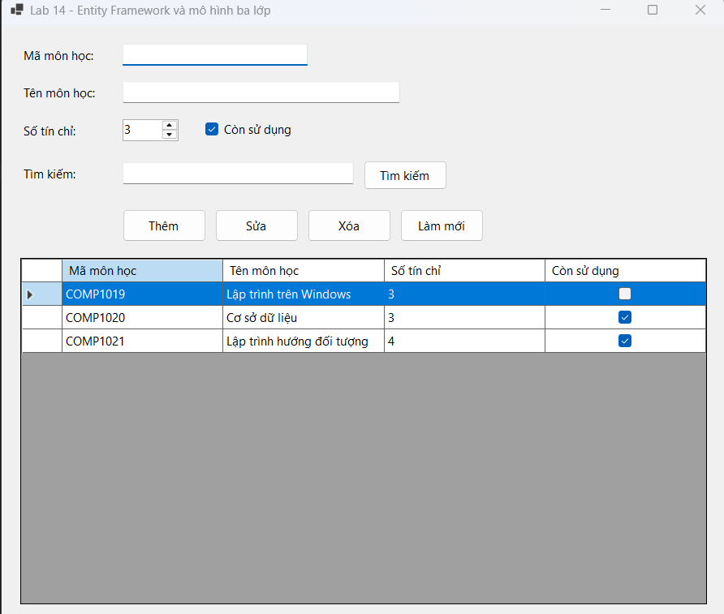
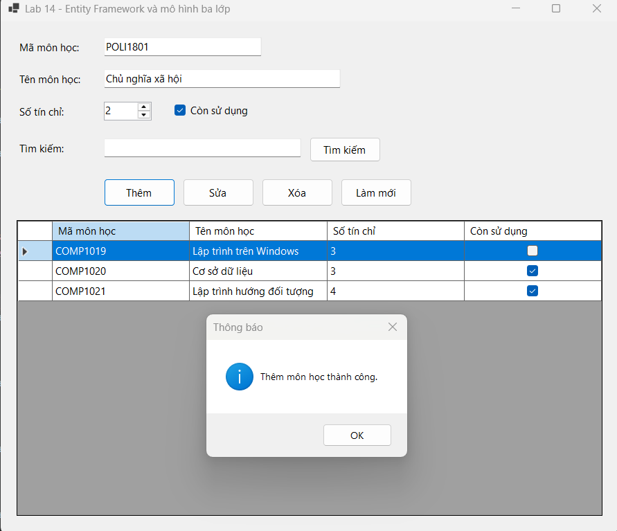
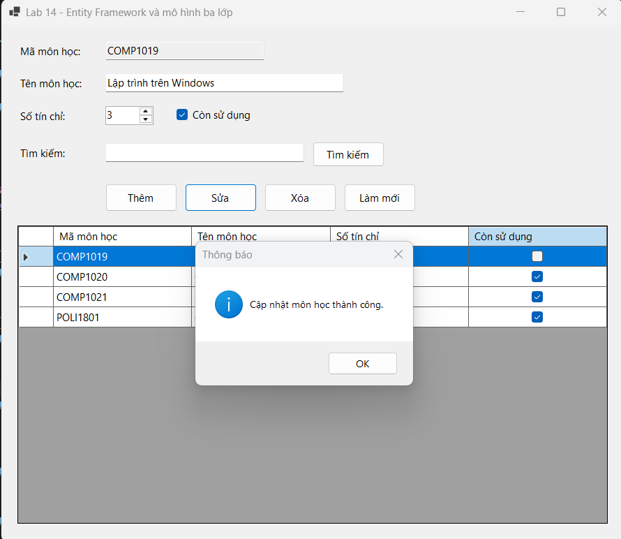
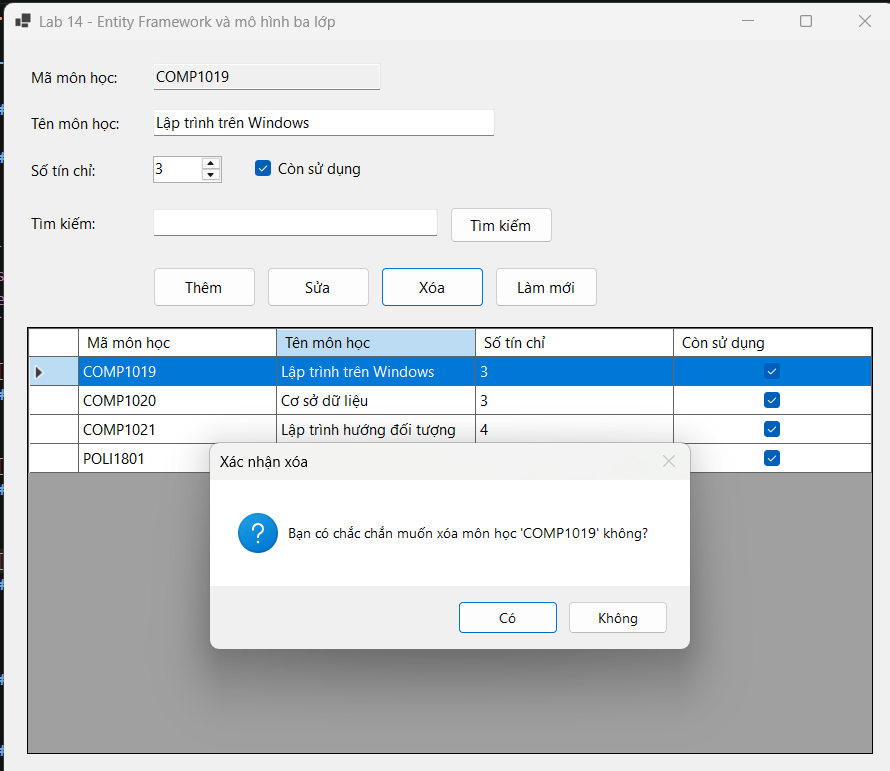
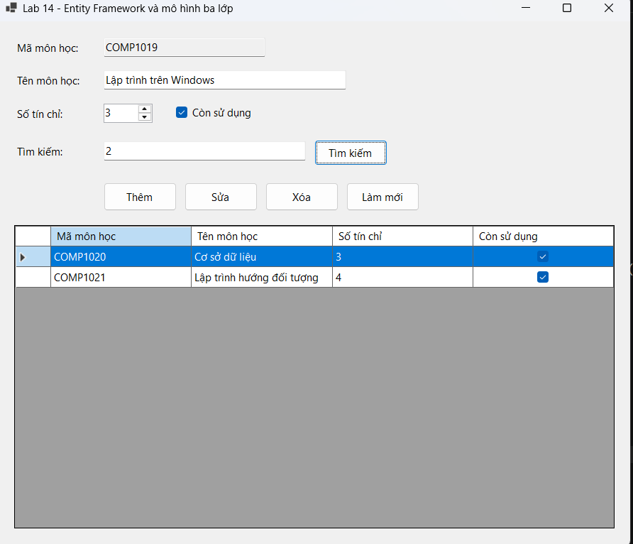

# Lab 14 - Entity Framework và mô hình ba lớp (Quản lý môn học)

**Học phần:** 2611COMP101904 - Lập trình trên Windows  
**Sinh viên thực hiện:** Lê Trần Anh Khoa | **MSSV:** 51.01.104.044 | **Lớp:** 51.01.CNTT.C

---

## 📑 Mục lục

1. [Giới thiệu](#1-giới-thiệu)
2. [Cấu trúc project](#2-cấu-trúc-project)
3. [Giao diện & Control](#3-giao-diện--control)
4. [Luồng hoạt động tổng quát](#4-luồng-hoạt-động-tổng-quát)
5. [Chi tiết từng chức năng](#5-chi-tiết-từng-chức-năng)
6. [Script SQL](#6-script-sql)
7. [Kết nối Database](#7-kết-nối-database)
8. [Kiến trúc & kỹ thuật chính](#8-kiến-trúc--kỹ-thuật-chính)
9. [Xử lý lỗi & Validation](#9-xử-lý-lỗi--validation)
10. [Các lỗi thường gặp](#10-các-lỗi-thường-gặp)
11. [Câu hỏi nộp kèm](#11-câu-hỏi-nộp-kèm)
12. [Ghi chú & mở rộng](#12-ghi-chú--mở-rộng)

---

## 1. Giới thiệu

**Lab 14** là ứng dụng WinForms xây dựng module **Quản lý môn học** cho hệ thống EduManager. Khác với Lab 11 (dùng ADO.NET), bài này áp dụng **Entity Framework Core (EF Core)** làm ORM và tổ chức mã nguồn theo **mô hình 3 lớp (GUI - BLL - DAL)**.

Các kỹ thuật chính được minh họa:

- Tương tác database thông qua **Entity Framework Core** (Code-First / Database-First).
- Tách biệt giao diện (**GUI**) - nghiệp vụ (**BLL**) - truy cập dữ liệu (**DAL**).
- Sử dụng **LINQ** thay cho câu lệnh SQL thuần.
- Áp dụng **Change Tracking** (`Add`, `Update`, `Remove`, `SaveChanges`) của EF Core.
- Đặt Validation tập trung tại **BLL** trước khi gọi xuống DAL.
- Sử dụng Data Binding cơ bản với `DataGridView`.

| Thông tin | Nội dung |
|---|---|
| Tên ứng dụng | Lab14_EFCore_3Layers |
| Phiên bản | 1.0 |
| Nền tảng | .NET 10 (Windows Forms) |
| Database | SQL Server (EduManagerDB) |
| Package | Microsoft.EntityFrameworkCore.SqlServer, Microsoft.EntityFrameworkCore.Tools |
| Ngôn ngữ | C# |

---

## 2. Cấu trúc project

```
Lab 14 -  Entity Framework và mô hình ba lớp
│
├── Models/
│   └── MonHoc.cs               # Entity ánh xạ bảng MONHOC
├── Data/
│   └── Lab14Context.cs         # DbContext (EF Core), cấu hình kết nối
├── DAL/
│   └── MonHocDAL.cs            # Truy cập dữ liệu bằng LINQ (EF Core)
├── BLL/
│   └── MonHocBLL.cs            # Nghiệp vụ & Validation
├── GUI/
│   ├── FrmMonHoc.cs            # Xử lý sự kiện giao diện
│   └── FrmMonHoc.Designer.cs   # Khai báo control giao diện
├── Scripts/
│   └── EduManagerDB.sql        # Script tạo database + bảng + dữ liệu mẫu
├── Program.cs                  # Entry point
├── Lab 14 -  Entity Framework và mô hình ba lớp.csproj 
└── README.md                   # File mô tả này
```

---

## 3. Giao diện & Control

### Vùng nhập liệu

| Control | Tên | Mô tả |
|---|---|---|
| TextBox | `txtMaMonHoc` | Mã môn học — **bắt buộc**, khóa chính (tối đa 10 ký tự) |
| TextBox | `txtTenMonHoc` | Tên môn học — **bắt buộc** (tối đa 100 ký tự) |
| NumericUpDown | `nudSoTinChi` | Số tín chỉ (Min: 1, Max: 6) |
| CheckBox | `chkTrangThai` | Trạng thái còn sử dụng hay không |
| TextBox | `txtTimKiem` | Từ khóa tìm kiếm (theo mã hoặc tên môn) |

### Thanh nút chức năng

| Control | Tên | Mô tả |
|---|---|---|
| Button | `btnThem` | Thêm môn học mới |
| Button | `btnSua` | Cập nhật thông tin môn học |
| Button | `btnXoa` | Xóa môn học (có xác nhận) |
| Button | `btnLamMoi` | Xóa input, load lại danh sách |
| Button | `btnTimKiem` | Tìm kiếm theo Mã hoặc Tên |

### Vùng hiển thị

| Control | Tên | Mô tả |
|---|---|---|
| DataGridView | `dgvMonHoc` | Hiển thị danh sách môn học |

---

## 4. Luồng hoạt động tổng quát

```
┌────────────────┐    Nhập liệu     ┌────────────────────┐
│   Người dùng   │ ───────────────► │  GUI (Form)        │
│                │                  │  txtMaMonHoc...    │
│                │  Click nút       └─────────┬──────────┘
│                │ ───────────────────────────►│
│                │                            ▼
│                │                  ┌────────────────────┐
│                │                  │  BLL (MonHocBLL)   │
│                │                  │  - Kiểm tra rỗng   │
│                │                  │  - Kiểm tra trùng  │
│                │                  │  - Check 1 <= TC<=6│
│                │                  └─────────┬──────────┘
│                │                            │ Dữ liệu hợp lệ
│                │                            ▼
│                │                  ┌────────────────────┐
│                │                  │  DAL (MonHocDAL)   │
│                │                  │  DbContext         │
│                │                  │  LINQ -> SQL       │
│                │                  │  SaveChanges()     │
│                │                  └─────────┬──────────┘
│                │                            │
│                │                            ▼
│                │                  ┌────────────────────┐
│                │                  │  Database          │
│                │                  │  (SQL Server)      │
│                │                  └────────────────────┘
└────────────────┘
```

1. **Form Load** → `FrmMonHoc_Load` gọi `BLL.GetAll()` (BLL gọi tiếp `DAL.GetAll()`) để đổ dữ liệu vào DataGridView.
2. **Click Thêm/Sửa** → GUI lấy dữ liệu → `BLL.Add()` hoặc `BLL.Update()`. Tại BLL, dữ liệu được **Validate**, nếu hợp lệ mới gọi xuống DAL.
3. **Click Xóa** → Hiển thị `MessageBox` xác nhận → nếu chọn Yes, gọi `BLL.Delete()`.
4. **Click Tìm kiếm** → Gọi `BLL.Search(txtTimKiem.Text)` → BLL gọi DAL dùng LINQ `.Where(m => m.TenMonHoc.Contains(...))`.
5. **Click vào dòng DataGridView** → Đưa dữ liệu dòng đó lên các control nhập liệu (khóa mã môn học lại để không sửa).

---

## 5. Chi tiết từng chức năng

### 5.1. Load dữ liệu
- **GUI:** Gọi `_bll.GetAll()`.
- **BLL:** Gọi `_dal.GetAll()`.
- **DAL (EF Core):** 
```csharp
using var context = new Lab14Context();
return context.MonHocs.AsNoTracking().OrderBy(m => m.MaMonHoc).ToList();
```
→ `AsNoTracking()` giúp tối ưu hiệu năng khi chỉ đọc dữ liệu (không cần theo dõi thay đổi).

### 5.2. Thêm môn học
- **Validation (BLL):** Kiểm tra Mã/Tên không rỗng, Số tín chỉ 1-6, Mã chưa tồn tại.
- **DAL:** Dùng `context.MonHocs.Add(mh); context.SaveChanges();`

### 5.3. Sửa môn học
- **GUI:** Khóa `txtMaMonHoc` (ReadOnly = true) khi click vào dòng.
- **DAL:** Tìm entity theo mã, gán lại các trường Tên, Số TC, Trạng thái rồi `SaveChanges()`. (Không cho phép sửa Khóa chính).

### 5.4. Xóa môn học
- **GUI:** Kiểm tra `MessageBox.Show(..., MessageBoxButtons.YesNo)`.
- **DAL:** `context.MonHocs.Remove(entity); context.SaveChanges();`

### 5.5. Tìm kiếm
- **DAL:** Sử dụng LINQ: `.Where(m => m.MaMonHoc.Contains(k) || m.TenMonHoc.Contains(k))`.

### 5.6. Làm mới
- Xóa trắng text, reset NumericUpDown về 3, CheckBox về `true`.
- Mở khóa `txtMaMonHoc` (`ReadOnly = false`).
- Load lại DataGridView.

---

## 6. Script SQL

**File `Scripts/EduManagerDB.sql`:**

```sql
IF DB_ID('EduManagerDB') IS NULL
    CREATE DATABASE EduManagerDB;
GO
USE EduManagerDB;
GO

IF OBJECT_ID('MONHOC', 'U') IS NOT NULL
    DROP TABLE MONHOC;
GO

CREATE TABLE MONHOC
(
    MaMonHoc   NVARCHAR(10)  NOT NULL,
    TenMonHoc  NVARCHAR(100) NOT NULL,
    SoTinChi   INT           NOT NULL,
    TrangThai  BIT           NOT NULL CONSTRAINT DF_MONHOC_TrangThai DEFAULT (1),
    CONSTRAINT PK_MONHOC PRIMARY KEY (MaMonHoc),
    CONSTRAINT CK_MONHOC_SoTinChi CHECK (SoTinChi BETWEEN 1 AND 6)
);
GO

INSERT INTO MONHOC (MaMonHoc, TenMonHoc, SoTinChi, TrangThai) VALUES
('COMP1019', N'Lập trình trên Windows',     3, 1),
('COMP1020', N'Cơ sở dữ liệu',              3, 1),
('COMP1021', N'Lập trình hướng đối tượng',  4, 1);
GO
```

---

## 7. Kết nối Database

### 7.1. Cài package
Mở NuGet Package Manager, cài 2 package (chọn version `10.0.0`):
- `Microsoft.EntityFrameworkCore.SqlServer`
- `Microsoft.EntityFrameworkCore.Tools`

### 7.2. Chuỗi kết nối
Nằm trong file `Data/Lab14Context.cs`:
```csharp
optionsBuilder.UseSqlServer(
    "Server=.;Database=EduManagerDB;Trusted_Connection=True;TrustServerCertificate=True;");
```

| Thành phần | Ý nghĩa |
|---|---|
| `Server=.` | SQL Server mặc định trên máy local (có thể đổi thành `.\SQLEXPRESS`, `(localdb)\MSSQLLocalDB` hoặc tên máy `LAPTOP-XXX\ASUS`) |
| `Database=EduManagerDB` | Tên database |
| `Trusted_Connection=True` | Đăng nhập bằng Windows Authentication |
| `TrustServerCertificate=True` | Bỏ qua kiểm tra chứng chỉ SSL |

> **Lưu ý:** Nếu máy bạn dùng tên server khác, hãy sửa lại thông số `Server=` cho khớp với SSMS.

---

## 8. Kiến trúc & kỹ thuật chính

| Kỹ thuật | Nơi áp dụng | Mô tả |
|---|---|---|
| **Entity Framework Core** | DAL | ORM ánh xạ bảng thành class, tự sinh SQL |
| **DbContext** | Data | Quản lý kết nối và theo dõi sự thay đổi của Entity |
| **LINQ** | DAL | Viết truy vấn bằng C# thay vì SQL thuần |
| **AsNoTracking** | DAL (hàm GetAll, Search) | Tăng tốc độ đọc dữ liệu |
| **Validation** | BLL | Kiểm tra điều kiện nghiệp vụ trước khi gọi DAL |
| **Try-Catch** | GUI | Bắt Exception và hiển thị `MessageBox` thân thiện |

### 8.1. Vì sao dùng mô hình 3 lớp?
- **GUI (Form):** Chỉ xử lý giao diện, bắt sự kiện, hiển thị thông báo. Không biết database là gì.
- **BLL (Business Logic):** Nơi chứa "luật chơi" (VD: Mã không rỗng, không được trùng, tín chỉ 1-6).
- **DAL (Data Access):** Chỉ lo nói chuyện với database qua EF Core.
→ Giúp code dễ bảo trì, dễ test và không bị trộn lẫn code SQL vào giao diện.

### 8.2. Entity Framework Core vs ADO.NET
- **ADO.NET:** Viết SQL thuần, tự mở `SqlConnection`, tự map dữ liệu vào `DataTable` (như Lab 11).
- **EF Core:** Dùng LINQ, `SaveChanges()` tự động insert/update. Code ngắn gọn hơn, ít lỗi gõ sai tên cột.

---

## 9. Xử lý lỗi & Validation

### 9.1. Validation tập trung tại BLL
```csharp
private static void Validate(MonHoc mh)
{
    if (string.IsNullOrWhiteSpace(mh.MaMonHoc))
        throw new ArgumentException("Mã môn học không được để trống.");
    if (string.IsNullOrWhiteSpace(mh.TenMonHoc))
        throw new ArgumentException("Tên môn học không được để trống.");
    if (mh.SoTinChi < 1 || mh.SoTinChi > 6)
        throw new ArgumentException("Số tín chỉ phải nằm trong khoảng từ 1 đến 6.");
}
```

### 9.2. Bảng xử lý lỗi hiển thị trên GUI

| Trường hợp | Hành vi (MessageBox) | Icon |
|---|---|---|
| Mã môn học rỗng | "Mã môn học không được để trống" | Error |
| Tên môn học rỗng | "Tên môn học không được để trống" | Error |
| Trùng mã khi Thêm | "Mã môn học '...' đã tồn tại" | Error |
| Sửa/Xóa môn không tồn tại | "Không tìm thấy môn học có mã '...'" | Error |
| Xóa môn học | "Bạn có chắc muốn xóa môn học '...' không?" | Question |
| Lỗi kết nối CSDL | "Lỗi khi tải danh sách môn học: ..." | Error |

---

## 10. Các lỗi thường gặp

| Lỗi | Cách xử lý |
|---|---|
| `error: 40 - Could not open a connection to SQL Server` | Sai chuỗi kết nối. Mở `Data/Lab14Context.cs` đổi `Server=.` thành `Server=TÊN_MÁY\TÊN_INSTANCE` (VD: `LAPTOP-ML456VU9\ASUS`). |
| `The type or namespace name 'EntityFrameworkCore' could not be found` | Chưa cài NuGet package EF Core. Chuột phải project -> Manage NuGet -> Cài `Microsoft.EntityFrameworkCore.SqlServer`. |
| `Invalid column name 'MaMonHoc'` (khi chạy SQL) | Bảng MONHOC cũ bị dính khóa ngoại. Chạy script xóa DB (Drop Database) rồi tạo lại từ đầu. |
| `The current .NET SDK does not support targeting .NET 10.0` | Máy chưa cài .NET 10 SDK hoặc Visual Studio chưa được cập nhật bản mới nhất. |
| DataGridView trống trơn | Chưa chạy script tạo bảng và insert dữ liệu. Hoặc chuỗi kết nối đang trỏ sai Database. |

---

## 11. Câu hỏi nộp kèm

**8. Vì sao không nên viết toàn bộ code CRUD trong sự kiện Button Click?**
Vì sẽ vi phạm nguyên tắc Single Responsibility (SRP), code bị trùng lặp, khó kiểm thử (Unit Test) và khó bảo trì. Nếu sau này đổi CSDL hoặc thêm luật nghiệp vụ, ta phải sửa ở rất nhiều form khác nhau. Tách ra 3 lớp giúp cô lập lỗi và tái sử dụng code.

**9. BLL và DAL khác nhau ở điểm nào?**
- **DAL (Data Access Layer):** Chỉ biết làm việc với Database (thêm, xóa, sửa, truy vấn). Không chứa logic nghiệp vụ. 
- **BLL (Business Logic Layer):** Chứa các quy tắc nghiệp vụ (validate dữ liệu, kiểm tra trùng mã, ràng buộc logic). BLL nhận yêu cầu từ GUI, kiểm tra hợp lệ rồi mới gọi DAL.

**10. Entity Framework khác ADO.NET ở điểm nào?**
- **ADO.NET:** Phải tự viết câu lệnh SQL, tự mở kết nối (`SqlConnection`), tự map dữ liệu vào `DataTable`.
- **EF Core:** Là một ORM, cho phép thao tác với database thông qua các đối tượng C# (Entities) và LINQ. Tự động sinh SQL, tự động theo dõi thay đổi (`Change Tracking`) và cập nhật khi gọi `SaveChanges()`.

**11. Trong bài lab này, validation nào nên đặt ở BLL?**
Tất cả các validation liên quan đến nghiệp vụ đều nên đặt ở BLL:
- Mã môn học, tên môn học không được rỗng.
- Số tín chỉ phải từ 1 đến 6.
- Không cho phép thêm mã môn học đã tồn tại.
- Kiểm tra môn học có tồn tại trước khi Sửa/Xóa.
*(GUI chỉ nên kiểm tra tính hợp lệ của control như: giới hạn NumericUpDown 1-6, chưa chọn dòng thì báo lỗi).*

---

## 12. Ghi chú & mở rộng

- **Tối ưu:** Sử dụng `AsNoTracking()` khi load danh sách giúp EF Core không lưu trữ trạng thái của các object vào bộ nhớ (vì ta không có ý định sửa chúng ngay lập tức).
- **Mở rộng:**
  - Thêm phân trang cho DataGridView (sử dụng `.Skip().Take()` trong LINQ).
  - Tích hợp thêm Form Quản lý Sinh Viên / Điểm số (tạo quan hệ 1-N giữa Môn học và Điểm).
  - Sử dụng `Dependency Injection` (DI) để inject `MonHocBLL` vào `FrmMonHoc` thay vì khởi tạo trực tiếp.