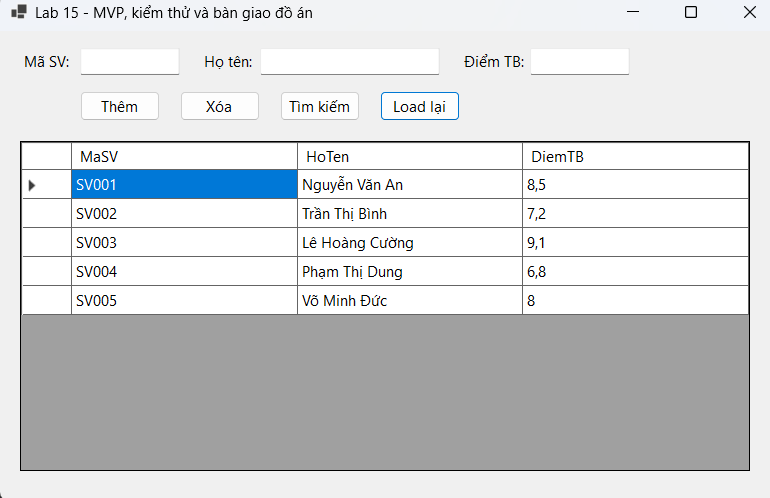
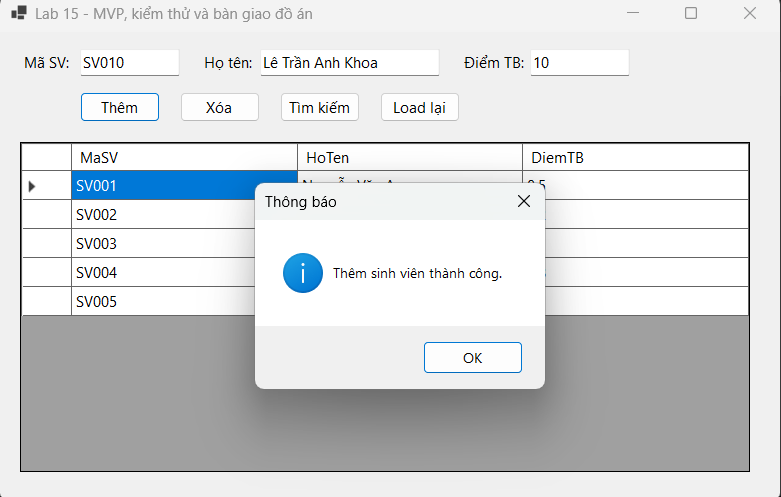
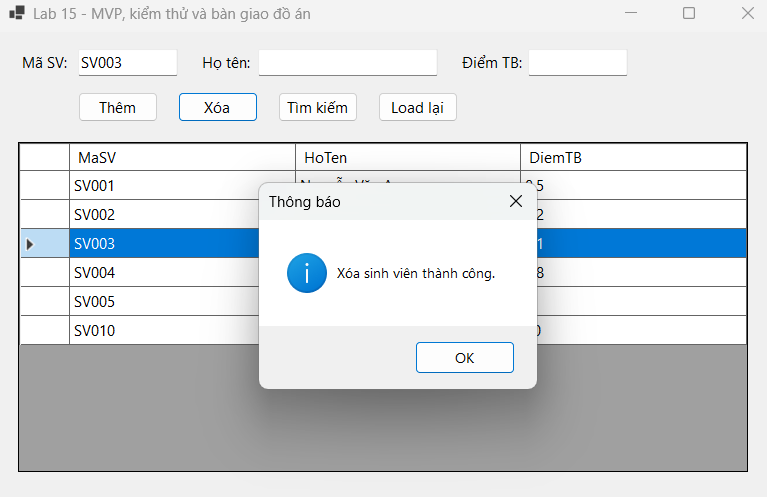
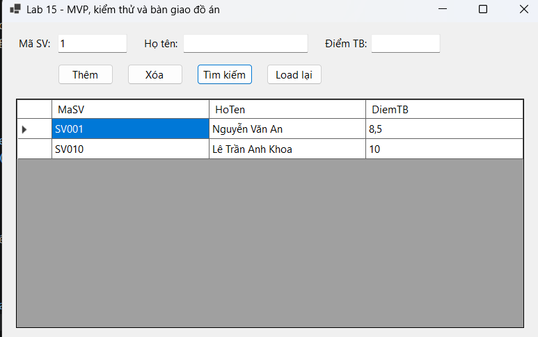

# Lab 15 - MVP, kiểm thử và bàn giao đồ án (Quản lý Sinh viên)

**Học phần:** 2611COMP101904 - Lập trình trên Windows  
**Sinh viên thực hiện:** Lê Trần Anh Khoa | **MSSV:** 51.01.104.044 | **Lớp:** 51.01.CNTT.C

---

## 📑 Mục lục
1. [Giới thiệu](#1-giới-thiệu)
2. [Cấu trúc project](#2-cấu-trúc-project)
3. [Giao diện & Control](#3-giao-diện--control)
4. [Luồng hoạt động tổng quát (MVP)](#4-luồng-hoạt-động-tổng-quát-mvp)
5. [Chi tiết từng chức năng](#5-chi-tiết-từng-chức-năng)
6. [Kiến trúc & kỹ thuật chính](#6-kiến-trúc--kỹ-thuật-chính)
7. [Xử lý lỗi & Validation](#7-xử-lý-lỗi--validation)
8. [Bảng Test Case (Kiểm thử)](#8-bảng-test-case-kiểm-thử)
9. [Checklist bàn giao đồ án cuối kỳ](#9-checklist-bàn-giao-đồ-án-cuối-kỳ)
10. [Hướng dẫn chạy](#10-hướng-dẫn-chạy)
11. [Ghi chú & mở rộng](#11-ghi-chú--mở-rộng)

---

## 1. Giới thiệu

**Lab 15 - MVP** là ứng dụng WinForms minh họa việc **tách xử lý logic khỏi Form** bằng mô hình **MVP (Model - View - Presenter)**. 

Ứng dụng thực hiện chức năng quản lý sinh viên cơ bản bao gồm: Load danh sách, Thêm, Xóa, Tìm kiếm. Khác với các bài Lab trước (viết code trực tiếp trong Form), bài này áp dụng kiến trúc MVP giúp mã nguồn dễ bảo trì, dễ kiểm thử (Unit Test) và phân tách rõ ràng trách nhiệm giữa giao diện và nghiệp vụ.

**Các kỹ thuật chính được minh họa:**
- Mô hình kiến trúc **MVP cơ bản**.
- Áp dụng **Interface** (`IStudentView`) để giao tiếp giữa Presenter và Form.
- Quản lý dữ liệu in-memory bằng `List<Student>` (thông qua Repository Pattern).
- Xử lý sự kiện (Event) và Validation dữ liệu đầu vào.

| Thông tin | Nội dung |
|---|---|
| Tên project | Lab 15 - MVP, kiểm thử và bàn giao đồ án |
| Namespace | `Lab_15____MVP__kiểm_thử_và_bàn_giao_đồ_án` |
| Nền tảng | .NET 10 (Windows Forms) |
| Ngôn ngữ | C# 14 |
| Lưu trữ dữ liệu | In-memory (`List<Student>`) |

---

## 2. Cấu trúc project

```text
Lab 15 - MVP, kiểm thử và bàn giao đồ án/
│
├── Program.cs                  # Entry point
│
├── Models/
│   └── Student.cs              # Chứa class thực thể Sinh viên
│
├── Views/
│   ├── IStudentView.cs         # Interface định nghĩa các thành phần Form cung cấp
│   ├── FrmStudent.cs           # Logic Form (chỉ gọi Presenter)
│   └── FrmStudent.Designer.cs  # Khai báo giao diện
│
├── Presenters/
│   └── StudentPresenter.cs     # Chứa logic nghiệp vụ (Thêm, Xóa, Tìm kiếm)
│
├── Repositories/
│   ├── IStudentRepository.cs   # Interface lưu trữ
│   └── StudentRepository.cs    # Xử lý lưu trữ (dùng List, chứa data mẫu)
│
└── Lab15_MVP.csproj            # File cấu hình project
```

---

## 3. Giao diện & Control

### Vùng nhập liệu & Tìm kiếm
| Control | Tên | Mô tả |
|---|---|---|
| TextBox | `txtMaSV` | Mã sinh viên — **bắt buộc**, dùng để Xóa/Tìm |
| TextBox | `txtHoTen` | Họ tên sinh viên — **bắt buộc** |
| TextBox | `txtDiemTB` | Điểm TB — **bắt buộc**, phải là số |

### Thanh nút chức năng
| Control | Tên | Mô tả |
|---|---|---|
| Button | `btnLoad` | Load lại toàn bộ danh sách |
| Button | `btnAdd` | Thêm sinh viên mới |
| Button | `btnDelete` | Xóa sinh viên theo Mã SV |
| Button | `btnSearch` | Tìm kiếm theo Tên hoặc Mã |

### Vùng hiển thị
| Control | Tên | Mô tả |
|---|---|---|
| DataGridView | `dgvStudents` | Hiển thị danh sách sinh viên |

---

## 4. Luồng hoạt động tổng quát (MVP)

Kiến trúc MVP tuân thủ nghiêm ngặt quy tắc: **Form không chứa logic, Presenter không chứa control.**

```text
┌────────────────┐    Nhập liệu     ┌────────────────────┐
│   Người dùng   │ ───────────────► │  Form (View)       │
│                │                  │  - txtMaSV, txtTen │
│                │                  └─────────┬──────────┘
│                │                            │
│                │  Click Thêm / Xóa / Tìm     │ (Chỉ gọi 1 hàm duy nhất)
│                │ ───────────────────────────►│
│                │                            ▼
│                │                  ┌────────────────────┐
│                │                  │  StudentPresenter  │
│                │                  │  - Validate logic  │
│                │                  │  - Gọi Repository  │
│                │                  └─────────┬──────────┘
│                │                            │
│                │                            ▼
│                │                  ┌────────────────────┐
│                │                  │ StudentRepository  │
│                │                  │ - List<Student>    │
│                │                  │ - Thêm/Xóa/Tìm     │
│                │                  └─────────┬──────────┘
│                │                            │
│                │  Cập nhật giao diện        │ Trả kết quả
│                │ ◄──────────────────────────┘
│                │  (Thông qua IStudentView)
└────────────────┘
```

---

## 5. Chi tiết từng chức năng

### 5.1. Load danh sách
- Khi Form khởi chạy hoặc nhấn `btnLoad`, Form gọi `_presenter.LoadStudents()`.
- Presenter lấy danh sách từ Repository và gọi `_view.SetStudentList(students)` để hiển thị lên DataGridView.

### 5.2. Thêm sinh viên
- Form gọi `_presenter.AddStudent()`.
- Presenter thực hiện:
  1. Kiểm tra rỗng (Mã, Tên, Điểm).
  2. Kiểm tra kiểu dữ liệu của Điểm (`double.TryParse`).
  3. Kiểm tra trùng mã (`_repository.Exists()`).
  4. Nếu hợp lệ, thêm vào Repository và gọi `_view.ShowMessage()`, `_view.ClearInput()`, `LoadStudents()`.

### 5.3. Xóa sinh viên
- Form gọi `_presenter.DeleteStudent()`.
- Presenter kiểm tra mã có tồn tại không. Nếu có, gọi `_repository.Delete(maSV)` và làm mới danh sách.

### 5.4. Tìm kiếm
- Form gọi `_presenter.SearchStudent()`.
- Presenter lấy từ khóa (từ `HoTen` hoặc `MaSV`), gọi `_repository.Search(keyword)` và cập nhật lại DataGridView.

---

## 6. Kiến trúc & kỹ thuật chính

| Kỹ thuật | Nơi áp dụng | Mô tả |
|---|---|---|
| **Interface (View)** | `IStudentView` | Giúp Presenter thao tác với Form mà không cần biết Form dùng control gì (TextBox, DataGridView) |
| **Interface (Repo)** | `IStudentRepository` | Giúp dễ dàng thay thế nguồn dữ liệu (List sang SQL Server) sau này |
| **Event Handler** | `FrmStudent.cs` | Các hàm `btn_Click` chỉ gọi đúng 1 hàm của Presenter |
| **Dependency Injection** | `FrmStudent` Constructor | Truyền `this` (View) vào Presenter để Presenter gọi lại |

### Quy tắc MVP đã tuân thủ:
1. ❌ **Không** viết xử lý thêm/xóa/tìm trực tiếp trong Button Click.
2. ✅ Button Click **chỉ gọi** phương thức của Presenter.
3. ✅ Presenter **không** truy cập trực tiếp TextBox hay DataGridView.
4. ✅ Presenter giao tiếp với Form **thông qua Interface `IStudentView`**.
5. ✅ Có sẵn dữ liệu mẫu (5 sinh viên) để kiểm tra ngay.

---

## 7. Xử lý lỗi & Validation

Mọi logic kiểm tra dữ liệu được đặt tại `StudentPresenter.cs`.

| Trường hợp | Hành vi / Thông báo |
|---|---|
| Mã SV rỗng | "Vui lòng nhập đầy đủ Mã SV, Họ tên và Điểm TB." |
| Tên rỗng | "Vui lòng nhập đầy đủ Mã SV, Họ tên và Điểm TB." |
| Điểm rỗng | "Vui lòng nhập đầy đủ Mã SV, Họ tên và Điểm TB." |
| Điểm sai kiểu | "Điểm TB phải là số hợp lệ." |
| Mã SV bị trùng | "Mã sinh viên đã tồn tại. Vui lòng nhập mã khác." |
| Xóa mã không tồn tại | "Không tìm thấy sinh viên có mã: [Mã]" |
| Không tìm thấy khi Search| "Không tìm thấy sinh viên phù hợp." |

---

## 8. Bảng Test Case (Kiểm thử)

| ID | Chức năng | Thao tác / Dữ liệu | Kết quả mong đợi |
|---|---|---|---|
| **TC01** | Load danh sách | Mở Form | Hiển thị 5 sinh viên mẫu (SV001-SV005) |
| **TC02** | Thêm hợp lệ | Nhập SV006, "Nguyễn Văn E", 8.2 | Thêm thành công, danh sách tăng lên 6 |
| **TC03** | Thêm trùng mã | Nhập SV001, "Tên bất kỳ", 7.0 | Báo lỗi "Mã sinh viên đã tồn tại" |
| **TC04** | Xóa dữ liệu | Nhập SV002 -> Nhấn Xóa | Xóa thành công, SV002 biến mất |
| **TC05** | Tìm kiếm | Nhập "An" ở ô Họ tên -> Nhấn Tìm | Hiển thị sinh viên có tên chứa "An" |
| **TC06** | Kiểm tra rỗng | Bỏ trống Mã SV -> Nhấn Thêm | Báo lỗi yêu cầu nhập đầy đủ |
| **TC07** | Sai kiểu điểm | Nhập điểm "abc" -> Nhấn Thêm | Báo lỗi "Điểm TB phải là số hợp lệ" |

---

## 9. Checklist bàn giao đồ án cuối kỳ

- [x] Source code WinForms đầy đủ, push GitHub.
- [x] README ghi cách chạy, phiên bản VS/.NET.
- [x] Ảnh chụp màn hình khi chạy chương trình.
- [x] File test case (≥ 5 trường hợp, ở trên gồm 7).
- [x] Form implements `IStudentView`.
- [x] `StudentPresenter` xử lý logic, không truy cập control trực tiếp.
- [x] Button Click chỉ gọi phương thức Presenter.
- [x] Có `IStudentRepository` + `StudentRepository` lưu dữ liệu.
- [x] Có dữ liệu mẫu (SV001 - SV005) để kiểm tra ngay.
- [x] Kiểm tra rỗng, sai kiểu, trùng mã, thông báo kết quả.
- [x] Tiêu đề Form & Solution đúng tên môn học.
- [x] Build thành công trên .NET 10 (`net10.0-windows`).

---

## 10. Hướng dẫn chạy

1. Cài đặt **Visual Studio 2022 (17.14+)** hoặc **Visual Studio 2026**.
2. Đảm bảo đã cài **.NET 10 SDK**.
3. Mở file Solution `.sln`.
4. Chọn cấu hình **Debug**, nhấn **F5** để chạy.
5. Hoặc dùng CLI:
   ```bash
   dotnet run --project Lab15_MVP
   ```
*(Không cần cài đặt cơ sở dữ liệu, dữ liệu lưu in-memory).*

---

## 11. Ghi chú & mở rộng

- **Kết nối với bài Lab 11:** Có thể dễ dàng thay thế `StudentRepository` hiện tại (dùng `List<Student>`) bằng một `StudentSqlRepository` sử dụng `Microsoft.Data.SqlClient` để kết nối SQL Server giống như bài Lab 11 mà **không cần sửa lại Form hay Presenter** (nhờ áp dụng Interface).
- **Mở rộng thêm:** Có thể thêm chức năng Sửa (Update) sinh viên, phân trang DataGridView, hoặc xuất file Excel.
- **Kiểm thử tự động:** Do logic đã được tách khỏi giao diện, có thể dễ dàng viết Unit Test (dùng MSTest/xUnit) để test các hàm trong `StudentPresenter` và `StudentRepository`.
```

---
